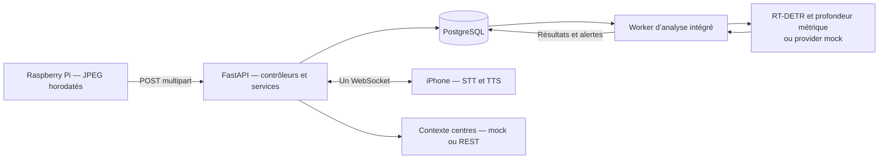

# LOOKi — Backend principal

Backend **Python / FastAPI** du prototype de lunettes connectées. Il reçoit les JPEG du Raspberry Pi, analyse les objets et leur proximité, puis transmet descriptions, réponses et alertes à l’iPhone via **un seul WebSocket bidirectionnel**. PostgreSQL conserve les sessions, images, détections et événements rejouables.

Ce dossier est la **racine du dépôt Git** (`LOOKi/backend/` dans le workspace). Toutes les commandes ci-dessous se lancent ici ; aucun fichier du dossier parent n’est nécessaire.



## Démarrer avec Docker

Prérequis : Docker avec Compose. Si le terminal est dans `LOOKi/`, entrer d’abord dans `backend/`.

```bash
test -f .env || cp .env.example .env
docker compose up --build -d
docker compose ps
curl --fail http://127.0.0.1:8000/health/ready
```

Le fichier d’exemple sélectionne `mock`, sans poids de modèle. Un `.env` existant conserve ses réglages de vision réelle. Compose construit depuis `.` et monte `./calibration/` ; il applique les migrations Alembic avant de démarrer l’API et son worker. PostgreSQL reste sur le réseau Docker interne. Le nom de projet `looki` conserve les volumes existants après le déplacement du Compose.

- [Swagger HTTP](http://127.0.0.1:8000/docs) et [OpenAPI](http://127.0.0.1:8000/openapi.json).
- Clé locale par défaut : `Authorization: Bearer looki-local-dev-key`.
- Backend lié à `127.0.0.1:8000` : l’accès depuis un Pi/iPhone physique demande une exposition adaptée ; HTTPS/WSS demande un reverse proxy TLS.

```bash
docker compose logs --tail=100 backend
docker compose stop
```

`stop` arrête les services et conserve les données. Voir le [guide d’exploitation](docs/05-installation-et-exploitation.md) pour les paramètres, les modèles, les migrations et le diagnostic.

## Démonstration

Avec `LOOKI_VISION_PROVIDER=mock` :

```bash
docker compose exec backend python scripts/demo.py --base-url http://127.0.0.1:8000
```

La démo crée une session, envoie une image proche simulée, vérifie l’analyse et l’alerte, pose une question via le même WebSocket, teste la reconnexion puis clôture la session. Les fixtures `near.jpg`, `far.jpg` et `clear.jpg` sont dans `fixtures/images/`.

## Organisation du dépôt

```text
.
├── compose.yaml          # Backend + PostgreSQL 16
├── Dockerfile            # Python 3.12, migrations et un processus Uvicorn
├── .env.example          # Configuration de développement partageable
├── app/
│   ├── main.py           # FastAPI et cycle de vie
│   ├── controllers/      # HTTP, WebSocket, adaptation du protocole
│   ├── schemas/          # Validation Pydantic des échanges
│   ├── services/         # Sessions, images, questions, analyse et proximité
│   ├── repositories/     # Accès aux données SQLAlchemy
│   ├── models/           # Tables SQLAlchemy
│   ├── core/             # Configuration, DB, authentification, runtime
│   ├── providers/        # Contexte centres : JSON local ou REST
│   └── vision/           # Mock, Depth Anything, UniDepthV2, RT-DETR, calibration
├── alembic/              # Migrations PostgreSQL
├── calibration/          # Calibration réelle de caméra, montée en lecture seule
├── contracts/            # OpenAPI, JSON Schema et exemples
├── docs/                 # Architecture, données, flux, exploitation, évaluations
│   └── diagrams/         # 12 diagrammes Mermaid autonomes (.mmd)
├── fixtures/             # Contextes et images de test sourcées
├── scripts/              # Démo, évaluations et export OpenAPI
├── tests/                # Tests des règles, providers et protocoles
├── pyproject.toml
└── uv.lock
```

Les contrôleurs appellent les services ; les repositories portent les requêtes SQL. Les providers isolent les modèles et le backend centres. L’inférence s’exécute hors de la boucle HTTP, dans un worker intégré au même processus. La base sert de file durable et de journal de reprise. **Un seul worker Uvicorn et une seule réplique** sont prévus dans ce POC.

## Documentation et schémas

Le [sommaire détaillé](docs/README.md) décrit les choix et leurs limites. Les [sources Mermaid `.mmd`](docs/diagrams/README.md) peuvent être ouvertes dans un éditeur compatible Mermaid.

| Sujet | Schéma autonome | Explication |
| --- | --- | --- |
| Architecture et frontières | [Architecture](docs/diagrams/01-architecture.mmd), [couches](docs/diagrams/02-couches.mmd) | [Chapitre 01](docs/01-architecture.md) |
| Classes | [Services et repositories](docs/diagrams/03-classes-services.mmd), [vision](docs/diagrams/05-classes-vision.mmd) | [Architecture](docs/01-architecture.md), [vision](docs/04-vision-et-proximite.md) |
| Tables PostgreSQL | [Relations et colonnes](docs/diagrams/04-base-de-donnees.mmd) | [Dictionnaire, contraintes et transactions](docs/02-base-de-donnees.md) |
| Images et alertes | [Séquence d’ingestion](docs/diagrams/06-ingestion-et-alerte.mmd), [états](docs/diagrams/09-cycle-image.mmd) | [Contrats et flux](docs/03-contrats-et-flux.md) |
| Questions et reconnexion | [Questions](docs/diagrams/07-questions-websocket.mmd), [rejeu](docs/diagrams/08-reconnexion-websocket.mmd) | [API et événements](contracts/README.md) |
| Objets et distances | [Fusion vision](docs/diagrams/10-vision-urbaine.mmd), [proximité](docs/diagrams/11-proximite.mmd) | [Vision et proximité](docs/04-vision-et-proximite.md) |
| Conteneurs et volumes | [Déploiement Compose](docs/diagrams/12-deploiement-compose.mmd) | [Installation et exploitation](docs/05-installation-et-exploitation.md) |

## Vision réelle et alertes

`depth_anything_metric` estime la profondeur de trois régions fixes. `urban_objects` détecte des objets avec RT-DETR et leur associe une profondeur issue de Depth Anything Outdoor ou UniDepthV2. Une calibration réelle peut être fournie à UniDepthV2 : [activation et configuration](docs/05-installation-et-exploitation.md#activer-la-profondeur-métrique).

Par défaut, une observation exploitable à **≤ 1,5 m** est `near`, à **≥ 3 m** elle est `far`, sinon `medium`. Une distance absente ou un score insuffisant donne `unknown`. Une image avec au moins une observation `near` produit un événement `alert.proximity` regroupant toutes les observations proches. Les captures périmées sont refusées pour éviter une alerte obsolète ; aucun suivi d’objet ni cooldown n’est encore appliqué.

Après installation locale des dépendances de développement, avec le serveur en `urban_objects` :

```bash
.venv/bin/python scripts/test_real_images.py \
  --base-url http://127.0.0.1:8000 \
  --expected-provider urban_objects --repeat 3 \
  --output-dir output/urban-current-evaluation
```

Les [essais urbains](docs/09-test-urbain.md) et la [comparaison avec références physiques](docs/10-metric-depth-comparison.md) distinguent temps de calcul, erreurs métriques et alertes transmises. Les distances monoculaires restent des estimations : le modèle et la calibration doivent être validés sur la caméra Pi finale. Le LLM, le suivi vidéo et les itinéraires restent prévus pour la suite ; les réponses aux questions sont déterministes et le STT/TTS appartient à l’iPhone.

## Développer et tester

Avec Python 3.12 ou 3.13 et `uv` :

```bash
uv sync --frozen --extra dev
.venv/bin/pytest
.venv/bin/ruff check app tests scripts
.venv/bin/python scripts/export_openapi.py
```

L’export écrit dans `contracts/openapi.json`. Les tests de protocole utilisent SQLite temporaire et tournent sans serveur externe. Les adaptateurs vision sont testés avec des sorties contrôlées, sans télécharger de poids. La validation de déploiement PostgreSQL complète ces tests.

Le `.gitignore` exclut `.env`, `.venv`, les caches, les poids et les futurs rapports `output/`. Les rapports historiques restent disponibles localement, mais ne sont pas nécessaires au démarrage après clonage. Les fichiers déjà suivis par Git restent suivis même si une règle les ignore. Les scripts [ETH3D](fixtures/metric-reference/README.md) et [Middlebury](fixtures/metric-bicycle-reference/README.md) permettent de reconstruire les références métriques. Les secrets et calibrations propres à une caméra restent locaux ; `*.example.json` peut servir d’exemple partagé.
