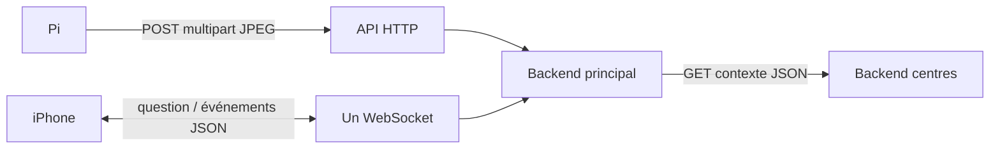
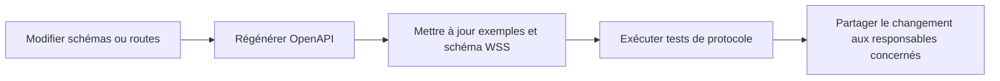

# Contrats LOOKi — API v1

Ces contrats permettent au Pi, à l’iPhone et au backend centres de développer indépendamment. La base HTTP locale est `http://localhost:8000`, avec préfixe `/api/v1`. En déploiement distant, utiliser HTTPS/WSS derrière un reverse proxy TLS.

| Fichier | Usage |
| --- | --- |
| [openapi.json](openapi.json) | Contrat HTTP généré depuis FastAPI |
| [websocket.schema.json](websocket.schema.json) | JSON Schema 2020-12 des messages entrants et sortants |
| [center-context.schema.json](center-context.schema.json) | Structure JSON du contexte centres |
| [examples/](examples/) | Exemples complets des principaux messages |

La documentation détaillée du protocole et de la reprise est dans [docs/03-contrats-et-flux.md](../docs/03-contrats-et-flux.md).



## Authentification

Toutes les routes métier HTTP et l’ouverture WebSocket demandent `Authorization: Bearer <LOOKI_API_KEY>`. La valeur de développement est `looki-local-dev-key`. La clé n’est jamais un paramètre d’URL. Les endpoints `/health/live`, `/health/ready`, `/docs` et `/openapi.json` sont accessibles sans cette clé.

## Session et image

| Action | Méthode / chemin | Résultat |
| --- | --- | --- |
| Créer | `POST /api/v1/sessions` | `201`, session et snapshot du contexte |
| Lire | `GET /api/v1/sessions/{session_id}` | `200`, session |
| Clôturer | `POST /api/v1/sessions/{session_id}/close` | `200`, session clôturée ; idempotent |
| Envoyer une image | `POST /api/v1/sessions/{session_id}/frames` | `202` nouvelle image ; `200` tentative identique déjà acceptée |
| Lire le résultat | `GET /api/v1/sessions/{session_id}/frames/{frame_id}` | `200`, état et détections éventuelles |
| Lire le journal | `GET /api/v1/sessions/{session_id}/events?after=0&limit=100` | `200`, tableau d’événements |

Le corps de création est `{"center_id":"demo-centre","user_id":"demo-user"}` ; `center_id` possède cette valeur par défaut et `user_id` est optionnel. Fournir `{}` est donc suffisant pour créer une session de démonstration.

L’upload est `multipart/form-data` avec trois parties :

| Champ | Format | Règle |
| --- | --- | --- |
| `image` | Octets JPEG, partie `Content-Type: image/jpeg` | Vrai JPEG décodable ; défaut maximum `5 MiB` et `12 000 000` pixels |
| `timestamp` | Date-heure RFC 3339 avec fuseau | Instant de capture, par exemple `2026-10-14T12:00:00Z` |
| `frame_id` | UUID | Identifiant créé par le Pi, inchangé pendant les tentatives d’envoi |

L’ensemble de la requête est limité à `6 MiB` par défaut. Une capture nouvelle doit avoir au plus `30 s` d’âge et ne pas être datée à plus de `5 s` dans le futur. Une nouvelle tentative d’une image acceptée conserve les mêmes octets et le même instant de capture : sinon `409 frame_id_conflict`. La répétition exacte reste consultable même après expiration de la capture ou clôture de session.

## WebSocket bidirectionnel

URL : `/api/v1/sessions/{session_id}/ws?after=0`. `after` est un curseur exclusif sur les identifiants durables. Un état initial est envoyé avec `id: null`, puis les événements persistés dont `id > after`, dans l’ordre croissant.

Client → serveur :

```json
{"type":"question","request_id":"33333333-3333-4333-8333-333333333333","text":"Que vois-tu devant moi ?"}
```

```json
{"type":"ping"}
```

Une question contient `1` à `2000` caractères et ne peut pas être blanche. Les champs supplémentaires sont refusés. Chaque message est une trame texte JSON d’au plus `8192` octets. Aucun `POST` de questions séparé n’est nécessaire ni fourni.

Serveur → client :

```json
{
  "id": 3,
  "type": "alert.proximity",
  "session_id": "11111111-1111-4111-8111-111111111111",
  "timestamp": "2026-10-14T12:00:00Z",
  "payload": {
    "frame_id": "22222222-2222-4222-8222-222222222222",
    "provider": "mock",
    "simulated": true,
    "captured_at": "2026-10-14T12:00:00Z",
    "text": "Simulation : attention, obstacle proche, à environ 0.45 mètre.",
    "severity": "warning",
    "threshold_m": 1.5,
    "nearest_distance_m": 0.45,
    "detections": [
      {"label":"obstacle_mock","confidence":1.0,"bbox":[0.3,0.25,0.7,0.9],"distance_m":0.45,"distance_source":"simulated","proximity":"near"}
    ]
  }
}
```

| Type | Persisté | Payload principal |
| --- | --- | --- |
| `session.state` | Oui à la création/clôture ; non pour l’état initial du socket | `status`, `center_id`, et `vision_provider` seulement dans l’état initial |
| `frame.analyzed` | Oui | `frame_id`, `provider`, `simulated`, `captured_at`, `text`, `detections`, `latency_ms`, `timing_ms`, `metadata` |
| `alert.proximity` | Oui | Champs communs de l’image, `text`, `severity`, `threshold_m`, `nearest_distance_m`, détections proches |
| `analysis.failed` | Oui | `frame_id`, `code`, `text` |
| `answer` | Oui | `request_id`, `question`, `text`, `mode`, `center_id`, `center_name`, `frame_id` et `simulated` éventuellement nuls |
| `pong` | Non | Objet vide |
| `error` | Non | `code`, `message` |

Pour dédupliquer, utiliser l’`id` de l’enveloppe, pas le texte. Les événements persistés peuvent être rejoués ; conserver le dernier `id` effectivement traité et se reconnecter avec `after=<id>`. `id: null` ne change jamais le curseur. Les identifiants ne sont pas contigus dans une session.

Un événement rejoué peut être ancien. Pour `alert.proximity`, vérifier `payload.captured_at` avant toute vocalisation comme danger actuel ; une alerte périmée reste un élément d’historique. Le mobile définit sa fenêtre de fraîcheur audio et donne priorité aux alertes récentes.

### Objets urbains et temps de calcul

Le provider `urban_objects` combine RT-DETR avec Depth Anything Outdoor ou UniDepthV2. Chaque détection expose `label` (classe COCO canonique), `bbox` (`xyxy` normalisé), `observation_type: "object"`, `confidence` (score du détecteur), `depth_valid_fraction` (couverture de profondeur valide, ou `null`) et une `distance_m` estimée, éventuellement `null`. Le provider `depth_anything_metric` conserve ses trois régions fixes avec `observation_type: "region"` ; sa `confidence` représente la couverture de profondeur, pas un score de reconnaissance. Aucun de ces scores ne mesure la précision physique des mètres.

L’[exemple urbain](examples/frame-analyzed-urban.json) est un événement réellement reçu pendant la campagne de photographies urbaines. Ses coordonnées et distances décrivent uniquement cette capture ; les identifiants et dates ne sont pas à réutiliser pour un nouvel upload.

Le backend émet une alerte par image contenant au moins une détection `near`, avec toutes les détections proches dans son payload. Le texte nomme l’objet le plus proche et sa direction dans l’image. Plusieurs images proches produisent plusieurs alertes ; il n’y a pas encore de suivi d’objets entre images. Une distance inconnue ne devient jamais une distance nulle.

`GET frames/{frame_id}` et `frame.analyzed` exposent les mêmes `timing_ms` et `metadata`. Les temps, mesurés en millisecondes côté serveur, distinguent `depth_preprocess_ms`, `depth_inference_ms` (passage dans le réseau), `depth_postprocess_ms`, `depth_total_ms`, les équivalents `detection_*`, `fusion_ms` et `total_vision_ms`. `latency_ms` conserve sa définition de durée du traitement serveur, hors attente dans la file avant prise en charge. Les poids sont chargés au démarrage, hors de ces durées. Le délai jusqu’au WebSocket est une mesure distincte du client de test.

`metadata` précise les modèles, la méthode d’échantillonnage et les seuils serveur. Ces champs sont additifs : les anciens événements persistés ne sont pas réécrits et peuvent les omettre. Pour une ancienne détection sans `observation_type`, considérer `region`.

Répéter la même question avec le même `request_id` et le même texte normalisé renvoie la même réponse durable. Réutiliser ce `request_id` pour un texte différent produit `request_id_conflict`. Une réponse rejouée peut être plus ancienne que le curseur courant : garder le maximum des identifiants traités.

## Contrat centres

Le backend principal attend `GET {LOOKI_CENTRES_BASE_URL}/api/v1/centres/{center_id}/context`. Si une clé centres est configurée, elle est transmise dans un en-tête Bearer distinct.

Voir [l’exemple de contexte](examples/center-context.json). `schema_version` doit valoir `1.0`, `center_id` doit correspondre au centre demandé, les identifiants de lieux/nœuds doivent être uniques et les références de graphe doivent exister. Le JSON Schema décrit la structure ; ces dernières contraintes sont vérifiées par le provider applicatif.

Le contexte est chargé une fois à la création de session et conservé. Un centre inconnu produit `404`; un contexte invalide, un timeout ou une erreur externe produit `503`. Le délai par défaut est `3 s`.

## Évolution du contrat



Pour régénérer la partie HTTP depuis la racine du dépôt :

```bash
.venv/bin/python scripts/export_openapi.py
```

Les dates et UUID des exemples sont illustratifs. Un upload réel doit utiliser un nouvel horodatage courant. Les distances des exemples mock sont des valeurs de scénario, pas des mesures physiques.
