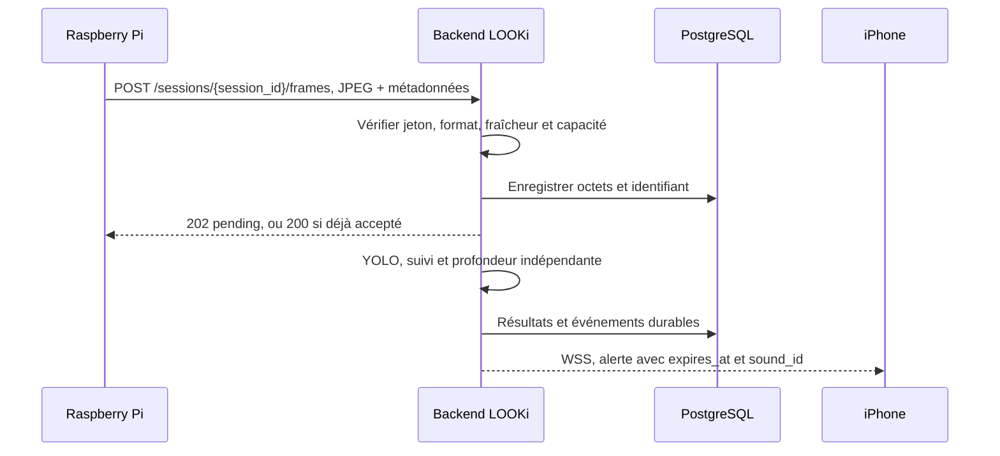

# Raspberry Pi → backend · Contrat v1.2 JPEG

**Implémenté le 30 octobre 2026.** Propriétaires : Embedded (Elyes) et backend LOOKi (Hamza). Ce document et [OpenAPI](openapi.json) définissent l’interface à implémenter sur le Pi. **Le format retenu pour le Pi et le front est JPEG (`image/jpeg`)**. Cette version remplace le PNG de v1.1 : les nouveaux envois PNG sont refusés avec `415 unsupported_image_type`, y compris un PNG présenté comme JPEG. Les anciennes captures déjà stockées restent lisibles avec leur MIME d’origine.

## Session et connexion

Le Pi accède à Internet par le partage Wi-Fi de l’iPhone. Il envoie directement ses captures au backend ; l’iPhone ne relaie pas les fichiers et aucune liaison applicative Pi/iPhone n’est nécessaire.

L’opérateur provisionne une session commune et fournit au Pi `base_url`, `session_id` et `pi_token`, selon le [contrat de session](session-access.md). Le mobile reçoit le même `session_id`, avec un jeton distinct. Le Pi ne crée pas une session différente à chaque capture ou reconnexion. Ne pas installer la clé opérateur ni la clé OpenAI sur le Pi.



## Upload

`POST /api/v1/sessions/{session_id}/frames`, en HTTPS sur la VM. HTTP n’est utilisé que pour les essais locaux.

- En-tête : `Authorization: Bearer <pi_token>`.
- Corps : `multipart/form-data` ; laisser la bibliothèque HTTP générer la boundary.
- Pas de JSON contenant une image en base64, ni de vidéo complète sur cet endpoint.

| Partie | Type | Obligatoire | Règle |
| --- | --- | --- | --- |
| `image` | Fichier binaire, `Content-Type: image/jpeg` | Oui | JPEG réellement décodable et vérifié ; encodage depuis une capture RGB recommandé |
| `frame_id` | UUID créé par le Pi | Oui | Un nouvel UUID par capture, identique sur chaque retry |
| `timestamp` | Date RFC 3339 avec fuseau, UTC recommandé | Oui | Instant de capture, fixé avant compression/upload ; ne jamais le rafraîchir pour un retry |
| `latest_only` | Booléen multipart, `true` / `false` | Non, défaut serveur `false` | **Envoyer `true` pour le flux Pi**, afin de remplacer les captures en attente par la plus récente |

`session_id` est dans le chemin, pas dans une quatrième partie. Le nom du fichier peut être `capture.jpg` ; il ne détermine ni l’identité ni le type. Le champ `captured_at` des réponses et événements correspond au `timestamp` fourni. Une date sans fuseau est refusée.

| Limite serveur par défaut | Valeur |
| --- | --- |
| Taille du fichier | 5 MiB (5 242 880 octets) |
| Requête multipart entière | 6 MiB (6 291 456 octets) |
| Dimensions | Au plus 12 000 000 pixels |
| Âge d’une capture nouvelle | Au plus 30 secondes |
| Tolérance d’horloge dans le futur | Au plus 5 secondes |
| File globale | 32 captures pending + processing |

Le JPEG est compressé avec perte. Une qualité **85/100** est un point de départ pour les essais Pi ; le serveur ne recalcule pas cette qualité et conserve les octets reçus. Ne pas envoyer du RGB brut sous un nom `.jpg`. Une résolution initiale de **960 × 540**, sans recadrage et stable pendant une session, est un réglage de départ à mesurer sur le Pi. La limite de 12 MP n’est pas une résolution recommandée. Maintenir les horloges synchronisées et réduire résolution/cadence si le lien ne suit pas ; ne pas dépasser les limites serveur pour forcer une admission.

## Cadence et saturation

Le Pi peut viser **15 captures/s**, avec **une requête en vol et une seule capture locale en attente**, remplacée lorsqu’une plus récente arrive. Une capture en cours de calcul côté serveur n’est pas interrompue. Une capture remplacée côté serveur devient `failed`, avec `error_code: superseded_frame`, et n’est jamais présentée comme analysée.

Cette cadence d’entrée ne garantit pas 15 analyses/s. La campagne précédente, en JPEG sur machine ARM64 avec quota de 4 CPU, mesurait 8,54 analyses/s ; **aucun débit sur la VM finale ni sur le Pi n’est encore mesuré**. Pour la VM partagée de 8 vCPU / 32 Go, le profil proposé pour le backend est 6 CPU maximum et 3 threads, à comparer à 2 threads lors de la recette.

Avec `latest_only=true`, une capture nouvelle doit être strictement plus récente que la dernière admise dans cette session. Sinon : `409 out_of_order_frame`. Une répétition exacte déjà acceptée reste prioritaire sur cette règle.

## Réponse et résultat

`202` signifie **accepté et persisté**, pas « analysé » ni « environnement dégagé ». Le corps `FrameRead` complet est défini dans OpenAPI ; exemple d’extrait :

```json
{
  "frame_id": "22222222-2222-4222-8222-222222222222",
  "session_id": "11111111-1111-4111-8111-111111111111",
  "status": "pending",
  "captured_at": "2026-10-30T13:00:00Z",
  "width": 960,
  "height": 540,
  "content_type": "image/jpeg",
  "detections": []
}
```

Pour vérifier une capture : `GET /api/v1/sessions/{session_id}/frames/{frame_id}`. États : `pending`, `processing`, `completed`, `failed`. Le fichier d’origine reste consultable à `/image`, avec les **octets JPEG exacts** et leur `Content-Type`, sans conversion silencieuse. L’analyse travaille sur une image RGB décodée.

Le Pi n’a pas besoin d’attendre la profondeur ou les alertes avant de poursuivre sa capture. Les événements `frame.analyzed`, `frame.depth_analyzed` et les alertes sont destinés au mobile et aux outils de diagnostic.

## Réessais et erreurs

Conserver pour une capture les **mêmes octets, le même UUID et le même timestamp**. Une répétition exacte renvoie `200` et l’état existant, sans ajouter une analyse. Réencoder le JPEG peut changer ses octets : conserver le buffer initial tant que le résultat de l’envoi est incertain.

| HTTP / code | Réaction du Pi |
| --- | --- |
| `200`, `202` | Admission confirmée ; poursuivre avec la capture suivante |
| Timeout / réseau coupé | GET du même `frame_id` ; si absent, réessayer exactement la même requête, sans nouvel UUID |
| `401 unauthenticated` | Jeton absent, invalide ou expiré : reprovisionner, sans boucle de retry |
| `403 session_forbidden` | Mauvaise session ou mauvais rôle : corriger le provisionnement |
| `404 session_not_found` | Session inconnue : corriger l’identifiant |
| `409 session_closed` | Arrêter la capture pour cette session |
| `409 frame_id_conflict` | UUID réutilisé avec d’autres octets ou date : corriger le client |
| `409 out_of_order_frame` | Abandonner cette capture nouvelle dépassée, envoyer une capture plus récente |
| `413 image_too_large`, `image_dimensions_exceeded`, `request_too_large` | Réduire la taille des prochaines captures |
| `415 unsupported_image_type`, `image_type_mismatch` | Corriger le format ou le MIME |
| `422 invalid_image`, `invalid_request`, `timezone_required` | Corriger les octets ou les métadonnées |
| `422 invalid_timestamp` | Capture périmée ou horloge erronée ; ne pas antidater/réhorodater le même UUID |
| `429 queue_full` | Respecter `Retry-After: 1`, garder la file locale bornée |
| `502`, `503`, `504` | Vérifier l’admission avant retry, délai progressif borné |

Une session close ou une capture devenue ancienne peut toujours retourner `200` pour une répétition exacte déjà admise. Cela permet de résoudre un accusé perdu. Limiter les réessais, par exemple à trois tentatives, et conserver une cadence adaptée plutôt que laisser une file grandir pendant une panne.

## Exemple d’envoi

Les variables sont fournies par l’opérateur. `FRAME_ID` et `CAPTURED_AT` doivent être créés au moment de la capture et réutilisés tels quels sur retry :

```bash
curl --fail-with-body \
  -H "Authorization: Bearer $LOOKI_PI_TOKEN" \
  -F "frame_id=$FRAME_ID" \
  -F "timestamp=$CAPTURED_AT" \
  -F 'latest_only=true' \
  -F 'image=@capture.jpg;type=image/jpeg' \
  "$LOOKI_BASE_URL/api/v1/sessions/$LOOKI_SESSION_ID/frames"
```

Le backend fournit aussi `scripts/pi_upload.py`, avec réessais bornés et vérification d’admission après timeout :

```bash
python scripts/pi_upload.py --base-url "$LOOKI_BASE_URL" \
  --session-id "$LOOKI_SESSION_ID" --image capture.jpg
```

Ce script envoie un fichier de test et le date à l’invocation ; une vraie boucle caméra doit fournir l’instant de capture. Le logiciel de caméra, son démarrage automatique et le provisionnement matériel restent à implémenter côté Embedded.

## Critères d’intégration

JPEG réel analysé ; octets restitués à l’identique ; même capture renvoyée sans doublon ; MIME incorrect, PNG déguisé et JPEG tronqué refusés ; mauvaise session refusée ; saturation sans file non bornée ; horloge désynchronisée détectée ; alerte reçue côté mobile avec capture source, expiration et son. Les tests backend couvrent le protocole ; la recette sur le Pi et le réseau réels reste nécessaire.
