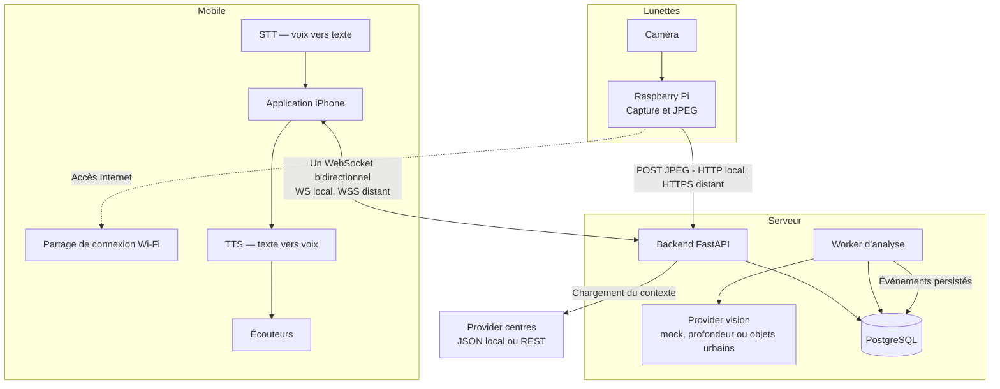
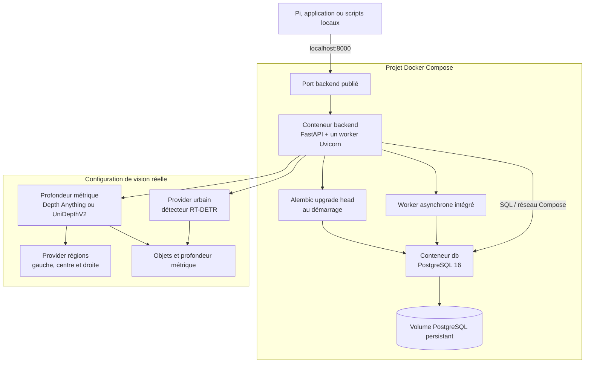
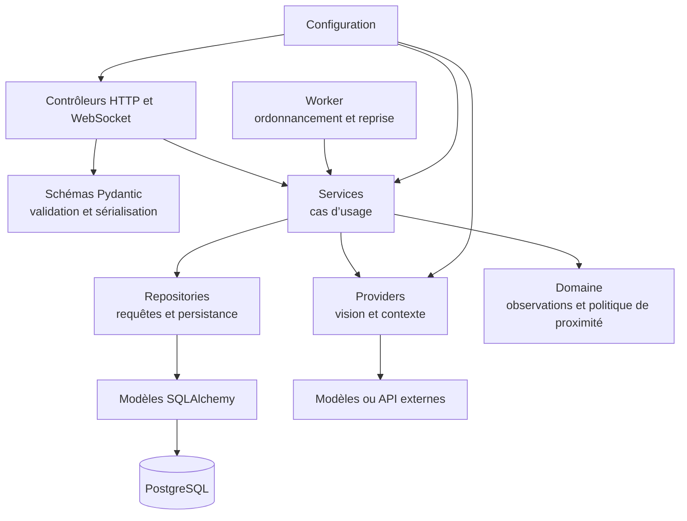
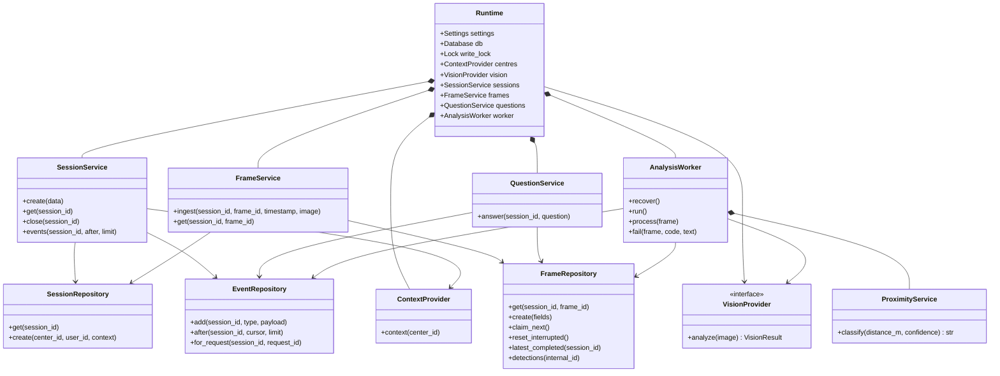
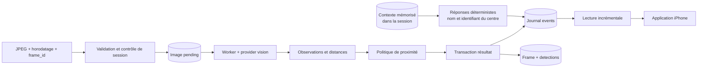
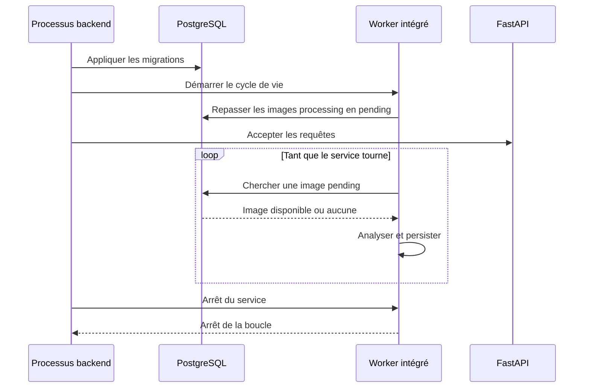
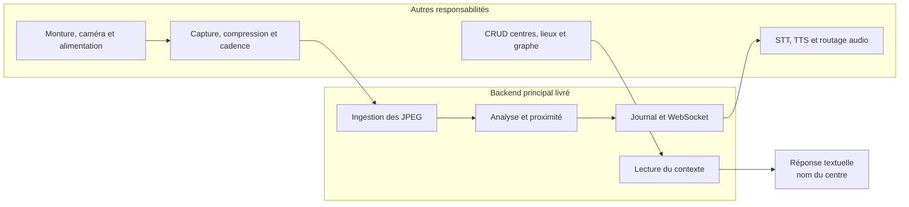

# 01 — Architecture logicielle

> Pour `yolo_seg_track`, le flux courant sépare le suivi rapide et la profondeur : voir [le chapitre 13](13-profondeur-independante.md). Les parcours synchrones ci-dessous restent applicables aux autres providers et au mode `LOOKI_DECOUPLED_DEPTH=false`.

Sources Mermaid : [architecture](diagrams/01-architecture.mmd), [couches](diagrams/02-couches.mmd), [classes](diagrams/03-classes-services.mmd) et [déploiement](diagrams/12-deploiement-compose.mmd).

## Périmètre et frontières

Le backend reçoit des images JPEG indépendantes. Il orchestre un provider de vision, applique une politique de proximité, persiste le résultat et expose les textes à l’application mobile. Le Raspberry Pi utilise l’iPhone comme point d’accès réseau ; il n’appelle pas l’application iOS.



Les routes HTTP ne réalisent pas l’inférence dans la requête d’upload. Une image valide est enregistrée puis une réponse `202 Accepted` est renvoyée. Le worker récupère les images en attente. Le flux WebSocket lit le journal d’événements en base et transmet les nouvelles entrées au mobile.

## Déploiement du POC



La base n’a pas besoin d’un port publié sur l’hôte pour que le backend y accède. Un seul processus applicatif est prévu : le worker s’exécute dans le même cycle de vie que FastAPI. Augmenter le nombre de workers ou de réplicas demanderait un mécanisme de réservation distribuée des images et une politique de reprise adaptée.

Compose fournit HTTP et WS pour le développement local. Pour un accès distant, placer un reverse proxy TLS devant le backend pour obtenir HTTPS et WSS et conserver l’en-tête `Authorization`. Le chiffrement n’est pas fourni par Uvicorn dans cette composition.

## Organisation par responsabilité



| Couche | Responsabilité | Ne doit pas porter |
| --- | --- | --- |
| Contrôleur | Lire une requête, appliquer l’authentification, appeler un cas d’usage, renvoyer le protocole attendu | Calcul de proximité, requêtes SQL dispersées |
| Schéma | Contraintes de format et forme des échanges | Connexion réseau ou inférence |
| Service | Enchaîner les opérations, décider les transitions et les événements | Détails internes d’un modèle ML |
| Repository | Charger, insérer et modifier les données d’un agrégat | Règles d’alerte ou présentation audio |
| Provider | Adapter une dépendance remplaçable : modèle ou centres | Routage FastAPI |
| Domaine | Représenter les observations et classer les distances | Dépendance aux endpoints HTTP |
| Worker | Reprendre les images, appeler l’analyse, gérer le statut final | Transcription et synthèse vocales |

La séparation permet de garder les mêmes contrôleurs et cas d’usage quand le provider mock est remplacé par une implémentation réelle. Elle ne suppose pas un microservice par couche : toutes ces classes sont dans le même backend.

## Classes et composition du runtime



Le `Runtime` est créé une fois pendant le démarrage de l’application. Il compose les dépendances et expose les services aux contrôleurs via l’état FastAPI. Les repositories reçoivent une session SQLAlchemy correspondant à l’opération en cours ; ils ne conservent pas une connexion partagée entre requêtes.

```text
backend/                       # Racine du dépôt Git
├── app/
│   ├── main.py                  # Application FastAPI et cycle de vie
│   ├── controllers/             # Routes HTTP et WebSocket
│   ├── core/                    # Configuration, DB, auth, runtime, limites
│   ├── models/                  # Entités SQLAlchemy
│   ├── schemas/                 # Schémas d’entrée et de sortie
│   ├── repositories/            # Accès SQL
│   ├── services/                # Sessions, images, questions, worker, proximité
│   ├── providers/               # Contexte centres mock ou REST
│   └── vision/                  # Contrat et providers vision
├── compose.yaml                 # Backend + PostgreSQL depuis cette racine
├── README.md                    # Démarrage et index
├── docs/                        # Chapitres détaillés et diagrams/*.mmd
├── contracts/                   # OpenAPI, WebSocket et exemples
├── alembic/                     # Migrations versionnées
├── fixtures/                    # JPEG de démonstration et contexte JSON
├── scripts/                     # Démo, génération des images, export OpenAPI
└── tests/                       # Protocole, reprise, vision et règles
```

## Circulation des données



La base joue deux rôles : stockage durable des résultats et file d’attente minimale. Le journal d’événements sert aussi de source de reprise pour les clients WebSocket ; le backend n’a pas besoin que le mobile soit connecté au moment de l’analyse.

## Durées de vie



Un redémarrage peut reprendre une inférence interrompue. Le worker effectue aussi une reprise après une erreur transitoire de base empêchant la validation des résultats. L’opération de calcul peut donc être exécutée à nouveau, mais les résultats et les événements d’un traitement terminé sont enregistrés ensemble. La garantie visée est une reprise cohérente du POC, pas une exécution physique unique du modèle.

## Ce qui appartient aux autres composants



Le backend ne pilote pas la caméra, ne calcule pas le partage de connexion, ne produit pas de son et ne maintient pas le référentiel métier des centres. Dans cette phase, une question reçoit une réponse déterministe fondée sur les observations disponibles ; l’intégration d’un LLM, d’itinéraires et d’un modèle vidéo temporel reste à ajouter.

Le contexte centres est conservé dans la session et ses métadonnées sont jointes aux réponses. Il n’est pas envoyé au provider de vision dans cette version et ne modifie pas encore les classes reconnues ou le calcul de proximité.
