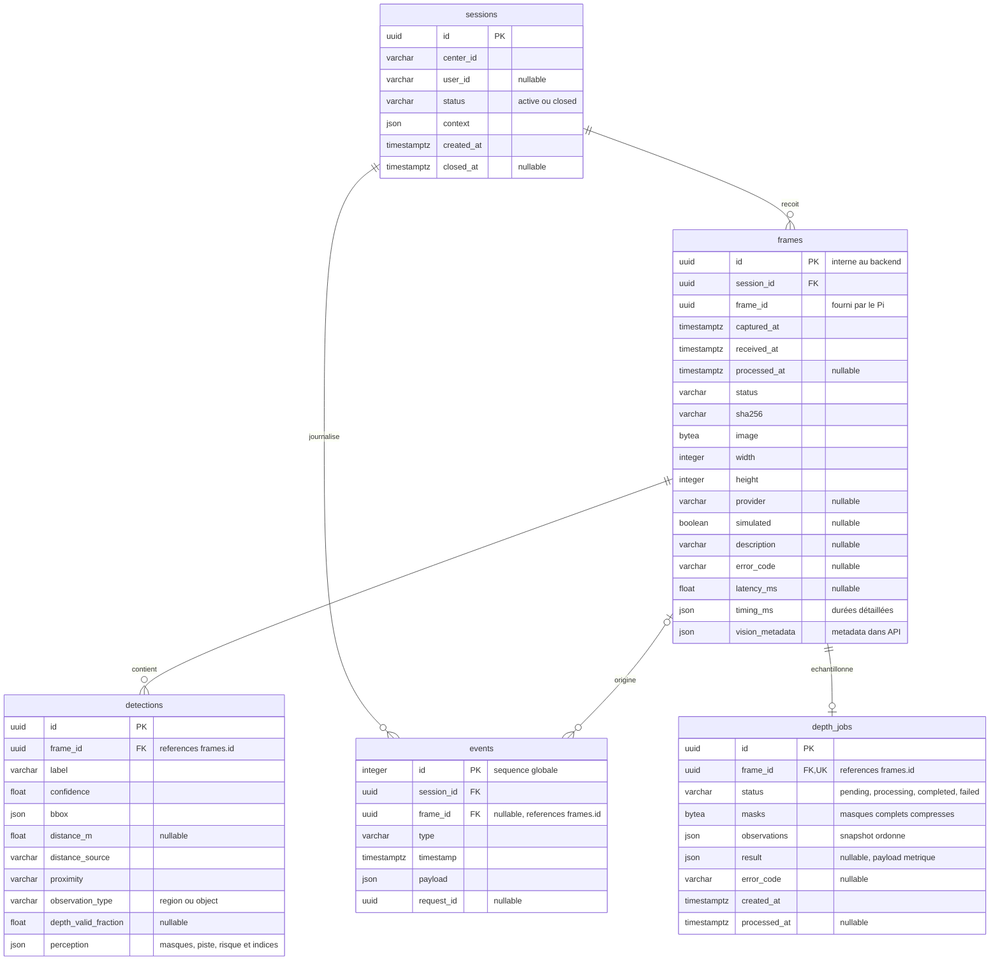
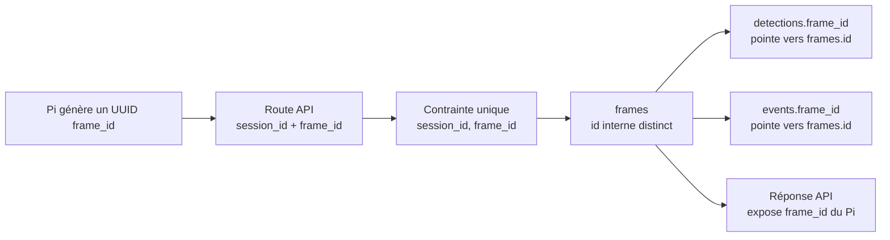
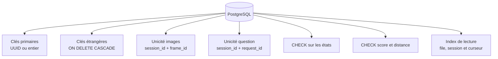
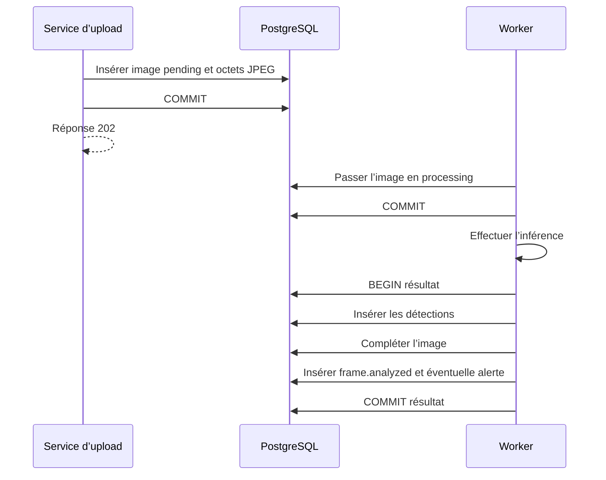
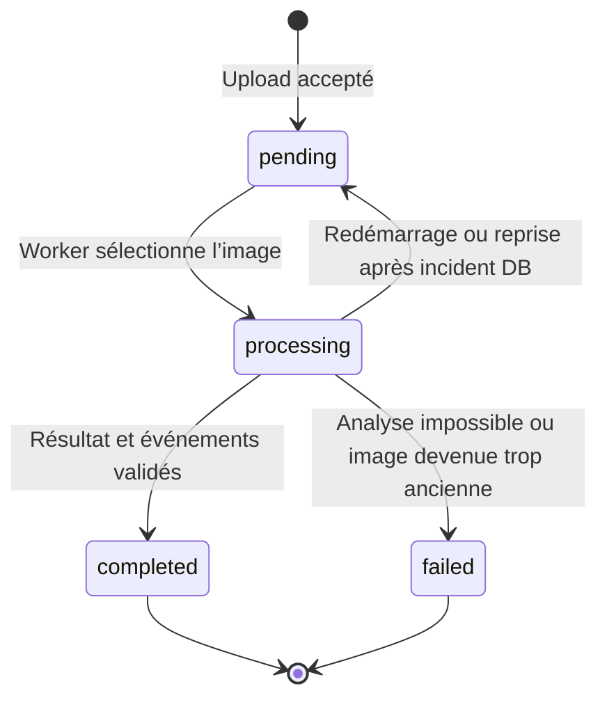
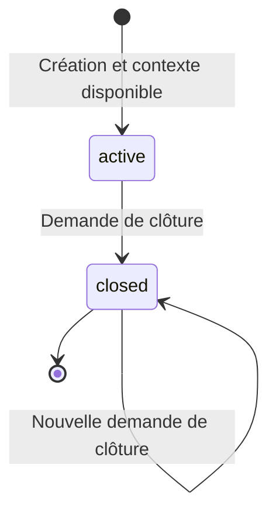

# 02 — Base de données et persistance

Sources Mermaid : [tables et relations](diagrams/04-base-de-donnees.mmd), [cycle des images](diagrams/09-cycle-image.mmd).

## Modèle relationnel

Les entités sont définies dans `app/models/entities.py`. Les migrations Alembic constituent le moyen de créer et d’évoluer le schéma PostgreSQL. L’option de création directe des tables sert aux tests et n’est pas le mécanisme de migration de Compose.

## Les deux identifiants d’une image

`frames.id` est la clé technique du backend. `frames.frame_id` est la clé métier fournie par le Pi, réutilisée pour les tentatives d’envoi d’une même capture. Les URLs et les événements destinés au Pi/mobile utilisent l’identifiant client. Les clés étrangères des tables `detections`, `depth_jobs` et `events` utilisent la clé interne, malgré leur nom de colonne `frame_id`.

La même valeur de `frame_id` peut être utilisée dans deux sessions différentes. Une image appartient à une seule session. Il n’y a pas de déduplication globale entre images différentes présentant des octets identiques.

## Dictionnaire des données

### Session

| Champ | Sens et cycle de vie |
| --- | --- |
| `id` | UUID créé par le backend, partagé ensuite avec le Pi et le mobile |
| `center_id` | Identifiant métier du centre ; ce n’est pas une FK vers une table locale |
| `user_id` | Identifiant métier optionnel ; aucune table d’utilisateurs n’est créée dans ce backend |
| `status` | `active` accepte images et questions ; `closed` les refuse |
| `context` | Copie JSON du contexte obtenue à la création de la session |
| `created_at` | Horodatage serveur de création |
| `closed_at` | Horodatage de clôture, `null` tant que la session est active |

Le backend centres demeure la source métier. Le snapshot de contexte rend la session cohérente même si le graphe externe évolue ensuite. Il n’est pas rafraîchi automatiquement pendant la session.

### Frame

| Champ | Sens |
| --- | --- |
| `captured_at` | Valeur `timestamp` transmise par le Pi, avec fuseau explicite |
| `received_at` | Date serveur d’acceptation |
| `processed_at` | Date serveur de fin du traitement, si disponible |
| `status` | `pending`, `processing`, `completed` ou `failed` |
| `sha256` | Empreinte des octets JPEG pour contrôler les nouvelles tentatives d’envoi |
| `image` | Octets JPEG en `bytea`, chargés explicitement pour l’analyse |
| `width`, `height` | Dimensions obtenues en décodant l’image |
| `provider` | Nom du provider ayant produit l’analyse |
| `simulated` | Indique un résultat simulé ; `null` avant disponibilité d’un résultat |
| `description` | Résumé textuel de l’analyse, maximum de colonne `2000` caractères |
| `error_code` | Code d’échec exploitable sans exposer une trace interne |
| `latency_ms` | Durée depuis l’entrée dans le traitement worker jusqu’à la préparation du résultat ; exclut l’attente en file, l’upload et l’audio |
| `timing_ms` | Détail des durées mesurées dans les providers, notamment prétraitement, profondeur, détection et fusion ; objet vide pour les anciennes images |
| `vision_metadata` | Paramètres et identifiants des modèles associés au résultat, exposés sous le nom `metadata` dans l’API ; objet vide pour les anciennes images |

Stocker les JPEG dans PostgreSQL simplifie la persistance transactionnelle du POC. Les réponses de consultation ne renvoient pas les octets JPEG. À cadence continue, cette stratégie fait croître rapidement la base ; aucune suppression automatique n’est active dans cette version.

### Detection

| Champ | Sens |
| --- | --- |
| `label` | Nom simulé, nom de région, ou classe COCO pour urban_objects |
| `confidence` | Score entre `0` et `1`, dont l’interprétation dépend du provider |
| `bbox` | Tableau JSON `[x_min, y_min, x_max, y_max]` normalisé |
| `distance_m` | Estimation métrique ou distance simulée, `null` si inconnue |
| `distance_source` | Origine de la mesure : `simulated` ou `metric_model` |
| `proximity` | `near`, `medium`, `far` ou `unknown`, calculé par les règles métier |
| `observation_type` | `region` pour une zone fixe de profondeur ou `object` pour une boîte issue du détecteur |
| `depth_valid_fraction` | Proportion de pixels de profondeur exploitables dans la zone de mesure, entre `0` et `1`, ou `null` si non renseignée |

Une image sans observation conserve un résultat d’analyse et zéro ligne de détection. Une observation sans distance conserve sa ligne ; l’absence de mesure ne doit pas être confondue avec une distance lointaine.

### Event

| Champ | Sens |
| --- | --- |
| `id` | Entier auto-incrémenté global, utilisé comme curseur de reprise |
| `session_id` | Filtre obligatoire du journal présenté à un client |
| `frame_id` | Origine image éventuelle ; `null` pour un événement sans image associée |
| `type` | Nature de l’événement, par exemple `frame.analyzed`, `alert.proximity`, `answer` |
| `timestamp` | Date serveur de création de l’événement |
| `payload` | Corps JSON dont le format dépend du type |
| `request_id` | Identifiant optionnel d’une question pour éviter de créer deux réponses à sa répétition |

Le curseur est global à la table, pas un compteur continu par session. Pour une session, les identifiants peuvent donc présenter des trous. Le client mémorise le dernier identifiant durable traité ; il ne calcule pas un prochain identifiant attendu.

## Contraintes et index

| Nom / mécanisme | Champs | But |
| --- | --- | --- |
| `uq_frame_session_client` | `frames(session_id, frame_id)` | Empêcher deux lignes pour la même capture logique |
| `ix_frames_queue` | `frames(status, received_at)` | Chercher les images en attente dans l’ordre de réception |
| Index de `frames.session_id` | Session de l’image | Accélérer les accès par session |
| Index de `detections.frame_id` | Clé interne de l’image | Charger les observations d’une analyse |
| `ix_events_session_cursor` | `events(session_id, id)` | Rejouer les événements après un curseur |
| `uq_event_question_request` | `events(session_id, request_id)` | Unicité d’une réponse par identifiant de question dans une session |
| `ck_session_status` | `status` | Limiter les sessions à `active` ou `closed` |
| `ck_frame_status` | `status` | Limiter les images aux quatre états définis |
| `ck_detection_confidence` | `confidence` | Contraindre le score entre `0` et `1` |
| `ck_detection_distance` | `distance_m` | Accepter `null` ou une distance non négative |
| `ck_detection_proximity` | `proximity` | Limiter le classement aux quatre valeurs définies |
| `ck_observation_type` | `observation_type` | Distinguer une observation de région d’une observation d’objet |
| `ck_depth_valid_fraction` | `depth_valid_fraction` | Accepter `null` ou une proportion entre `0` et `1` |

Les colonnes JSON conservent des structures souples ; leur schéma applicatif est contrôlé par les modèles/contrats, pas par un `CHECK` SQL exhaustif. Les contraintes sur les états restent en base en plus des contrôles du service.

La migration `9d21c735a842` ajoute les durées détaillées, les métadonnées de vision et les deux champs d’observation. Les anciennes images conservent des objets JSON vides et leurs observations sont de type `region` ; aucune nouvelle estimation n’est inventée lors de la migration.

## Transactions et reprise

La transaction finale évite qu’un mobile reçoive une alerte durable sans le résultat d’analyse correspondant. L’inférence n’est pas effectuée sous une transaction SQL longue : le calcul se situe entre la réservation logique de l’image et la transaction des résultats.

Une image acceptée peut être devenue trop ancienne quand le worker la traite. Elle doit alors échouer explicitement, pour éviter d’envoyer une alerte concernant une scène dépassée. Les états terminaux sont consultables ; un échec n’est pas masqué par une réponse mock.

## Clôture et conservation

La clôture ne supprime pas la session ni son historique. Les images déjà acceptées peuvent terminer leur traitement. Les nouveaux uploads et les nouvelles questions sont refusés ; la lecture et la reprise des événements restent disponibles.

Les relations SQL ont des cascades de suppression, mais aucune route de suppression ni tâche de purge n’est livrée. Supprimer une session directement en base supprimerait ses images, observations et événements associés. Le dimensionnement, la rétention et le droit d’accès par utilisateur restent des travaux à mener avant une exploitation multiutilisateur.

La migration `b84e901df8ac` ajoute `detections.perception JSON NOT NULL DEFAULT '{}'` : masques normalisés, piste temporaire, risque et indices. Aucun état interne du tracker n’est persisté. Voir [segmentation et suivi](12-segmentation-suivi.md).

### Échantillons de profondeur indépendants

La migration `c581a9367e02` ajoute `depth_jobs`, liée par une FK unique à `frames.id`. `masks` conserve les masques complets compressés, chargés de façon différée ; `observations` en conserve le snapshot ordonné. `result` contient le payload métrique final et `error_code` son éventuel échec. `created_at` et `processed_at` datent le travail. La contrainte `ck_depth_job_status` borne les quatre états. La réservation sélectionne les travaux `pending` par date de création.

Le résultat visuel reste dans `frames` et `detections`, avec mètres nuls en mode indépendant. Les mètres différés ne le réécrivent pas. Le résultat de profondeur, `frame.depth_analyzed` et l’alerte métrique éventuelle sont validés ensemble. Une reprise remet `processing` en `pending` puis vérifie la fraîcheur de la capture. Voir [le flux complet et le cycle de vie](13-profondeur-independante.md).
