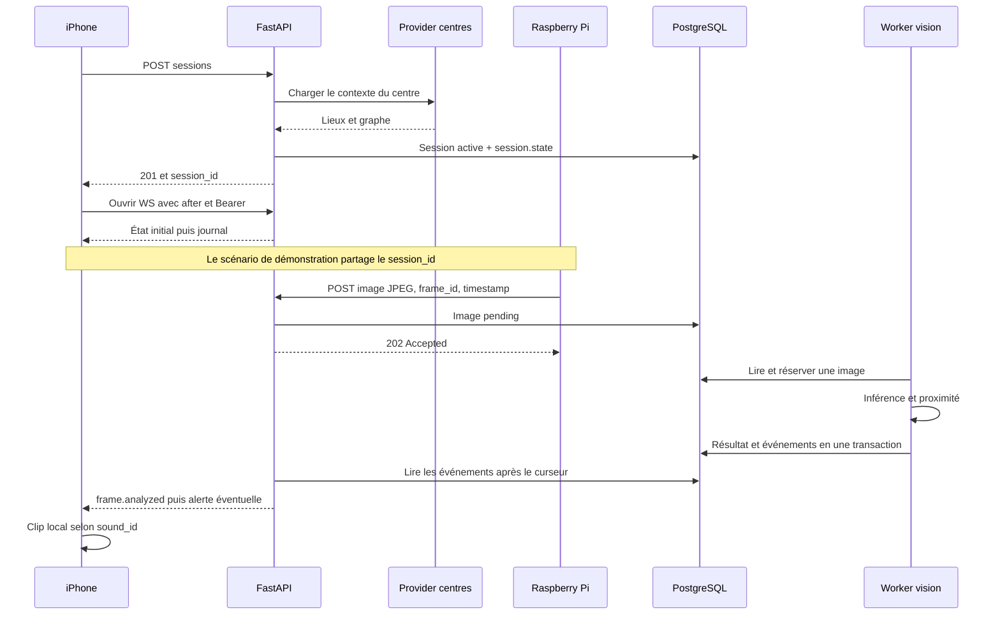
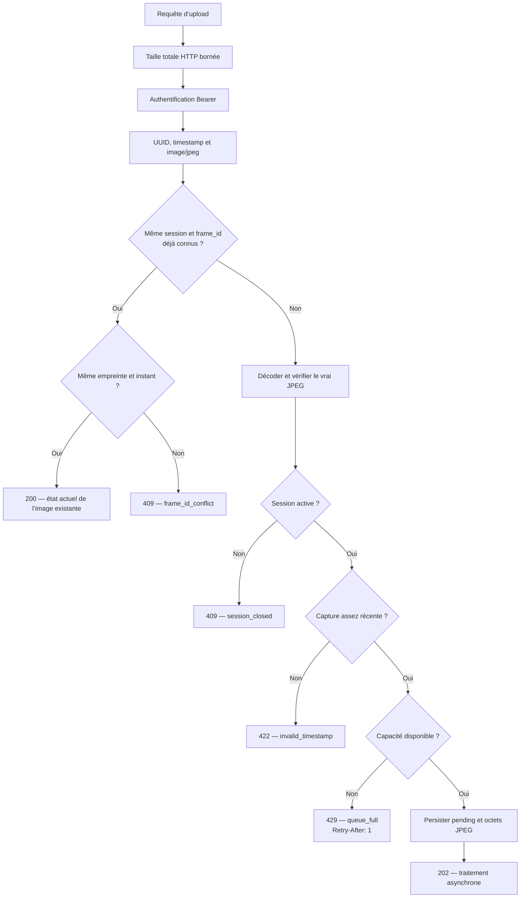
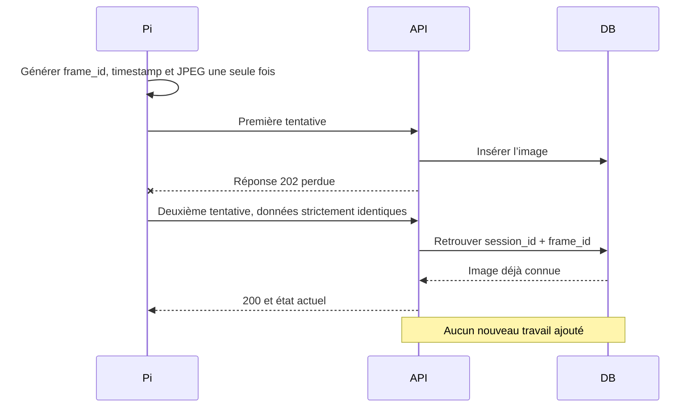
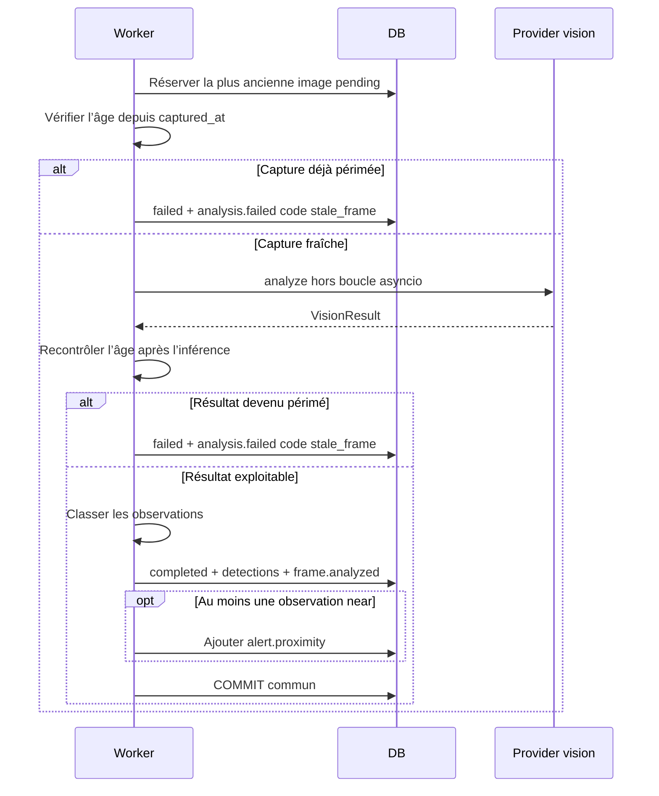
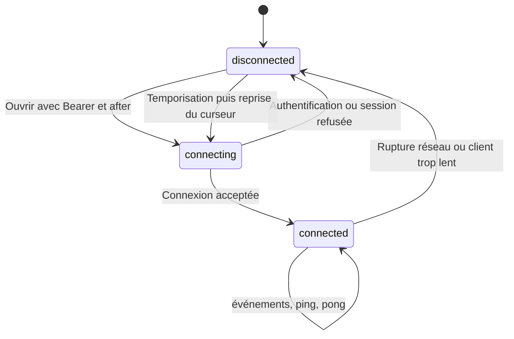
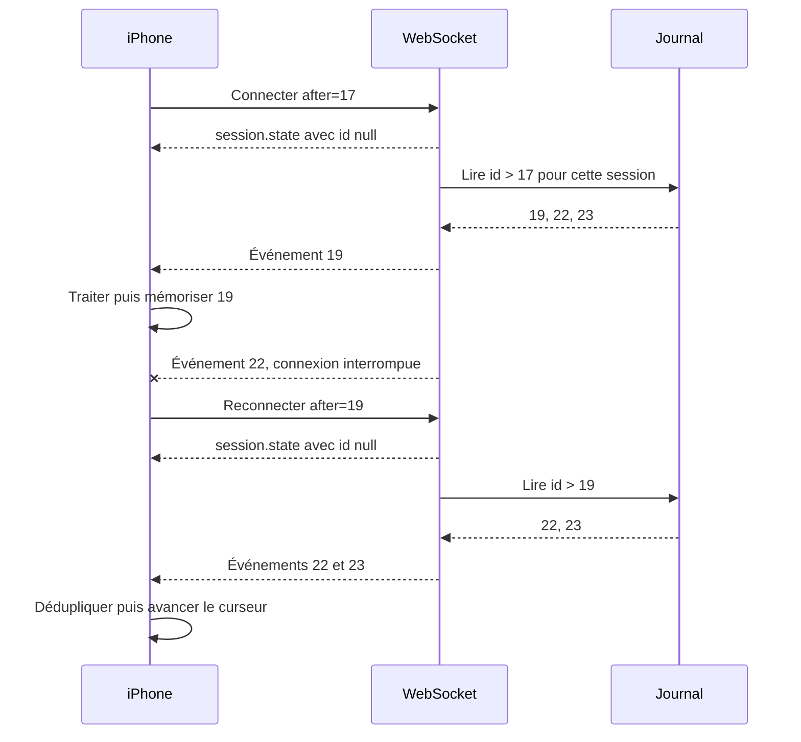
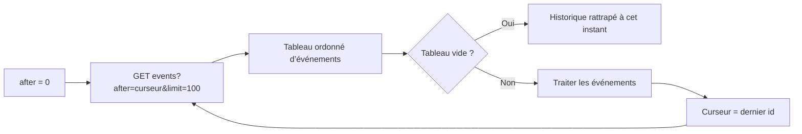
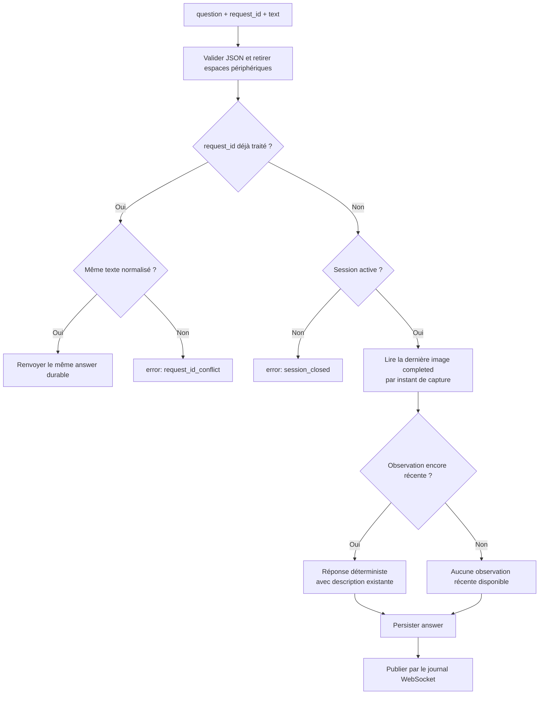

# 03 — Contrats et flux applicatifs

Sources Mermaid : [ingestion et alerte](diagrams/06-ingestion-et-alerte.mmd), [questions](diagrams/07-questions-websocket.mmd), [reconnexion](diagrams/08-reconnexion-websocket.mmd).

**Mise à jour du 30 octobre 2026 :** les contrats [Pi JPEG](../contracts/raspberry-backend.md), [mobile HTTP](../contracts/mobile-backend.md), [accès](../contracts/session-access.md) et [alertes WSS](../contracts/alerts.md) sont normatifs.

## Vue des échanges

Les endpoints et structures complètes sont dans [le contrat partagé](../contracts/README.md) et l’OpenAPI. Cette page décrit leur comportement et leurs garanties.

## Admission d’une capture

Le backend recontrôle l’existence de l’image après le décodage, dans la section d’admission sérialisée. Deux requêtes concurrentes portant le même identifiant ne créent pas deux captures. La limite de file compte les images `pending` et `processing` de toutes les sessions, avec un maximum de `32` par défaut.

La validation des dimensions empêche de se fier à la seule taille compressée. Un fichier déclaré `image/jpeg` mais qui ne contient pas un JPEG valide est refusé. La validation vérifie aussi le chargement des pixels, pour détecter des fichiers tronqués qu’une simple inspection d’en-tête pourrait manquer.

## Réessai après perte de réponse

L’idempotence porte sur l’identité de capture, les octets et l’instant de capture. Elle ne compare pas seulement le nom du fichier. Une représentation d’horodatage équivalente après normalisation UTC décrit le même instant. Le réessai exact reste accepté après la fermeture de session ou après la fenêtre de fraîcheur, car il ne correspond pas à une nouvelle admission.

## Analyse, âge et alerte

L’âge est contrôlé à l’upload, avant le calcul et après le calcul. Une inférence lente peut donc finir par un événement d’échec au lieu d’une alerte obsolète. Une exception de provider produit `analysis.failed` avec `inference_failed`. Ces deux échecs sont consultables sur le résultat de l’image et dans le journal.

Un événement d’alerte regroupe les détections proches d’une image et expose `nearest_distance_m`, la plus petite distance parmi elles. Il y a au plus une alerte de proximité par résultat d’image, même si plusieurs régions sont proches, puis une nouvelle alerte pour chaque nouvelle image proche. Aucun cooldown n’est appliqué.

## Connexion et reprise WebSocket

Le journal est interrogé toutes les `0.2 s` par défaut. Les pages contiennent au plus `100` événements par lecture WebSocket et sont enchaînées immédiatement lorsqu’elles sont pleines. Le flux est livré au moins une fois lorsque le client reprend avec un curseur conservé : il doit gérer les répétitions.

Le rejeu conserve les événements historiques, y compris les anciennes alertes. Avant de jouer un clip, le mobile vérifie `payload.expires_at`, calculé depuis la capture ; une alerte trop ancienne reste dans l’historique mais n’est pas annoncée comme un obstacle présent. La politique audio doit donner priorité aux alertes actuelles. Mémoriser `max(curseur, event.id)` pour les événements durables traités : une répétition explicite de question peut retransmettre une ancienne réponse déjà livrée.

Les envois concurrents du même socket sont sérialisés. Un envoi qui dépasse `5 s` entraîne l’arrêt du traitement de cette connexion ; les événements durables restent disponibles pour une reprise. Une trame binaire ou trop volumineuse est refusée avec le code WebSocket `1009`. Un Bearer absent/invalide ou une session inconnue est rejeté avant acceptation ; selon le client ASGI, cela apparaît comme un échec du handshake HTTP plutôt qu’une frame de clôture visible `1008`.

Les erreurs applicatives d’un message valide au niveau transport sont renvoyées dans un événement transitoire `error`. Le client peut conserver la connexion pour corriger son prochain message.

## Historique par HTTP

`after` vaut au minimum `0`. `limit` vaut de `1` à `500`, avec `100` par défaut. La réponse est un tableau brut ; il n’y a pas d’enveloppe `items` ni de champ `next_cursor`. Reprendre avec l’identifiant du dernier événement reçu. Les accès sont filtrés par session.

## Questions et idempotence

Le mobile utilise maintenant [le cycle HTTP durable](../contracts/mobile-backend.md). Le schéma ci-dessous décrit uniquement le **diagnostic WSS opérateur historique**, conservé pour les fixtures ; il ne décrit pas Realtime.

Le backend ne déduit pas encore l’intention de la question. Il retourne les dernières observations récentes, rappelle le mode POC et fournit le nom du centre dans le payload. Le champ `mode` vaut `observations_only`. Il n’y a ni génération d’itinéraire ni réponse fondée sur des connaissances générales.

## Erreurs et diagnostic

| HTTP / événement | Exemple de cause | Réaction client |
| --- | --- | --- |
| `401` | Clé absente ou invalide | Vérifier l’en-tête Bearer |
| `404` | Session, image ou centre inconnu | Vérifier les identifiants |
| `409` | Session fermée ou identité de capture réutilisée différemment | Corriger le parcours ou l’identité de capture |
| `413` | Trop d’octets ou trop de pixels | Réduire l’image côté Pi |
| `415` | Format non JPEG ou MIME différent | Envoyer une vraie image avec le bon MIME |
| `422` | Champs invalides, image illisible ou horodatage hors fenêtre | Corriger la donnée source |
| `429` | File globale pleine | Respecter `Retry-After: 1` et réduire la cadence |
| `503` | Contexte centres indisponible ou readiness en échec | Examiner la dépendance concernée |
| `analysis.failed` | `stale_frame` ou `inference_failed` | Signaler l’indisponibilité d’analyse, lire l’état de l’image |

Les erreurs métier HTTP utilisent `{"error":{"code":"...","message":"..."}}`. Les erreurs de validation FastAPI et d’authentification utilisent le format `detail` de FastAPI ; un dépassement détecté pendant la lecture d’un corps HTTP utilise également `detail` avec `code` et `message`. Ne pas supposer une enveloppe unique pour toutes les erreurs. Les traces internes sont journalisées sur le serveur, pas renvoyées dans les réponses métier.
