# 04 — Vision, profondeur et proximité

> Le profil partagé dans `.env.example` est `yolo_seg_track` : YOLO26n-seg + ByteTrack, avec UniDepthV2 indépendant. La synthèse ci-dessous décrit l’approche actuelle ; les sections suivantes documentent aussi les providers alternatifs et les premiers essais.

Sources Mermaid : [classes vision](diagrams/05-classes-vision.mmd), [fusion urbaine](diagrams/10-vision-urbaine.mmd), [proximité métrique](diagrams/11-proximite.mmd), [deux cadences](diagrams/15-profondeur-independante.mmd), [proximité visuelle par classe](diagrams/16-proximite-urbaine.mmd).

## Approche actuelle face aux distances surestimées

### Problème observé

Sur nos images urbaines et la vidéo NYC, certains objets occupent une grande partie de l’image tandis que la profondeur les situe encore à plusieurs mètres. Un seuil limité à `distance_m <= 1.5` manque alors des situations visuellement préoccupantes. La vidéo ne fournit pas de distances physiques mesurées : elle montre le désaccord entre indices, sans permettre de certifier que la personne se trouve à moins d’un mètre.

Deux difficultés se cumulent. Une caméra monoculaire ne mesure pas directement la distance : l’échelle estimée dépend du modèle, de la scène et des paramètres de caméra, qui ne sont pas encore calibrés sur le Pi. De plus, une boîte rectangulaire peut contenir beaucoup de chaussée ou d’arrière-plan autour d’un objet ; une profondeur calculée dans cette boîte peut concerner le fond. Changer Depth Anything pour UniDepthV2 ne résout pas à lui seul ces deux difficultés.

La réponse implémentée combine **segmentation, suivi temporel et vigilance visuelle**, tout en conservant une profondeur métrique séparée et identifiable. Aucun multiplicateur arbitraire ne corrige les mètres, et aucune taille apparente ne devient automatiquement « 1 m ».

### Deux traitements complémentaires

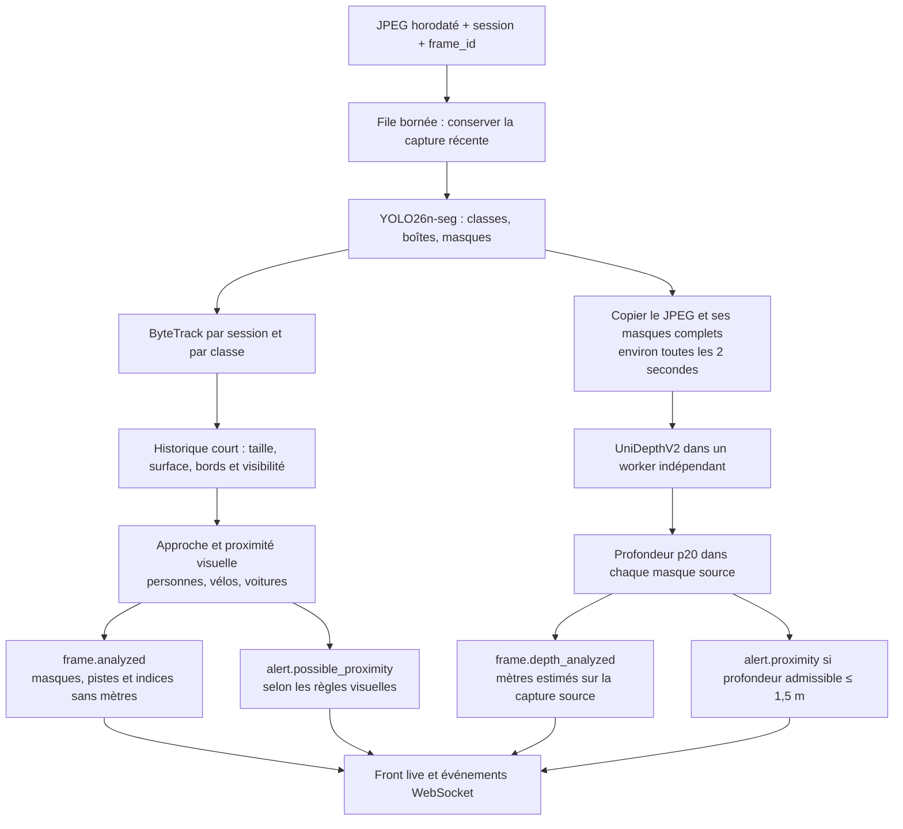

**La segmentation réduit la contamination par le fond.** Pour chaque objet, on utilise les pixels de son masque binaire complet, puis le percentile 20 des profondeurs valides. Il faut au moins 16 pixels valides et 50 % de couverture ; sinon la distance reste inconnue. Les polygones simplifiés affichés dans le front ne servent pas à calculer la profondeur. Un masque erroné ou une profondeur mal estimée restent possibles.

**Le suivi permet de comparer le même objet dans le temps.** ByteTrack associe les observations d’une session, séparément pour chaque classe. Sur une fenêtre d’une seconde, la tendance est calculée à partir des horodatages, avec au moins trois observations sur 350 ms. On utilise une médiane des pentes logarithmiques entre observations pour réduire les variations ponctuelles. Le calcul ne suppose donc pas que toutes les images envoyées à 15 ips sont analysées.

**L’approche visuelle demande plusieurs indices.** Pour une personne, on suit la hauteur ; pour un vélo ou une voiture, `sqrt(largeur × hauteur)` tient aussi compte des objets qui grandissent surtout en largeur. Une taille et une surface de masque croissantes donnent `approaching` ; des diminutions concordantes donnent `receding` seulement si la visibilité n’est pas partielle. Une silhouette coupée au bord ou masquée par un autre objet peut rapetisser sans s’éloigner. Ces états décrivent le mouvement apparent, sans vitesse physique ni temps avant collision.

### Quand déclencher la vigilance

Les règles `urban-visual-v4` combinent dimension relative, surface réelle du masque, croissance, bords touchés et persistance. Le vélo a notamment des seuils de surface plus petits que la voiture, car son cadre et ses roues occupent peu de pixels. Les valeurs exactes et les champs d’explication sont dans [le chapitre 14](14-proximite-urbaine.md#profils-de-taille-apparente).

| Situation observée | Décision |
| --- | --- |
| Objet qui grandit mais reste petit | Indiquer une approche ; cela ne suffit pas à déclencher la proximité |
| Objet imposant, masque suffisamment grand et bord gauche/droite/bas touché | Alerte visuelle immédiate si les seuils de classe et de confiance sont atteints |
| Objet imposant, piste persistante, croissance ou bord touché | Alerte visuelle après au moins deux observations sur 250 ms |
| Objet déjà très grand et persistant, sans croissance | Alerte possible même lorsque l’objet ou la caméra est immobile |
| Risque déjà présent puis observation temporairement faible ou partielle | Conservation bornée à 800 ms depuis le dernier indice fort, sans prolongation par le seul score faible |
| Profondeur loin ou inconnue mais indices visuels suffisants | Conserver la vigilance `alert.possible_proximity` ; ne pas déclarer la distance sûre |
| Profondeur admissible à 1,5 m ou moins | `alert.proximity`, indiquant une proximité estimée par le modèle |

Une nouvelle alerte visuelle exige `confidence >= 0.5`. Le détecteur conserve néanmoins les observations à partir de `0.25` pour aider ByteTrack à récupérer une piste ; elles ne créent pas seules une nouvelle alerte. Les doublons de même classe sont filtrés à partir du chevauchement des **boîtes et des masques**, ce qui évite d’éliminer deux silhouettes distinctes simplement parce que leurs boîtes se recouvrent.

L’événement visuel est émis à l’entrée du risque puis au plus toutes les deux secondes pour une même piste en risque persistant. Un changement d’identifiant peut produire une nouvelle alerte. Ce mécanisme limite les répétitions sans attendre un nombre de mètres fiable.

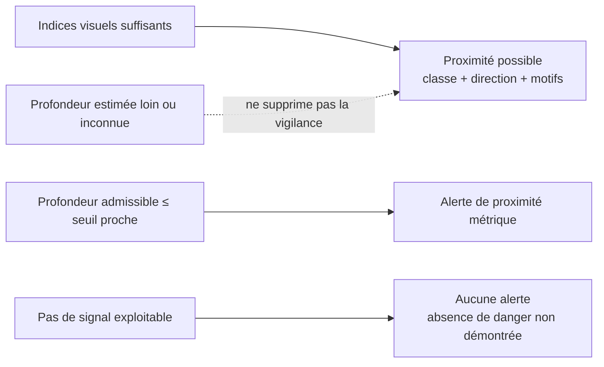

Exemple de restitution : « Proximité possible : voiture à gauche. Vigilance visuelle, distance incertaine. » Le front montre la classe, la piste, l’approche, les motifs et le score ; le panneau de profondeur reste lié à sa capture source. Une valeur ancienne n’est pas collée sur un objet plus récent. Dans ce mode, `frame.analyzed` contient les indices visuels et des distances nulles ; la profondeur arrive séparément dans `frame.depth_analyzed` avec son `frame_id` d’origine.

### Pourquoi calculer moins souvent la profondeur

Le budget est de **4 CPU**, avec deux threads par modèle. La profondeur est plus lente que YOLO : l’exécuter sur chaque capture ralentissait aussi le suivi et les alertes visuelles. Un worker séparé traite au plus un calcul de profondeur à la fois, avec un intervalle de soumission de deux secondes. Il réutilise le JPEG exact et les masques de cette capture. Une capture devenue trop vieille, au-delà de trois secondes, est rejetée pour la profondeur sans annuler son résultat visuel. Voir [le chapitre 13](13-profondeur-independante.md) pour les classes, les transactions et la reprise.

Le profil actuel utilise une entrée YOLO de 768 pixels et un seuil de détection à 0,25 pour conserver davantage de candidats. Sur le même clip NYC de 45,06 s, avec le quota Docker de 4 CPU, il a analysé **8,54 ips**, avec **107 ms** de vision médiane et **1 191 ms** de profondeur médiane : 18 événements visuels (14 personnes, 4 voitures), aucune alerte métrique à 1,5 m et aucune erreur de traitement. L’envoi à 15 ips reste une cadence d’entrée ; les images en attente remplacées ne sont pas analysées plus tard.

Ces essais vérifient que les alertes fonctionnent même sans franchissement du seuil métrique, sans établir une précision physique des distances ni un rappel de détection. La vidéo NYC ne valide pas de trajectoire réelle de vélo ; une photo de vélos valide séparément le déclenchement, et des séquences synthétiques testent les règles temporelles. Les [résultats détaillés](14-proximite-urbaine.md#résultats-sur-nyc-quota-de-4-cpu) distinguent ces preuves. La calibration du Pi, les distances mesurées, les mouvements de caméra, les occlusions et les erreurs d’association restent à évaluer.

## Cinq modes, un même contrat métier

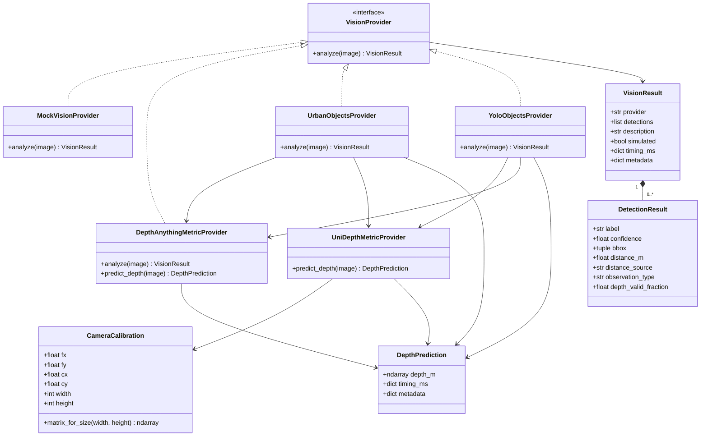

Le provider reçoit une image Pillow décodée et renvoie des observations indépendantes de FastAPI. Une observation contient un libellé, un score, une boîte normalisée, une distance éventuellement inconnue et l’origine de la distance. Le service applique ensuite les seuils et persiste les détections. Une `bbox` suit l’ordre `[x_min, y_min, x_max, y_max]`, avec des coordonnées comprises entre `0` et `1`.

Le champ `simulated` permet au mobile et aux outils de démonstration de distinguer les résultats fictifs. `distance_source` vaut `simulated` pour les données de démonstration ou `metric_model` pour les estimations du modèle métrique. Le protocole ne transforme pas une absence de distance en une distance sûre.

| Provider | Observations | Modèles par défaut |
| --- | --- | --- |
| `mock` | Scénarios fictifs explicitement identifiés | Aucun poids de modèle |
| `depth_anything_metric` | Trois régions fixes, `observation_type: region` | Depth Anything V2 Metric Indoor Small |
| `urban_objects` | Classes et boîtes d’objets, `observation_type: object` | RT-DETR R18 + moteur de profondeur configurable |
| `yolo_objects` | Classes et boîtes d’objets, `observation_type: object` | YOLO26 Nano + moteur de profondeur configurable |
| `yolo_seg_track` | Classes, masques, pistes et indices visuels, `observation_type: object` | YOLO26 Nano Segmentation + ByteTrack ; profil partagé avec UniDepthV2 indépendant |

`yolo_objects` et `yolo_seg_track` utilisent tous deux la classe `YoloObjectsProvider`, avec l’option `segment=True` pour le second ; le suivi est enrichi par `PerceptionService`. Lorsque `LOOKI_DEPTH_MODEL_ID` est vide ou absent, chaque provider choisit son checkpoint par défaut. Pour les trois providers objets, `LOOKI_DEPTH_BACKEND=depth_anything` choisit Outdoor Small et `LOOKI_DEPTH_BACKEND=unidepth_v2` choisit `lpiccinelli/unidepth-v2-vits14`. Une valeur explicite remplace ce choix. La distinction `observation_type` évite de présenter une zone générique comme un objet reconnu.

## Simulation reproductible

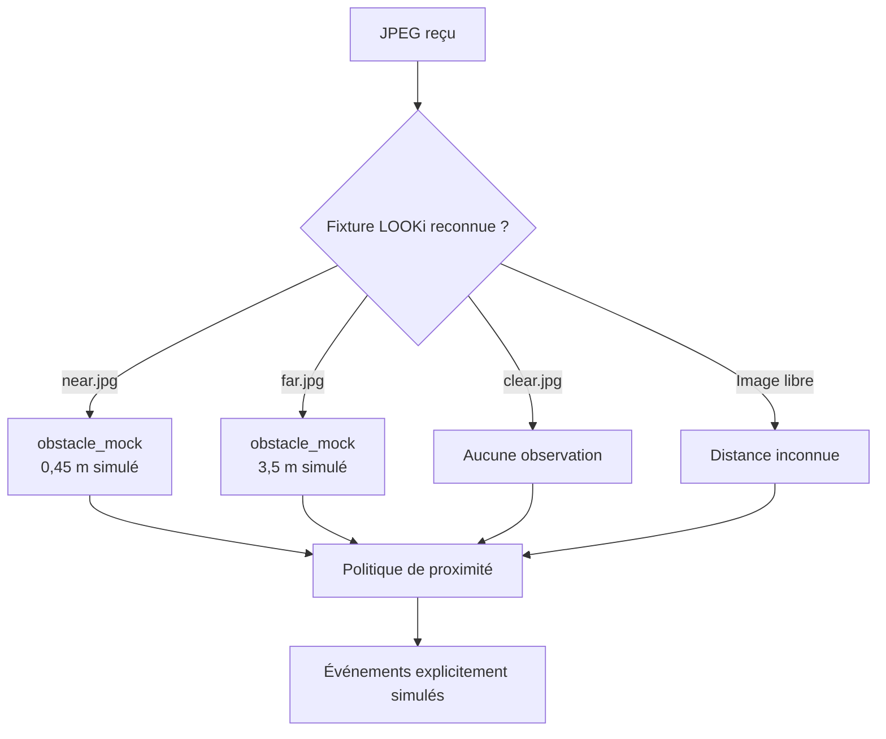

Les images de test sont des illustrations géométriques signées produites par le script `scripts/generate_mock_images.py`. Le provider reconnaît les fixtures, pas une distance dans une photographie quelconque. Recompresser, recadrer ou modifier une fixture peut empêcher sa reconnaissance : conserver les JPEG générés pour les démonstrations déterministes.

```bash
.venv/bin/python scripts/generate_mock_images.py
```

| Fixture | Observation attendue | Distance | Résultat attendu avec les seuils par défaut |
| --- | --- | --- | --- |
| `fixtures/images/near.jpg` | `obstacle_mock` | `0.45 m`, simulé | Analyse et alerte de proximité |
| `fixtures/images/far.jpg` | `obstacle_mock` | `3.5 m`, simulé | Analyse, classée loin |
| `fixtures/images/clear.jpg` | Aucune | Sans objet | Analyse sans alerte |
| Une photographie libre | Pas de mesure réelle par le mock | Inconnue | Ne pas interpréter comme un environnement dégagé |

L’intérêt du mode mock est de tester les frontières de service : upload, état de traitement, transaction de résultats, journal, reconnexion et question/réponse. Il ne valide pas la précision de la vision.

## Mode Depth Anything métrique

Le provider `depth_anything_metric` utilise par défaut `depth-anything/Depth-Anything-V2-Metric-Indoor-Small-hf`. Sa configuration déclare une profondeur métrique et une profondeur maximale de `20`. Le checkpoint est destiné au domaine intérieur. [Configuration officielle du modèle](https://huggingface.co/depth-anything/Depth-Anything-V2-Metric-Indoor-Small-hf/blob/main/config.json).

L’intégration s’appuie sur les interfaces `AutoImageProcessor` et `AutoModelForDepthEstimation`. Depth Anything estime la profondeur monoculaire ; son API fournit une carte de profondeur à partir d’une image. [Documentation Transformers](https://huggingface.co/docs/transformers/model_doc/depth_anything).

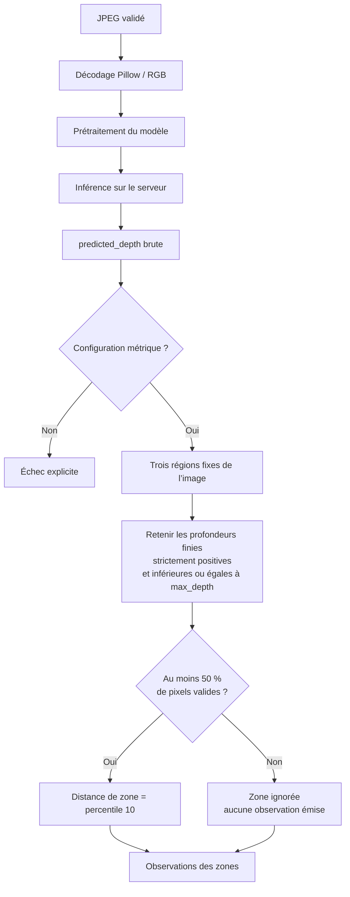

Les poids sont téléchargés et mis en cache lors du chargement du modèle. L’inférence se déroule sur le serveur qui héberge le backend : cette implémentation n’envoie pas les images à une API d’inférence externe. L’accès initial au registre de modèles reste nécessaire tant que le cache n’est pas prérempli. L’indisponibilité du modèle ne déclenche pas un remplacement silencieux par les données mock.

Le script `scripts/test_real_images.py` soumet un corpus de photographies au backend et relève les observations ainsi que les événements WebSocket. Les sources et conditions d’utilisation des photos figurent dans `fixtures/real-images/manifest.json`. Le rapport HTML superpose les régions d’échantillonnage : ces rectangles ne sont pas des boîtes de détection d’objets. La procédure et les résultats sont documentés dans [le test sur images réelles](08-test-images-reelles.md).

### Régions observées

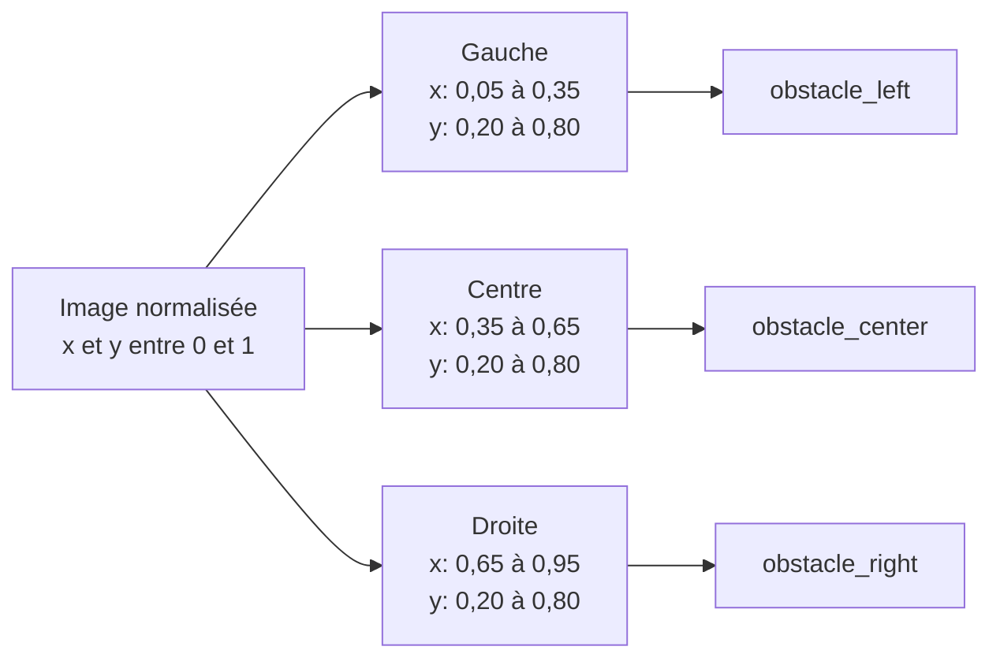

Le provider `depth_anything_metric` relève la proximité dans trois zones ; il ne reconnaît pas les catégories d’objets. Ses boîtes sont les régions de mesure, pas des contours d’objets segmentés. Un obstacle fin, hors de ces régions ou ne représentant qu’une faible portion des pixels peut être manqué. Le provider `urban_objects` décrit ci-dessous ajoute la détection sémantique.

Le percentile 10 privilégie les surfaces proches sans prendre uniquement le pixel le plus extrême. Ce choix reste une heuristique : il ne garantit ni la distance du point le plus proche ni la bonne séparation du sol et des obstacles. Le score `confidence` est ici la proportion de pixels de profondeur valides dans la zone. Il ne représente ni une probabilité de reconnaissance sémantique ni une confiance métrique calibrée.

Une région dont moins de la moitié des pixels sont valides ne produit pas de détection. Si aucune région n’est exploitable, le résultat contient une liste vide et une description indiquant que la distance est inconnue ; cette liste vide ne signifie pas que la scène est dégagée.

## Objets urbains et fusion avec la profondeur

Le provider `urban_objects` exécute la profondeur métrique puis RT-DETR sur la même image. Avec le moteur Depth Anything, le checkpoint Outdoor configure une portée maximale de `80 m`; cette borne décrit la sortie du modèle, pas une précision garantie sur toute cette distance. Le détecteur utilise `PekingU/rtdetr_r18vd` avec les classes COCO. [Configuration Depth Anything Outdoor](https://huggingface.co/depth-anything/Depth-Anything-V2-Metric-Outdoor-Small-hf/blob/main/config.json), [fiche RT-DETR R18](https://huggingface.co/PekingU/rtdetr_r18vd).

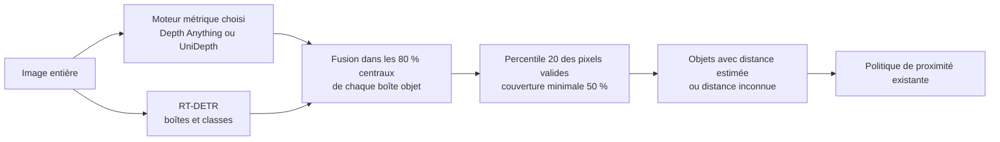

Les boîtes sont normalisées pour échantillonner la carte de profondeur à sa résolution native. Les pixels non finis, nuls, négatifs ou dépassant la portée du checkpoint sont exclus. Si moins de `50 %` des pixels sont valides, l’objet reste présent avec une distance `null`. Le détecteur doit atteindre `LOOKI_OBJECT_CONFIDENCE_THRESHOLD` : `0.5` dans les premières campagnes RT-DETR, `0.25` dans le profil YOLO partagé actuel.

Pour les objets, `confidence` désigne le score de détection et `depth_valid_fraction` la couverture de profondeur valide. Les libellés restent des classes anglaises normalisées, telles que `person`, `bicycle`, `car` ou `bus`. La boîte n’est pas un masque de segmentation : les pixels de fond et les occlusions peuvent fausser la distance. Les poteaux, bordures et autres catégories absentes du vocabulaire peuvent rester invisibles au système.

Pour ce checkpoint Outdoor, les données Virtual KITTI définissent une profondeur axiale `z`. Le champ `distance_m` reprend une estimation de profondeur ; le backend ne la convertit pas en portée euclidienne à partir d’intrinsèques calibrés. [Définition des cartes de profondeur Virtual KITTI 2](https://europe.naverlabs.com/proxy-virtual-worlds-vkitti-2/).

Le détail de la fusion, le corpus et les mesures sont dans [le test urbain](09-test-urbain.md).

Le moteur UniDepth V2 utilise l’API officielle `infer()` pour prédire une profondeur axiale et des intrinsèques à partir du RGB. `metadata.depth_backend`, `depth_intrinsics`, `depth_intrinsics_source` et `depth_horizontal_fov_deg` indiquent le moteur et la caméra utilisée. En mode estimé, cette caméra n’est pas une calibration mesurée. Une calibration pinhole rectifiée peut être fournie explicitement avec `LOOKI_CAMERA_CALIBRATION_PATH`; sa provenance est conservée dans les métadonnées. Le code est épinglé à une révision du dépôt officiel ; son score de confiance interne n’est pas une probabilité calibrée d’exactitude métrique. Le score `confidence` des observations reste celui de RT-DETR. La [comparaison avec références mesurées](10-metric-depth-comparison.md) décrit la validation et les conditions d’utilisation.

`depth_intrinsics_source` vaut `provided` lorsque la calibration est fournie et `estimated` sinon. `depth_intrinsics` contient la matrice effectivement utilisée à la résolution de l’image ; `depth_model_estimated_intrinsics` conserve séparément la matrice estimée par le réseau, même lorsqu’une calibration mesurée lui a été fournie. `depth_calibration_reference_size` et `depth_intrinsics_image_size` rendent le redimensionnement vérifiable. La borne de rejet numérique de `10 000 m` dans cet adapter n’est ni une portée validée ni un multiplicateur d’échelle.

## YOLO26 Nano pour le flux vidéo

Le provider `yolo_objects` exécute YOLO26n puis le moteur de profondeur choisi sur le même RGB. Il réutilise la fusion et les seuils existants. Le budget CPU, le niveau de résolution UniDepth, les événements et le frontend sont documentés dans le [chapitre 11](11-video-live-yolo.md). YOLO n’est pas un estimateur métrique à lui seul. `confidence` représente ici le score YOLO.

## Distinguer les temps de calcul

Les résultats HTTP et `frame.analyzed` contiennent un objet `timing_ms`. Avec Depth Anything, `depth_inference_ms` isole l’appel du réseau de profondeur. Avec UniDepth, il chronomètre l’API officielle `infer()`, qui contient son prétraitement et son post-traitement internes ; `metadata.depth_timing_scope` rend cette différence explicite. `depth_total_ms` couvre l’étape de profondeur avec la préparation et l’extraction ajoutées par l’adapter. Pour `urban_objects`, `detection_inference_ms` isole RT-DETR et `detection_total_ms` inclut aussi ses étapes de préparation et de conversion. `fusion_ms` mesure l’association des boîtes à la profondeur ; `total_vision_ms` couvre le provider entier.

Les mesures utilisent une horloge monotone. Les périphériques CUDA/MPS sont synchronisés quand ils sont utilisés, afin de mesurer l’exécution et pas seulement la soumission d’un calcul. Le chargement des poids au démarrage est exclu. `latency_ms` reste la durée du worker et le délai HTTP → WebSocket reste une mesure client séparée ; aucun de ces champs ne mesure la sortie audio.

## Politique de proximité métrique

Cette politique classe les mètres estimés. Les alertes **visuelles** décrites plus haut ont leur propre décision et leur propre temporisation ; une classification métrique `far` ne suffit pas à les annuler.

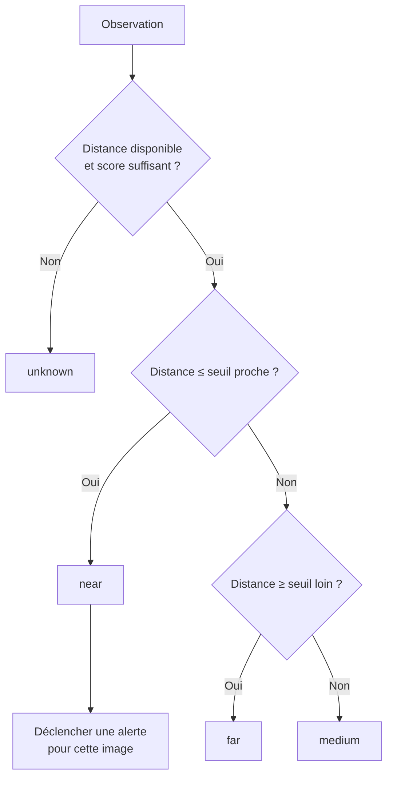

Valeurs initiales : seuil proche `1.5 m`, seuil loin `3.0 m`, score minimal `0.5`. Les bornes sont inclusives : `1.5 m` est proche et `3.0 m` est loin. Une distance intermédiaire est classée `medium`. Une mesure inconnue ou insuffisamment fiable reste `unknown` et n’est pas qualifiée de sûre.

Chaque image terminée qui contient au moins une observation proche éligible produit un événement `alert.proximity`. Il n’y a pas de temporisation entre deux images proches : le besoin « systématiquement alerter » est conservé. Un nouvel upload portant un nouveau `frame_id` peut donc générer une nouvelle alerte pour la même scène. Réessayer un upload identique avec le même identifiant n’ajoute pas de nouvelle analyse.

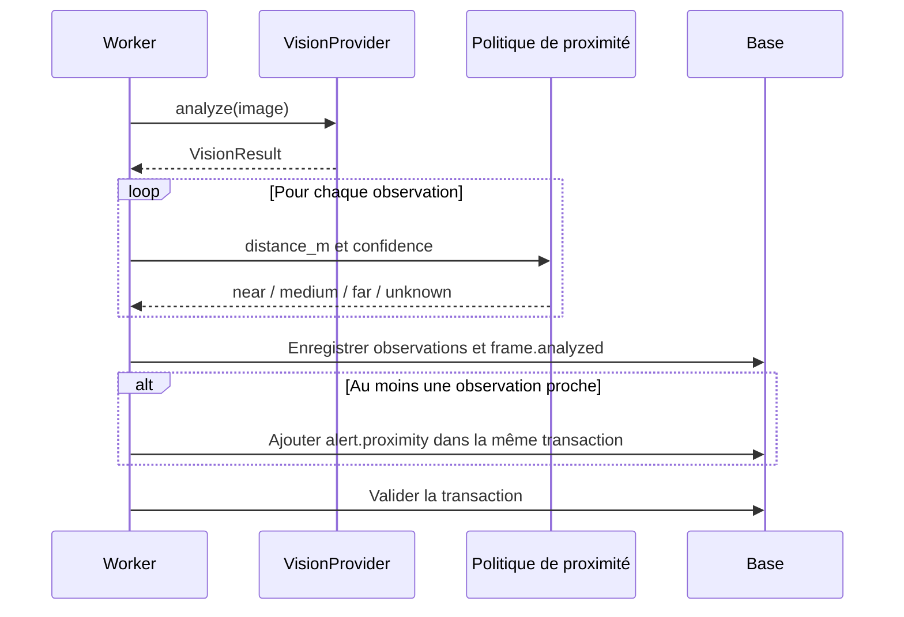

## Enrichissements suivants

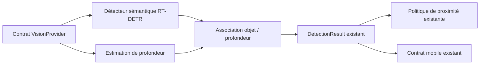

La fusion par boîtes reste disponible dans `urban_objects` et `yolo_objects`. La segmentation et le suivi temporel sont désormais livrés dans `yolo_seg_track`, avec un historique borné par session et des règles de remise à zéro. Les entrées restent des JPEG ; leur suivi ne constitue pas une estimation de vitesse physique. Les suites envisagées portent sur la calibration de la caméra finale, la validation sur distances mesurées et la couverture d’obstacles absents des classes actuelles.

## Validation physique à réaliser

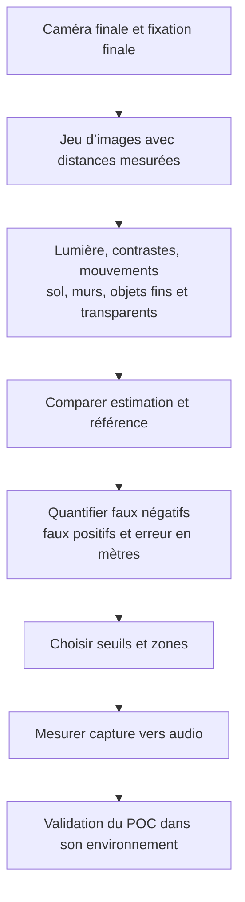

Les tests automatisés, les fixtures et une inférence sur des photographies sans vérité terrain ne remplacent pas cette campagne. Une photo peut permettre de contrôler les échanges et la cohérence des seuils, sans établir que l’obstacle est réellement à la distance annoncée. En particulier, il ne faut pas convertir la sortie d’un checkpoint de profondeur relative en mètres en appliquant arbitrairement un facteur. Le provider exige une configuration métrique pour éviter cette ambiguïté.

## Segmentation et suivi

Le provider `yolo_seg_track` ajoute YOLO26n-seg, l’échantillonnage dans les masques, ByteTrack et `alert.possible_proximity`. Les règles métriques précédentes restent inchangées. Le [chapitre 12](12-segmentation-suivi.md) décrit la première version synchrone ; les [chapitres 13](13-profondeur-independante.md) et [14](14-proximite-urbaine.md) décrivent la séparation des cadences et les profils actuels pour personnes, vélos et voitures.
