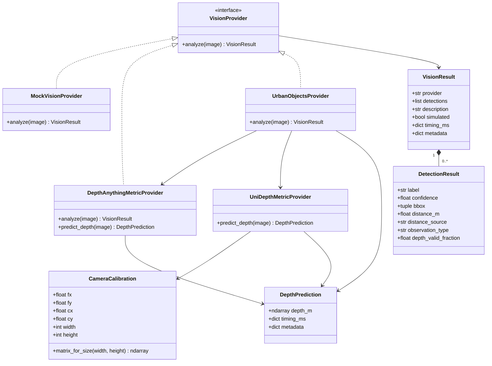
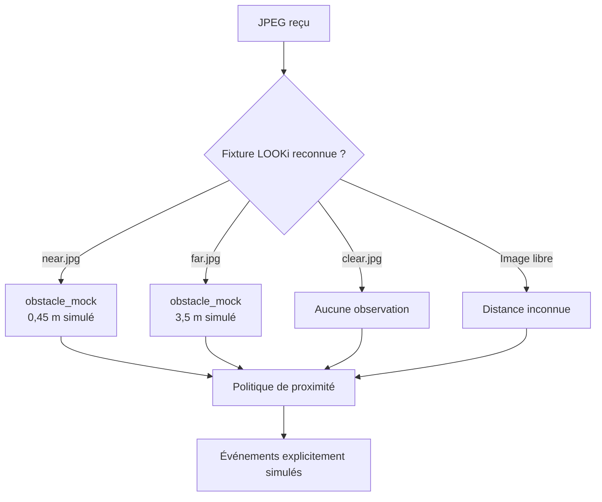
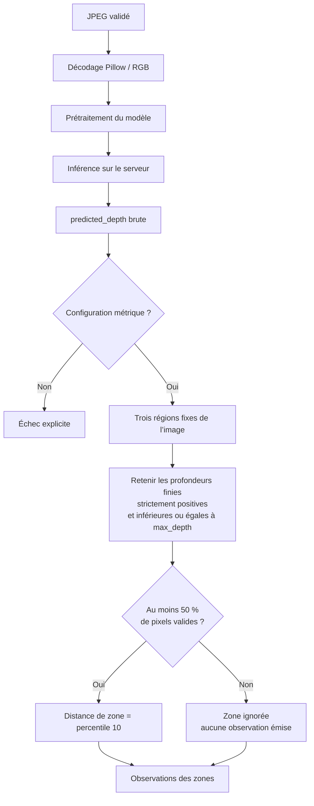
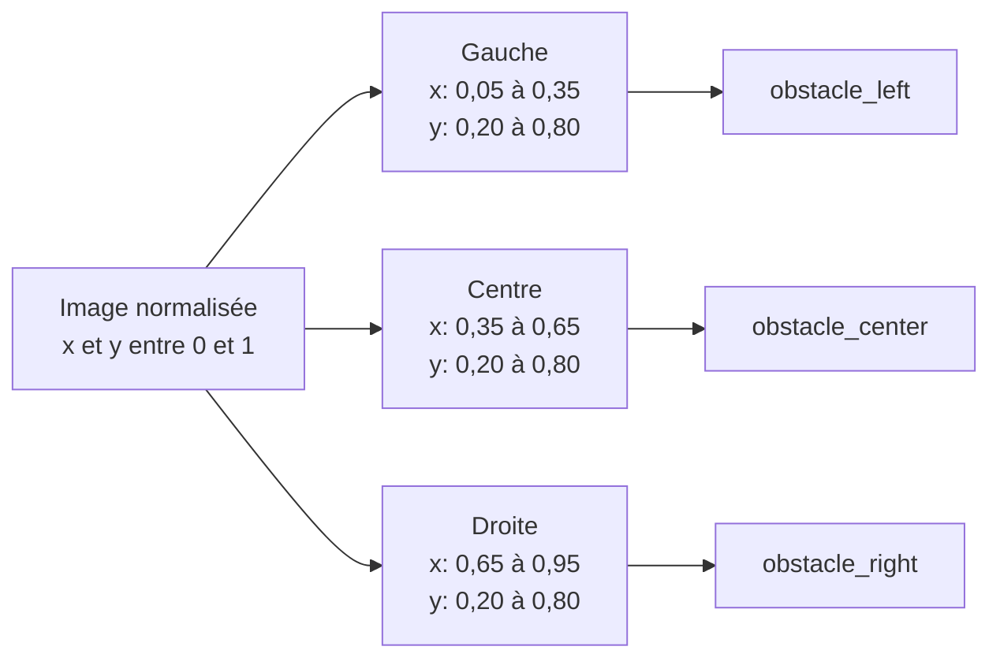
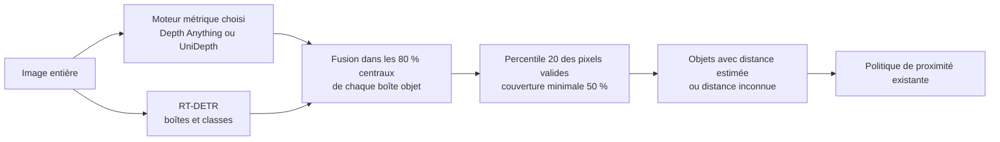
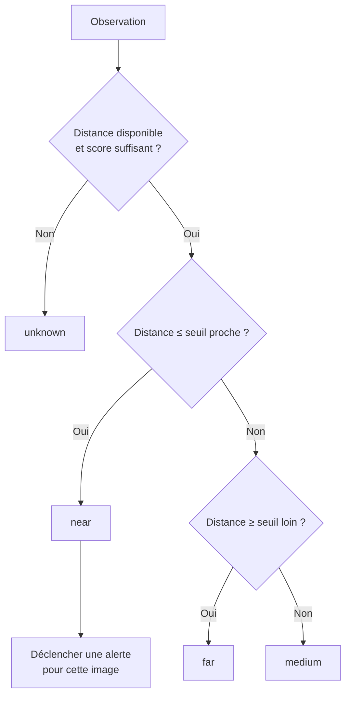
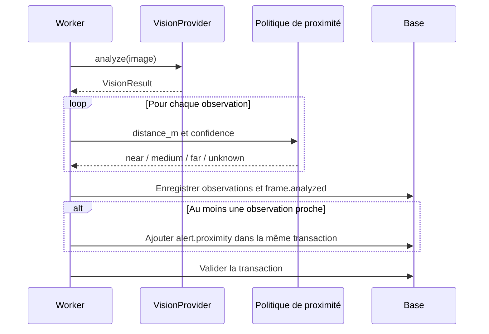
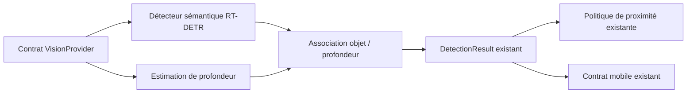
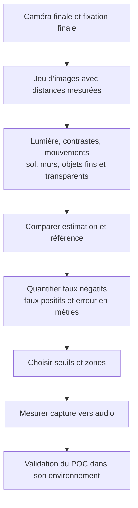

# 04 — Vision, profondeur et proximité

Sources Mermaid : [classes vision](diagrams/05-classes-vision.mmd), [fusion urbaine](diagrams/10-vision-urbaine.mmd), [proximité](diagrams/11-proximite.mmd).

## Trois modes, un même contrat métier



Le provider reçoit une image Pillow décodée et renvoie des observations indépendantes de FastAPI. Une observation contient un libellé, un score, une boîte normalisée, une distance éventuellement inconnue et l’origine de la distance. Le service applique ensuite les seuils et persiste les détections. Une `bbox` suit l’ordre `[x_min, y_min, x_max, y_max]`, avec des coordonnées comprises entre `0` et `1`.

Le champ `simulated` permet au mobile et aux outils de démonstration de distinguer les résultats fictifs. `distance_source` vaut `simulated` pour les données de démonstration ou `metric_model` pour les estimations du modèle métrique. Le protocole ne transforme pas une absence de distance en une distance sûre.

| Provider | Observations | Modèles par défaut |
| --- | --- | --- |
| `mock` | Scénarios fictifs explicitement identifiés | Aucun poids de modèle |
| `depth_anything_metric` | Trois régions fixes, `observation_type: region` | Depth Anything V2 Metric Indoor Small |
| `urban_objects` | Classes et boîtes d’objets, `observation_type: object` | RT-DETR R18 + moteur de profondeur configurable |

Lorsque `LOOKI_DEPTH_MODEL_ID` est vide ou absent, chaque provider choisit son checkpoint par défaut. Dans `urban_objects`, `LOOKI_DEPTH_BACKEND=depth_anything` choisit Outdoor Small et `LOOKI_DEPTH_BACKEND=unidepth_v2` choisit `lpiccinelli/unidepth-v2-vits14`. Une valeur explicite remplace ce choix. La distinction `observation_type` évite de présenter une zone générique comme un objet reconnu.

## Simulation reproductible



Les images de test sont des illustrations géométriques signées produites par le script `scripts/generate_mock_images.py`. Le provider reconnaît les fixtures, pas une distance dans une photographie quelconque. Recompresser, recadrer ou modifier une fixture peut empêcher sa reconnaissance : conserver les JPEG générés pour les démonstrations déterministes.

```bash
.venv/bin/python scripts/generate_mock_images.py
```

| Fixture | Observation attendue | Distance | Résultat attendu avec les seuils par défaut |
| --- | --- | --- | --- |
| `fixtures/images/near.jpg` | `obstacle_mock` | `0.45 m`, simulé | Analyse et alerte de proximité |
| `fixtures/images/far.jpg` | `obstacle_mock` | `3.5 m`, simulé | Analyse, classée loin |
| `fixtures/images/clear.jpg` | Aucune | Sans objet | Analyse sans alerte |
| Une photographie libre | Pas de mesure réelle par le mock | Inconnue | Ne pas interpréter comme un environnement dégagé |

L’intérêt du mode mock est de tester les frontières de service : upload, état de traitement, transaction de résultats, journal, reconnexion et question/réponse. Il ne valide pas la précision de la vision.

## Mode Depth Anything métrique

Le provider `depth_anything_metric` utilise par défaut `depth-anything/Depth-Anything-V2-Metric-Indoor-Small-hf`. Sa configuration déclare une profondeur métrique et une profondeur maximale de `20`. Le checkpoint est destiné au domaine intérieur. [Configuration officielle du modèle](https://huggingface.co/depth-anything/Depth-Anything-V2-Metric-Indoor-Small-hf/blob/main/config.json).

L’intégration s’appuie sur les interfaces `AutoImageProcessor` et `AutoModelForDepthEstimation`. Depth Anything estime la profondeur monoculaire ; son API fournit une carte de profondeur à partir d’une image. [Documentation Transformers](https://huggingface.co/docs/transformers/model_doc/depth_anything).



Les poids sont téléchargés et mis en cache lors du chargement du modèle. L’inférence se déroule sur le serveur qui héberge le backend : cette implémentation n’envoie pas les images à une API d’inférence externe. L’accès initial au registre de modèles reste nécessaire tant que le cache n’est pas prérempli. L’indisponibilité du modèle ne déclenche pas un remplacement silencieux par les données mock.

Le script `scripts/test_real_images.py` soumet un corpus de photographies au backend et relève les observations ainsi que les événements WebSocket. Les sources et conditions d’utilisation des photos figurent dans `fixtures/real-images/manifest.json`. Le rapport HTML superpose les régions d’échantillonnage : ces rectangles ne sont pas des boîtes de détection d’objets. La procédure et les résultats sont documentés dans [le test sur images réelles](08-test-images-reelles.md).

### Régions observées



Le provider `depth_anything_metric` relève la proximité dans trois zones ; il ne reconnaît pas les catégories d’objets. Ses boîtes sont les régions de mesure, pas des contours d’objets segmentés. Un obstacle fin, hors de ces régions ou ne représentant qu’une faible portion des pixels peut être manqué. Le provider `urban_objects` décrit ci-dessous ajoute la détection sémantique.

Le percentile 10 privilégie les surfaces proches sans prendre uniquement le pixel le plus extrême. Ce choix reste une heuristique : il ne garantit ni la distance du point le plus proche ni la bonne séparation du sol et des obstacles. Le score `confidence` est ici la proportion de pixels de profondeur valides dans la zone. Il ne représente ni une probabilité de reconnaissance sémantique ni une confiance métrique calibrée.

Une région dont moins de la moitié des pixels sont valides ne produit pas de détection. Si aucune région n’est exploitable, le résultat contient une liste vide et une description indiquant que la distance est inconnue ; cette liste vide ne signifie pas que la scène est dégagée.

## Objets urbains et fusion avec la profondeur

Le provider `urban_objects` exécute la profondeur métrique puis RT-DETR sur la même image. Avec le moteur Depth Anything, le checkpoint Outdoor configure une portée maximale de `80 m`; cette borne décrit la sortie du modèle, pas une précision garantie sur toute cette distance. Le détecteur utilise `PekingU/rtdetr_r18vd` avec les classes COCO. [Configuration Depth Anything Outdoor](https://huggingface.co/depth-anything/Depth-Anything-V2-Metric-Outdoor-Small-hf/blob/main/config.json), [fiche RT-DETR R18](https://huggingface.co/PekingU/rtdetr_r18vd).



Les boîtes sont normalisées pour échantillonner la carte de profondeur à sa résolution native. Les pixels non finis, nuls, négatifs ou dépassant la portée du checkpoint sont exclus. Si moins de `50 %` des pixels sont valides, l’objet reste présent avec une distance `null`. Le détecteur doit atteindre `LOOKI_OBJECT_CONFIDENCE_THRESHOLD`, fixé à `0.5` par défaut.

Pour les objets, `confidence` désigne le score de détection et `depth_valid_fraction` la couverture de profondeur valide. Les libellés restent des classes anglaises normalisées, telles que `person`, `bicycle`, `car` ou `bus`. La boîte n’est pas un masque de segmentation : les pixels de fond et les occlusions peuvent fausser la distance. Les poteaux, bordures et autres catégories absentes du vocabulaire peuvent rester invisibles au système.

Pour ce checkpoint Outdoor, les données Virtual KITTI définissent une profondeur axiale `z`. Le champ `distance_m` reprend une estimation de profondeur ; le backend ne la convertit pas en portée euclidienne à partir d’intrinsèques calibrés. [Définition des cartes de profondeur Virtual KITTI 2](https://europe.naverlabs.com/proxy-virtual-worlds-vkitti-2/).

Le détail de la fusion, le corpus et les mesures sont dans [le test urbain](09-test-urbain.md).

Le moteur UniDepth V2 utilise l’API officielle `infer()` pour prédire une profondeur axiale et des intrinsèques à partir du RGB. `metadata.depth_backend`, `depth_intrinsics`, `depth_intrinsics_source` et `depth_horizontal_fov_deg` indiquent le moteur et la caméra utilisée. En mode estimé, cette caméra n’est pas une calibration mesurée. Une calibration pinhole rectifiée peut être fournie explicitement avec `LOOKI_CAMERA_CALIBRATION_PATH`; sa provenance est conservée dans les métadonnées. Le code est épinglé à une révision du dépôt officiel ; son score de confiance interne n’est pas une probabilité calibrée d’exactitude métrique. Le score `confidence` des observations reste celui de RT-DETR. La [comparaison avec références mesurées](10-metric-depth-comparison.md) décrit la validation et les conditions d’utilisation.

`depth_intrinsics_source` vaut `provided` lorsque la calibration est fournie et `estimated` sinon. `depth_intrinsics` contient la matrice effectivement utilisée à la résolution de l’image ; `depth_model_estimated_intrinsics` conserve séparément la matrice estimée par le réseau, même lorsqu’une calibration mesurée lui a été fournie. `depth_calibration_reference_size` et `depth_intrinsics_image_size` rendent le redimensionnement vérifiable. La borne de rejet numérique de `10 000 m` dans cet adapter n’est ni une portée validée ni un multiplicateur d’échelle.

## Distinguer les temps de calcul

Les résultats HTTP et `frame.analyzed` contiennent un objet `timing_ms`. Avec Depth Anything, `depth_inference_ms` isole l’appel du réseau de profondeur. Avec UniDepth, il chronomètre l’API officielle `infer()`, qui contient son prétraitement et son post-traitement internes ; `metadata.depth_timing_scope` rend cette différence explicite. `depth_total_ms` couvre l’étape de profondeur avec la préparation et l’extraction ajoutées par l’adapter. Pour `urban_objects`, `detection_inference_ms` isole RT-DETR et `detection_total_ms` inclut aussi ses étapes de préparation et de conversion. `fusion_ms` mesure l’association des boîtes à la profondeur ; `total_vision_ms` couvre le provider entier.

Les mesures utilisent une horloge monotone. Les périphériques CUDA/MPS sont synchronisés quand ils sont utilisés, afin de mesurer l’exécution et pas seulement la soumission d’un calcul. Le chargement des poids au démarrage est exclu. `latency_ms` reste la durée du worker et le délai HTTP → WebSocket reste une mesure client séparée ; aucun de ces champs ne mesure la sortie audio.

## Politique de proximité



Valeurs initiales : seuil proche `1.5 m`, seuil loin `3.0 m`, score minimal `0.5`. Les bornes sont inclusives : `1.5 m` est proche et `3.0 m` est loin. Une distance intermédiaire est classée `medium`. Une mesure inconnue ou insuffisamment fiable reste `unknown` et n’est pas qualifiée de sûre.

Chaque image terminée qui contient au moins une observation proche éligible produit un événement `alert.proximity`. Il n’y a pas de temporisation entre deux images proches : le besoin « systématiquement alerter » est conservé. Un nouvel upload portant un nouveau `frame_id` peut donc générer une nouvelle alerte pour la même scène. Réessayer un upload identique avec le même identifiant n’ajoute pas de nouvelle analyse.



## Enrichissements suivants



La fusion objet/profondeur est livrée dans `urban_objects`. Elle peut ensuite être améliorée avec une segmentation et un détecteur couvrant davantage d’obstacles. Pour un modèle vidéo, conserver un état temporel par session et définir les règles de remise à zéro, d’ordre des images et de consommation mémoire. La version actuelle traite des JPEG indépendants ; elle ne suit pas un objet d’une image à l’autre et n’estime pas la vitesse d’approche.

## Validation physique à réaliser



Les tests automatisés, les fixtures et une inférence sur des photographies sans vérité terrain ne remplacent pas cette campagne. Une photo peut permettre de contrôler les échanges et la cohérence des seuils, sans établir que l’obstacle est réellement à la distance annoncée. En particulier, il ne faut pas convertir la sortie d’un checkpoint de profondeur relative en mètres en appliquant arbitrairement un facteur. Le provider exige une configuration métrique pour éviter cette ambiguïté.
