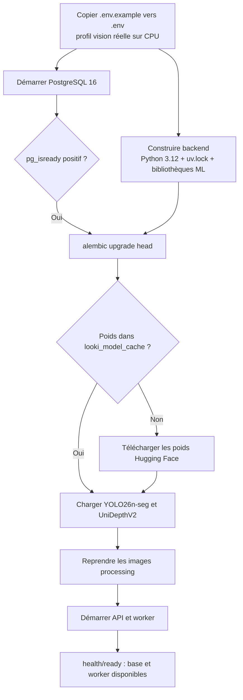
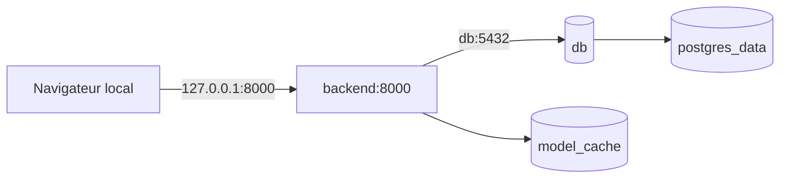
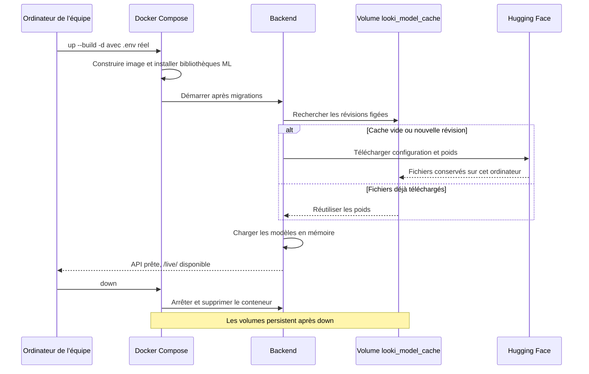
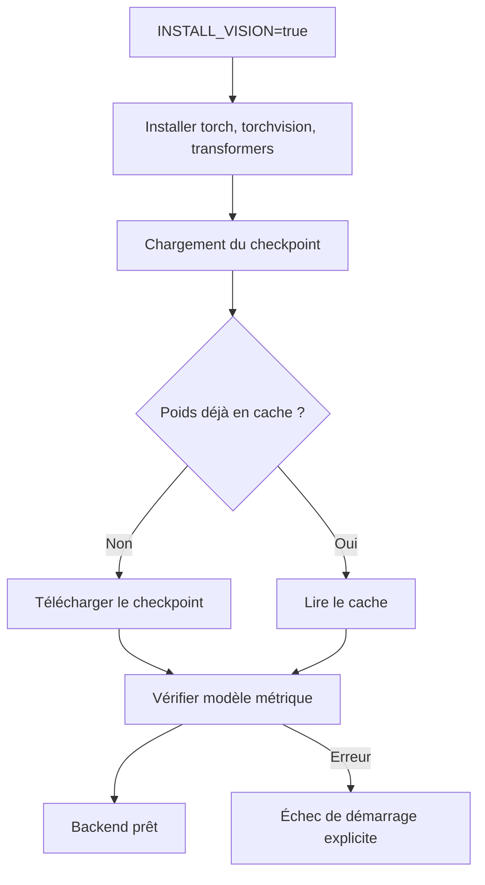
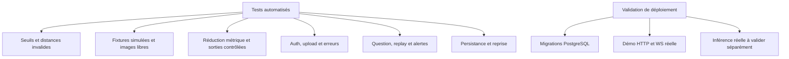
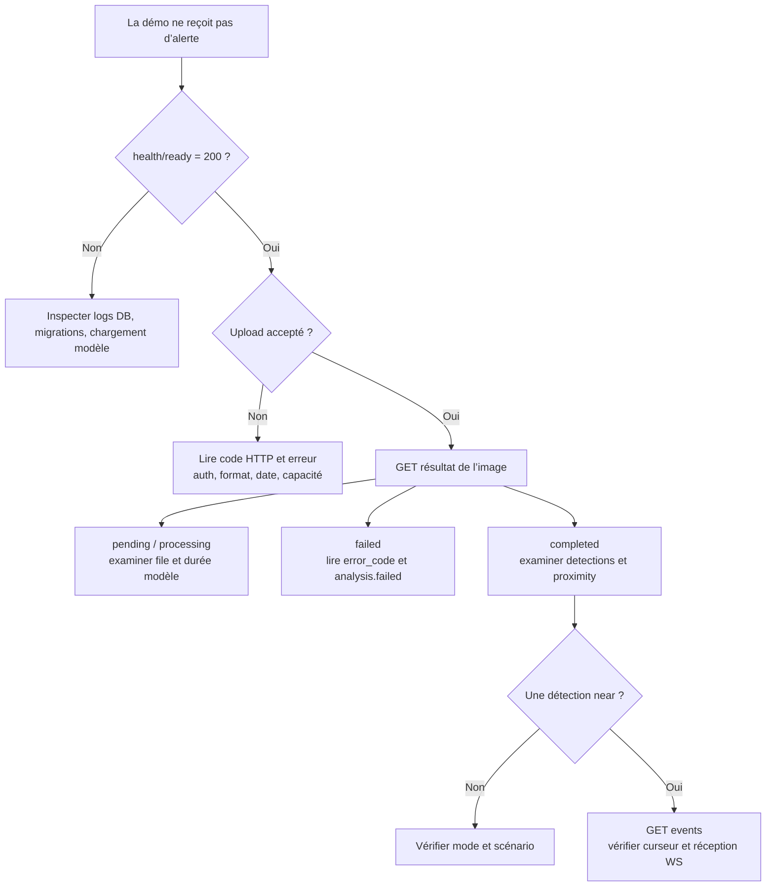
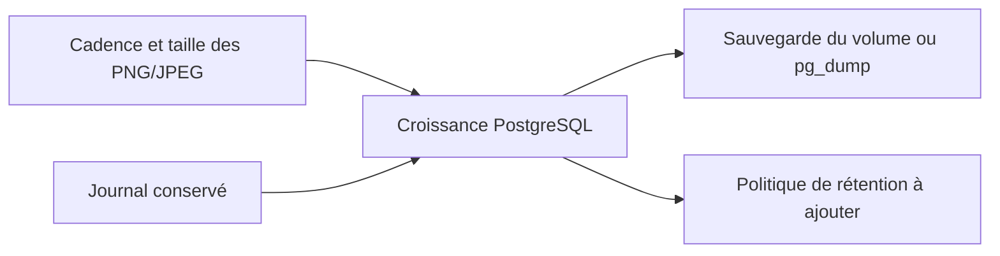

# 05 — Installation et exploitation

## Démarrage avec Compose



Prérequis : Docker avec le plugin Compose, un accès réseau pour télécharger les images, dépendances et poids au premier lancement, et au moins 4 CPU / 6 Gio disponibles pour le backend, en plus des ressources de PostgreSQL. Le profil partagé fonctionne sans GPU.

Depuis la racine du dépôt Git, le dossier `backend/` du workspace LOOKi :

```bash
test -f .env || cp .env.example .env
docker compose up --build -d
docker compose logs -f backend
```

Attendre `Application startup complete`, puis quitter le suivi des logs avec `Ctrl+C` et vérifier l’état. Cette interruption du suivi ne coupe pas les services détachés :

```bash
docker compose ps
curl --fail http://localhost:8000/health/ready
```

La commande de copie est à effectuer seulement lors de la première configuration ; ne pas écraser un `.env` contenant déjà des valeurs choisies. Le build utilise le lockfile `uv.lock`. Le backend s’exécute sous un utilisateur de conteneur non root et attend que PostgreSQL soit joignable avant d’appliquer les migrations.



Le volume PostgreSQL conserve les données après un arrêt ou une recréation des conteneurs. Le cache des modèles utilise un volume séparé. La base n’est pas publiée sur le réseau de l’hôte. La liaison du backend sur `127.0.0.1` signifie qu’un Pi ou un iPhone physique ne peut pas le joindre directement par l’IP LAN tant que l’exposition n’a pas été adaptée.

Le fichier `compose.yaml`, `.env` et le contexte de build sont dans cette même racine. Le montage caméra utilise `./calibration:/app/calibration:ro`. Le nom de projet reste `looki` : le déplacement du fichier Compose conserve les volumes `looki_postgres_data` et `looki_model_cache`. Ne pas changer de nom de projet si ces données doivent être réutilisées.

### Profil réel partagé et téléchargement des modèles

`.env.example` contient le profil réel testé à 4 CPU. Pour migrer un ancien `.env`, conserver ses secrets et mettre à jour ces valeurs :

```dotenv
INSTALL_VISION=true
LOOKI_VISION_PROVIDER=yolo_seg_track
LOOKI_DEPTH_BACKEND=unidepth_v2
LOOKI_DEPTH_MODEL_ID=
LOOKI_CAMERA_CALIBRATION_PATH=
LOOKI_VISION_DEVICE=cpu
LOOKI_CPU_THREADS=2
LOOKI_YOLO_IMAGE_SIZE=768
LOOKI_OBJECT_CONFIDENCE_THRESHOLD=0.25
LOOKI_MIN_CONFIDENCE=0.5
LOOKI_UNIDEPTH_RESOLUTION_LEVEL=0
LOOKI_DECOUPLED_DEPTH=true
LOOKI_DEPTH_INTERVAL_SECONDS=2
LOOKI_DEPTH_MAX_AGE_SECONDS=3
LOOKI_WORKER_POLL_SECONDS=0.01
BACKEND_CPUS=4
BACKEND_MEMORY=6g
```

Laisser le chemin de calibration vide tant que la caméra Pi n’a pas été calibrée. Vider aussi un ancien `LOOKI_DEPTH_MODEL_ID` qui pointe vers Depth Anything : une valeur explicite remplace le choix automatique du moteur. Les détails du profil visuel sont dans [le chapitre 14](14-proximite-urbaine.md).

`INSTALL_VISION=true` installe les **bibliothèques** durant `docker compose up --build`. Au démarrage du conteneur, le cycle de vie de l’application charge les **poids** depuis Hugging Face, avant de déclarer l’API prête. L’inférence s’exécute ensuite dans le conteneur, sur le CPU de la machine qui lance Compose.

| Composant | Modèle / fichier chargé | Révision figée | Poids approximatifs |
| --- | --- | --- | --- |
| Détection et segmentation | `Ultralytics/YOLO26`, `yolo26n-seg.pt` | `070ac3c51435984d992ba92eb3f234daf4e4500d` | 6,7 Mo |
| Profondeur | `lpiccinelli/unidepth-v2-vits14`, `model.safetensors` | `038c238f06c87b6c2f5b3749fd51fbf442b1f218` | 137 Mo |
| Suivi | ByteTrack | Fourni par la dépendance Ultralytics verrouillée | Aucun poids supplémentaire |

Ces tailles concernent seulement les fichiers de poids ; les images Docker et les bibliothèques ML occupent davantage d’espace. Les chargeurs sont dans [`app/vision/yolo.py`](../app/vision/yolo.py) et [`app/vision/unidepth.py`](../app/vision/unidepth.py). Les modèles ne sont inclus ni dans Git ni dans l’image Docker construite.



Le cache est monté à `/home/looki/.cache/huggingface` dans le conteneur, avec les snapshots dans `hub/models--…/snapshots/<revision>/`. Docker gère le stockage sur chaque hôte ; avec Docker Desktop, il se trouve dans le disque de sa VM Linux. Il n’est pas nécessaire d’installer les modèles dans un dossier Python de l’ordinateur.

Le premier démarrage peut dépasser les 90 secondes de délai initial du healthcheck selon la connexion et le CPU. Suivre les logs avant de diagnostiquer un échec. Un téléchargement impossible ou un chargement invalide fait échouer le démarrage explicitement ; il n’y a pas de remplacement silencieux par le mock. Les redémarrages réutilisent les poids en cache, même si la bibliothèque peut encore consulter les métadonnées du registre.

`docker compose down` conserve les volumes. `docker compose down --volumes` supprime **la base et le cache** : le prochain démarrage devra télécharger les poids à nouveau. Chaque nouvel ordinateur possède son propre cache. Pour rester en simulation sans poids, choisir explicitement `LOOKI_VISION_PROVIDER=mock` et `INSTALL_VISION=false`, puis reconstruire. Les valeurs de repli de Compose restent mock lorsque `.env.example` n’est pas copié.

### Essai vidéo réel

Ouvrir [/live/](http://127.0.0.1:8000/live/), renseigner la clé API et sélectionner une vidéo locale. Le fichier NYC de nos campagnes n’est pas versionné. `LOOKI_DEMO_VIDEO_PATH` reste vide dans l’exemple pour que chacun puisse choisir son fichier ; pour proposer une vidéo côté serveur, la déposer dans `media/` et définir par exemple `/app/media/night-walk.mp4`. Les JPEG sont réellement analysés par le backend.

## Démonstration mock sans installation Python locale

Le script ci-dessous attend les résultats déterministes du provider `mock`. Passer `LOOKI_VISION_PROVIDER=mock` dans `.env` et recréer le backend avec `docker compose up -d` avant de l’exécuter. Il ne valide pas la vision réelle ; utiliser alors une vidéo ou [le test sur photographies réelles](08-test-images-reelles.md).

```bash
docker compose exec backend python scripts/demo.py --base-url http://127.0.0.1:8000
```

Le script hérite de `LOOKI_API_KEY` dans le conteneur. Pour viser un autre backend depuis une installation locale :

```bash
.venv/bin/python scripts/demo.py --base-url http://localhost:8000 --api-key looki-local-dev-key --timeout 30
```

Il imprime les événements et termine avec une erreur si une étape HTTP/WebSocket attendue échoue. Une exécution crée des données persistées de démonstration ; la clôture de session ne les efface pas.

### Upload manuel

Créer une session :

```bash
curl --fail-with-body -X POST http://localhost:8000/api/v1/sessions \
  -H 'Authorization: Bearer looki-local-dev-key' \
  -H 'Content-Type: application/json' \
  -d '{"center_id":"demo-centre","user_id":"manual-demo"}'
```

Copier son `id`, choisir un nouveau UUID `frame_id` et un horodatage UTC courant. Pour éviter un exemple périmé, ce script utilise l’heure au moment de l’envoi et demande seulement le `session_id` déjà créé :

```bash
LOOKI_SESSION_ID=remplacer-par-id-de-session .venv/bin/python - <<'PY'
import os
from datetime import UTC, datetime
from pathlib import Path
from uuid import uuid4
import httpx

session_id = os.environ["LOOKI_SESSION_ID"]
key = os.getenv("LOOKI_API_KEY", "looki-local-dev-key")
response = httpx.post(
    f"http://localhost:8000/api/v1/sessions/{session_id}/frames",
    headers={"Authorization": f"Bearer {key}"},
    data={"frame_id": str(uuid4()), "timestamp": datetime.now(UTC).isoformat()},
    files={"image": ("near.jpg", Path("fixtures/images/near.jpg").read_bytes(), "image/jpeg")},
)
print(response.status_code, response.json())
response.raise_for_status()
PY
```

La démonstration automatisée couvre la même chaîne avec la réception WebSocket. Swagger permet également de créer une session et d’envoyer un JPEG après utilisation du bouton `Authorize`.

## Configuration principale

Les valeurs ci-dessous sont celles de **`.env.example`**, appliquées après copie vers `.env`. Elles peuvent différer des valeurs de repli du code et de Compose.

| Variable | Profil partagé | Effet |
| --- | --- | --- |
| `LOOKI_API_KEY` | `looki-local-dev-key` | Secret Bearer partagé, au moins `8` caractères |
| `POSTGRES_DB` | `looki` | Base créée par l’image PostgreSQL et utilisée par le backend Compose |
| `POSTGRES_USER` | `looki` | Utilisateur PostgreSQL |
| `POSTGRES_PASSWORD` | `looki-local-password` | Mot de passe PostgreSQL de développement |
| `BACKEND_PORT` | `8000` | Port local publié sur loopback |
| `LOOKI_VISION_PROVIDER` | `yolo_seg_track` | `mock`, `depth_anything_metric`, `urban_objects`, `yolo_objects` ou `yolo_seg_track` |
| `INSTALL_VISION` | `true` | Argument de build pour installer les dépendances ML |
| `LOOKI_DEPTH_BACKEND` | `unidepth_v2` | Moteur des providers objets : `depth_anything` ou `unidepth_v2` |
| `LOOKI_CAMERA_CALIBRATION_PATH` | Vide | JSON d’intrinsèques mesurées pour UniDepth ; vide = caméra estimée depuis les images |
| `LOOKI_DEPTH_MODEL_ID` | Vide | Sélection automatique : Indoor Small pour les régions ; Outdoor Small ou UniDepth V2 ViT-S pour les objets selon le moteur ; une valeur explicite remplace ce choix |
| `LOOKI_OBJECT_MODEL_ID` | `PekingU/rtdetr_r18vd` | Détecteur utilisé par `urban_objects` |
| `LOOKI_OBJECT_CONFIDENCE_THRESHOLD` | `0.25` | Score minimal conservé ; les observations faibles peuvent aider le suivi |
| `LOOKI_VISION_DEVICE` | `cpu` | Périphérique envoyé au modèle |
| `LOOKI_CPU_THREADS` | `2` | Threads Torch par modèle, avec vision et profondeur concurrentes |
| `LOOKI_YOLO_IMAGE_SIZE` | `768` | Taille d’entrée du détecteur |
| `LOOKI_UNIDEPTH_RESOLUTION_LEVEL` | `0` | Niveau officiel de profondeur le plus léger |
| `LOOKI_DECOUPLED_DEPTH` | `true` | Profondeur indépendante du suivi rapide en `yolo_seg_track` |
| `LOOKI_DEPTH_INTERVAL_SECONDS` | `2` | Intervalle de soumission au worker profondeur, sans accumuler les calculs |
| `LOOKI_DEPTH_MAX_AGE_SECONDS` | `3` | Âge maximal de la capture pour une profondeur exploitable |
| `LOOKI_WORKER_POLL_SECONDS` | `0.01` | Pause du worker lorsque la file est vide |
| `BACKEND_CPUS`, `BACKEND_MEMORY` | `4`, `6g` | Quotas du conteneur backend, pas des mesures de consommation |
| `LOOKI_DEMO_VIDEO_PATH` | Vide | Vidéo serveur optionnelle ; sélection locale disponible dans le navigateur |
| `LOOKI_NEAR_THRESHOLD_M` | `1.5` | Limite inclusive des distances proches |
| `LOOKI_FAR_THRESHOLD_M` | `3.0` | Début inclusif des distances lointaines ; doit dépasser le seuil proche |
| `LOOKI_MIN_CONFIDENCE` | `0.5` | Score minimal pour le classement métrique et une nouvelle alerte visuelle |
| `LOOKI_MAX_PENDING_FRAMES` | `32` | Limite globale `pending + processing` |
| `LOOKI_MAX_FRAME_AGE_SECONDS` | `30` | Âge maximal d’une capture ou observation utilisée |
| `LOOKI_CENTRES_PROVIDER` | `mock` | `mock` ou `rest` |
| `LOOKI_CENTRES_BASE_URL` | Vide | Origine du backend centres en mode REST |
| `LOOKI_CENTRES_API_KEY` | Vide | Bearer pour la dépendance centres, si nécessaire |

Ces variables sont câblées dans `compose.yaml`. Après changement d’une variable d’environnement, recréer le service avec `docker compose up -d`; un simple `restart` conserve la configuration du conteneur existant. Un changement d’extra ML demande une reconstruction.

### Réglages du code applicatif

Les variables suivantes sont lues par `Settings` lorsqu’elles sont présentes dans l’environnement du processus. Pour les modifier sous Compose, les ajouter explicitement à la section `environment` du service, sauf si elles y figurent déjà : le fichier `.env` de Compose n’injecte pas automatiquement toutes ses variables dans les conteneurs.

| Variable | Défaut | Détail |
| --- | --- | --- |
| `LOOKI_DATABASE_URL` | Non définie | URL SQLAlchemy complète prioritaire sur les composants DB |
| `LOOKI_DB_HOST` | `localhost`, remplacé par `db` sous Compose | Adresse DB |
| `LOOKI_DB_PORT` | `5432` | Port DB |
| `LOOKI_DB_NAME`, `LOOKI_DB_USER`, `LOOKI_DB_PASSWORD` | Valeurs de développement | Composants de l’URL construite par SQLAlchemy |
| `LOOKI_WORKER_ENABLED` | `true` | Démarrage du consommateur ; le désactiver laisse les captures en attente |
| `LOOKI_WEBSOCKET_POLL_SECONDS` | `0.2` | Pause entre lectures de journal sans page complète |
| `LOOKI_MAX_IMAGE_BYTES` | `5242880` | `5 MiB` maximum pour les octets PNG/JPEG |
| `LOOKI_MAX_REQUEST_BYTES` | `6291456` | `6 MiB` pour la requête entière ; doit dépasser la limite de fichier image |
| `LOOKI_MAX_IMAGE_PIXELS` | `12000000` | Limite `largeur × hauteur` |
| `LOOKI_MAX_FUTURE_SECONDS` | `5` | Tolérance d’horodatage futur |
| `LOOKI_CENTRES_TIMEOUT_SECONDS` | `3.0` | Timeout du client HTTP centres |
| `LOOKI_FIXTURES_DIR` | `fixtures` dans le dépôt, `/app/fixtures` dans le conteneur | Racine des contextes locaux |
| `LOOKI_CREATE_SCHEMA` | `false` | Création de tables réservée aux tests ; conserver Alembic pour Compose |

## Activer la profondeur métrique

La profondeur UniDepthV2 est déjà active dans le profil partagé. Pour reproduire le premier parcours **Depth Anything par régions**, modifier `.env` :

```dotenv
LOOKI_VISION_PROVIDER=depth_anything_metric
INSTALL_VISION=true
LOOKI_DEPTH_MODEL_ID=depth-anything/Depth-Anything-V2-Metric-Indoor-Small-hf
LOOKI_VISION_DEVICE=cpu
```

Puis reconstruire :

```bash
docker compose up --build -d
docker compose logs -f backend
```



Le premier lancement est plus long et peut dépasser la période initiale du healthcheck. Lire les journaux avant de conclure à une panne. Le mode CPU permet de démarrer sans configuration GPU, mais sa latence dépend du serveur ; la fenêtre d’âge de `30 s` peut expirer si l’inférence ou la file est trop lente.

Sur Linux, le lockfile utilise l’index officiel PyTorch CPU pour `torch` et `torchvision`, défini dans `pyproject.toml`. Cela évite de télécharger les bibliothèques CUDA pour ce déploiement CPU. Sur macOS, ces paquets conservent leur source PyPI. Le build Docker utilise un cache BuildKit pour les téléchargements `uv` ; ce cache n’est pas embarqué comme répertoire de téléchargement dans l’image finale. L’environnement `.venv` est installé pendant le build et reste propriété de root, lisible et exécutable par l’utilisateur applicatif `10001`. Les poids Hugging Face disposent de leur propre volume `model_cache`, accessible en écriture à cet utilisateur.

Le Compose livré ne réserve aucun GPU. `LOOKI_VISION_DEVICE=cuda` ne suffit pas : le passage à CUDA demande aussi des distributions PyTorch compatibles GPU, une mise à jour des sources et du lockfile, puis la configuration du runtime et des ressources de l’hôte. Aucune accélération GPU n’est supposée par les tests du POC.

Le script de démo `near.jpg` est conçu pour le provider mock. En mode réel, son alerte n’est pas garantie : envoyer des scènes de validation et comparer les estimations à des distances mesurées. Voir le chapitre [vision](04-vision-et-proximite.md).

Pour reproduire la première campagne de rue, utiliser `LOOKI_VISION_PROVIDER=urban_objects`, `LOOKI_DEPTH_BACKEND=depth_anything`, `LOOKI_OBJECT_MODEL_ID=PekingU/rtdetr_r18vd` et le checkpoint `depth-anything/Depth-Anything-V2-Metric-Outdoor-Small-hf`. Le [test urbain](09-test-urbain.md#reproduire-le-test) fournit sa configuration complète.

Le même provider peut utiliser UniDepth V2 avec `LOOKI_DEPTH_BACKEND=unidepth_v2` et `LOOKI_DEPTH_MODEL_ID=lpiccinelli/unidepth-v2-vits14`. Le modèle adapté au moteur peut aussi être choisi automatiquement en laissant `LOOKI_DEPTH_MODEL_ID` vide. Une ancienne valeur explicite dans `.env` reste prioritaire : la retirer ou la remplacer lors du changement de moteur. Les résultats comparés et les restrictions de licence figurent dans [la comparaison métrique](10-metric-depth-comparison.md).

### Fournir une calibration réellement mesurée

`calibration/` est monté en lecture seule dans `/app/calibration`. Un fichier destiné à la caméra Pi doit contenir exactement `width`, `height`, `fx`, `fy`, `cx`, `cy` : dimensions de référence et intrinsèques en pixels d’une caméra pinhole rectifiée. Activer ce fichier avec `LOOKI_CAMERA_CALIBRATION_PATH=/app/calibration/camera.json`, avec un provider objets (`urban_objects`, `yolo_objects` ou `yolo_seg_track`) et `unidepth_v2`. La calibration reste reportée pour le profil actuel. Voir le [contrat du dossier de calibration](../calibration/README.md).

Le backend adapte la matrice au redimensionnement de l’image entière et refuse un rapport de dimensions incompatible. Il ne corrige pas la distorsion optique et ne peut pas détecter un recadrage conservant le même ratio. Les images doivent correspondre à l’objectif, au mode de capture et au champ de vue calibrés. Les matrices des jeux ETH3D ou Middlebury ne doivent pas être utilisées comme calibration de la caméra Pi.

### Tester les photographies intérieures avec le provider de régions

Vérifier d’abord que `GET /health/ready` retourne `vision_provider: depth_anything_metric`. Depuis la racine du dépôt, avec l’environnement local du backend installé :

```bash
.venv/bin/python scripts/test_real_images.py \
  --base-url http://localhost:8000 \
  --output-dir output/real-depth-evaluation
```

La commande produit les événements reçus et les mesures dans `results.json`, puis un rapport visuel `report.html`. Les photos, leur provenance et leurs droits d’utilisation sont décrits dans le manifeste de `fixtures/real-images/`. Les résultats servent à vérifier l’intégration du vrai modèle ; sans distance mesurée dans les scènes, ils ne constituent pas une évaluation de précision métrique. Voir le [rapport détaillé](08-test-images-reelles.md).

## Développement et tests

```bash
uv sync --frozen --extra dev
.venv/bin/pytest
.venv/bin/ruff check app tests scripts
.venv/bin/python scripts/export_openapi.py
```

Sans `uv`, une installation éditable `python -m pip install -e '.[dev]'` dans un environnement Python 3.12/3.13 convient pour développer, mais ne reproduit pas exactement les versions du lockfile.



Les tests de protocole utilisent SQLite temporaire avec `aiosqlite`, afin de tourner sans service externe. Cela ne remplace pas un lancement PostgreSQL avec les migrations. Les tests du provider de profondeur vérifient son adaptation de sorties contrôlées, son refus de profondeur relative et ses filtres de valeurs ; ils n’évaluent pas la précision d’un checkpoint réel.

Pour lancer FastAPI directement sur l’hôte, fournir une base PostgreSQL accessible dans `LOOKI_DATABASE_URL`, appliquer `alembic upgrade head`, puis utiliser un seul processus :

```bash
.venv/bin/alembic upgrade head
.venv/bin/uvicorn app.main:app --host 127.0.0.1 --port 8000 --workers 1 --ws-max-size 8192
```

Ne pas augmenter `--workers` ou les réplicas Compose : le verrou de publication et la reprise des images sont conçus pour un seul processus.

## Inspection et opérations usuelles

```bash
docker compose logs --tail=100 backend
docker compose logs --tail=100 db
docker compose exec backend alembic current
docker compose exec db psql -U looki -d looki -c "SELECT status, count(*) FROM frames GROUP BY status;"
docker compose restart backend
docker compose down
```

Adapter les paramètres `psql` si les identifiants ont été modifiés. `docker compose down` conserve les volumes. L’option `-v` les supprime : elle effacerait les sessions, images, événements et le cache des modèles ; elle n’est pas nécessaire pour arrêter ou redémarrer.

### Lecture d’un incident



| Symptôme | Interprétation et action |
| --- | --- |
| `401` HTTP ou handshake WS refusé | Comparer la clé du client à l’environnement effectif du conteneur |
| `queue_full` | Le débit de capture dépasse le débit d’analyse ; réduire la cadence ou accélérer l’inférence |
| `invalid_timestamp` | Horloge désynchronisée ou capture retardée avant upload |
| `stale_frame` | La capture est devenue trop ancienne avant ou pendant l’analyse |
| `inference_failed` | Consulter l’exception serveur et le provider configuré |
| `center_unavailable` | Timeout, erreur REST, contenu invalide ou version de contexte incorrecte |
| Image en `processing` après panne de base | Rétablir la base ; le worker retente la reprise après l’incident. Le redémarrage applique aussi cette reprise |
| Connexion active, audio répété | Vérifier la déduplication des `id` côté mobile et distinguer les nouvelles alertes |
| Photographie libre sans distance en mode mock | Comportement attendu : utiliser les fixtures ou activer le provider réel |

## Persistance, sauvegarde et latence



Le POC n’efface aucune image automatiquement. Avant une capture prolongée, estimer le volume attendu à partir de la cadence et de la taille PNG/JPEG, puis surveiller l’espace disponible. Une clôture de session n’est pas une purge. Les sauvegardes contiennent aussi les images, qui peuvent porter des données personnelles.

`latency_ms` mesure le traitement worker jusqu’à la préparation du résultat. L’attente en file, l’upload, la livraison du journal, la synthèse et la sortie audio s’ajoutent à cette durée. Le chapitre [intégration](06-integration-equipe.md#mesure-de-bout-en-bout) détaille les instants à relever.

## Vérifications de la livraison initiale

Le 14 octobre 2026, la livraison a été vérifiée avec `84` tests automatisés, le contrôle Ruff et le contrôle de format. La composition PostgreSQL/backend démarre, la base et le backend sont sains, la démonstration HTTP + WebSocket fonctionne et Alembic ne signale pas de dérive entre le schéma migré et les modèles.

Une vérification distincte a chargé les poids officiels Depth Anything V2 Metric Indoor Small sur CPU et exécuté une inférence sur une image synthétique. Trois observations métriques finies ont été obtenues. Ce test prouve le fonctionnement de l’adapter avec le vrai modèle ; il ne mesure ni la précision sur des obstacles réels ni les performances représentatives de la caméra et du serveur finaux.

Le 15 octobre 2026, le provider réel a également été exécuté dans Docker sur cinq photographies : les cinq analyses ont terminé avec `simulated: false`, avec deux alertes de proximité persistées et reçues par WebSocket, et aucune alerte pour les trois autres images. Le [rapport de cette campagne](08-test-images-reelles.md#résultats-du-15-octobre-2026) détaille les mesures et la configuration. Les `84` tests du backend et `10` tests supplémentaires du script d’évaluation ont été vérifiés, soit `94` tests.

La campagne urbaine suivante a vérifié `18` analyses avec `urban_objects`, six photos répétées trois fois, et l’égalité des événements HTTP/persistés/WebSocket. Les `154` tests automatisés de cette version ont passé, ainsi que Ruff et le contrôle de dérive Alembic. Aucune alerte réelle n’a été produite au seuil de `1.5 m` : voir le [rapport urbain](09-test-urbain.md) pour les durées isolées et les limites des distances estimées.

La livraison incluant UniDepth et la calibration a ensuite passé `269` tests automatisés. Son essai du service termine `18` analyses urbaines sans alerte et les `5` anciennes photos avec `3` événements d’alerte persistés et reçus. Le [rapport de comparaison métrique](10-metric-depth-comparison.md) sépare ces contrôles de protocole des mesures d’erreur sur les références physiques. Aucun fichier de calibration de la caméra Pi n’a été inventé.

## Questions HTTP et audio Realtime

Le [contrat mobile](../contracts/mobile-backend.md) et le [chapitre 15](15-mobile-realtime-et-pi.md) définissent l’activation, les états, délais et erreurs. Renseigner la clé privée serveur puis `LOOKI_REALTIME_ENABLED=true` ; aucun secret fournisseur ne part vers les appareils. Sans clé, les appels audio sont indisponibles et la vision continue.

Pour l’intégration physique, provisionner une seule session et deux jetons selon le [contrat d’accès](../contracts/session-access.md). Le Pi envoie les PNG conformément au [contrat Embedded](../contracts/raspberry-backend.md). Les migrations de nouvelles tables s’appliquent avant le serveur au démarrage Compose. Un seul Uvicorn et une seule réplique restent requis.
