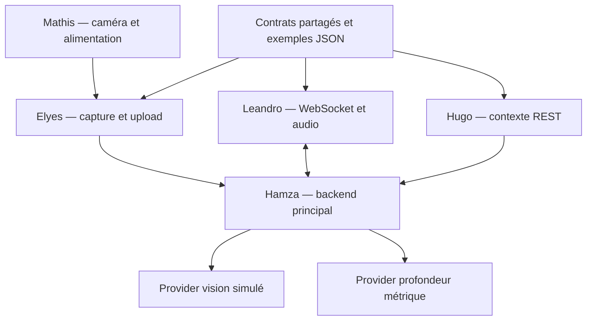
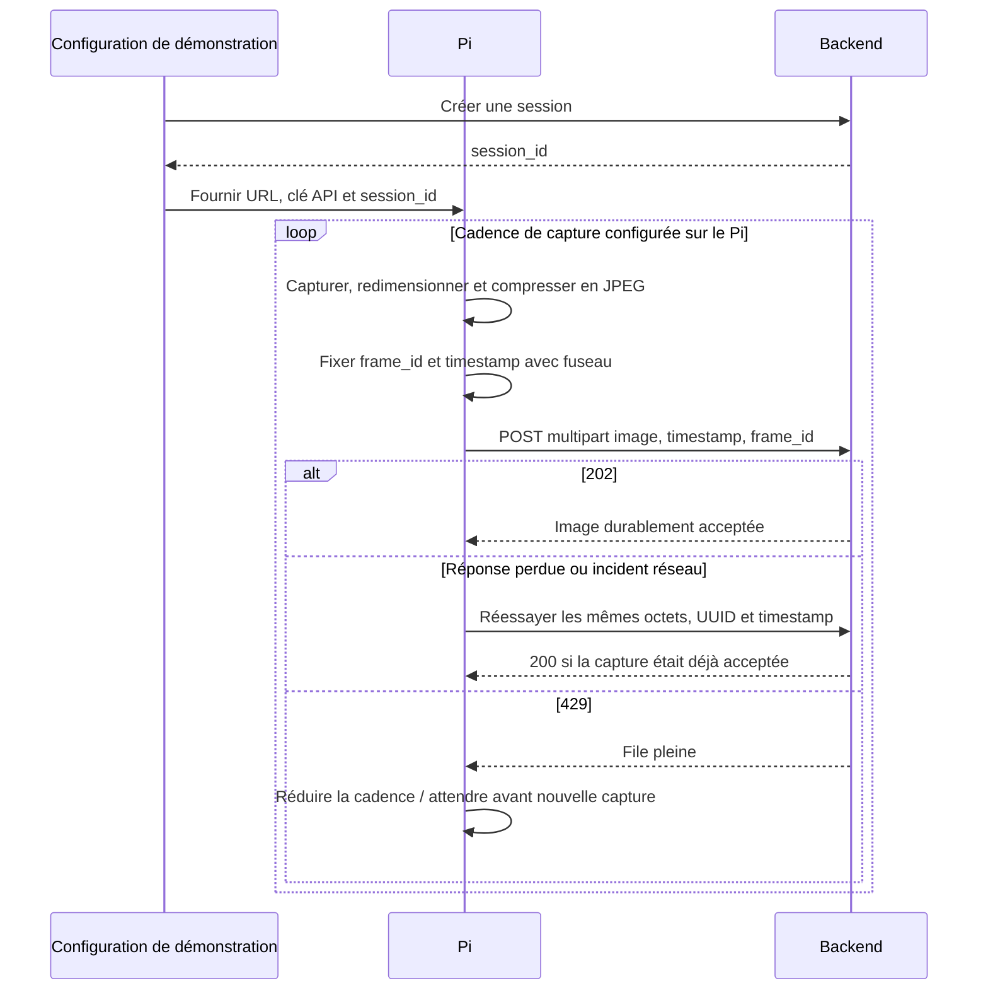
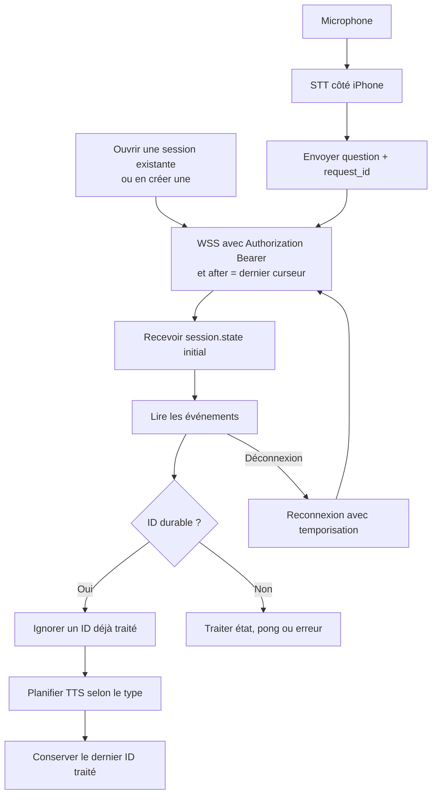
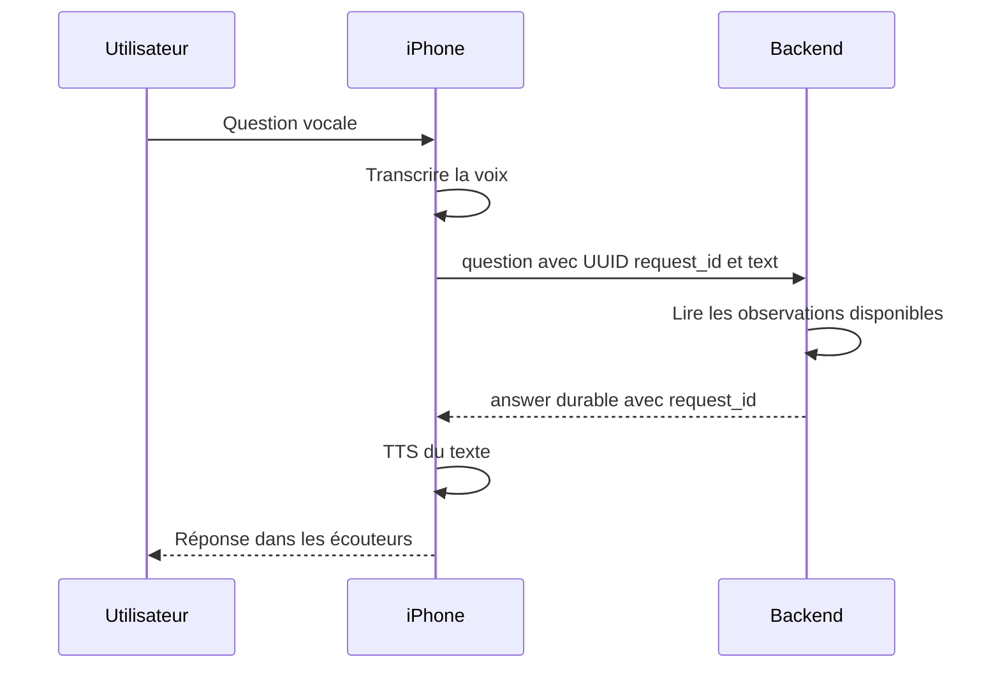
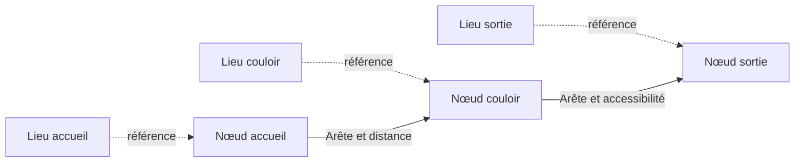
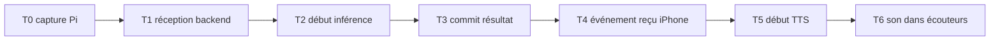

# 06 — Intégration avec l’équipe

## Avancer en parallèle

Chaque intégration peut démarrer avec `docker compose up --build -d`. Aucun modèle lourd ni Raspberry Pi n’est requis pour les scénarios simulés. Les contrats de référence se trouvent dans `/contracts`, et les tests de protocole dans `tests`.

## Pi → backend

Le Pi doit conserver l’UUID, l’horodatage et les octets exacts tant qu’il réessaie une capture. Recompresser le même fichier tout en réutilisant le même `frame_id` peut produire un conflit, puisque l’empreinte change. Pour une nouvelle capture, générer un nouvel UUID.

Synchroniser l’horloge du Pi. Une image trop ancienne ou datée trop loin dans le futur est refusée. Le backend applique aussi une limite d’âge avant l’analyse ; accumuler une longue file de captures pendant une coupure est peu utile pour l’alerte de proximité. Le contrôle de la cadence appartient au logiciel embarqué.

Le `session_id` est fourni aux deux clients par le parcours de démonstration. Aucun protocole d’appairage automatique, QR code ou canal applicatif iPhone → Pi n’est ajouté dans ce POC.

## iPhone ↔ backend

L’application utilise une seule connexion WebSocket bidirectionnelle pour les questions et les réponses. L’en-tête Bearer doit être ajouté lors de la requête d’ouverture du WebSocket. La clé n’est pas placée dans l’URL. Un client WebSocket natif peut porter cet en-tête ; le constructeur WebSocket standard d’un navigateur ne permet pas librement les mêmes en-têtes, ce qui doit être pris en compte pour un éventuel dashboard web.

Les événements durables peuvent être livrés à nouveau après une reconnexion. Dédupliquer par `id` avant de relancer une vocalisation déjà planifiée. Une alerte pour une nouvelle image porte un nouvel `id`, même si son texte ressemble à la précédente. La politique de répétition audio est à définir côté mobile en gardant cette distinction.

Avant le TTS d’une alerte rejouée, vérifier son `captured_at` : le backend conserve volontairement l’historique et ne retire pas les événements anciens lors de la reconnexion. Conserver une alerte périmée pour consultation, sans la présenter comme un danger actuel. Donner priorité aux alertes fraîches dans la file audio. Avancer le curseur avec le maximum de sa valeur actuelle et de l’identifiant traité.

Les messages `pong`, `error` et l’état initial de connexion ont `id: null` : ils ne font pas avancer le curseur. Ne pas remettre le curseur à zéro à leur réception. Les descriptions et réponses restent textuelles ; le backend n’envoie pas de flux audio.

### Questions

La réponse de cette phase est déterministe. Tester les cas « aucune image analysée », « observation proche », « résultat devenu trop ancien » et « session fermée ». Garder le même `request_id` si une question doit être répétée après un incident ; en générer un nouveau pour une question réellement nouvelle.

## Backend centres → backend principal

```mermaid
sequenceDiagram
    participant Client
    participant Main as Backend principal
    participant Provider as Provider centres
    participant Centres as Backend centres ou JSON local
    participant DB as PostgreSQL
    Client->>Main: POST sessions avec center_id
    Main->>Provider: context(center_id)
    Provider->>Centres: Lire le contexte
    Centres-->>Provider: JSON version 1.0
    Provider->>Provider: Valider références de lieux et graphe
    alt Contexte valide
        Provider-->>Main: Contexte normalisé
        Main->>DB: Sauver le snapshot dans sessions.context
        Main-->>Client: Session active
    else Centre inconnu
        Main-->>Client: 404
    else Dépendance indisponible ou contenu invalide
        Main-->>Client: 503
    end
```

Le contrat REST attendu est `GET /api/v1/centres/{center_id}/context`. Le provider local lit le fichier `fixtures/centres/{center_id}.json`. Le passage au provider REST se fait par configuration ; aucune réécriture des contrôleurs n’est nécessaire.

Le contexte rassemble des lieux et un graphe. Chaque nœud référence un lieu existant ; chaque arête référence deux nœuds existants et porte une distance positive ou nulle. Les identifiants de lieu et de nœud sont uniques dans leurs collections. Le centre retourné doit correspondre au centre demandé et la version de schéma doit être `1.0`.

Ce graphe donne un contexte métier. Le backend livré n’en déduit pas encore la position des lunettes, un trajet piéton ou une instruction de navigation. Ajouter des lieux en base ne suffit pas à localiser une image dans le bâtiment.

## Scénarios de recette partagée

| Scénario | Attendu côté backend | À vérifier côté client |
| --- | --- | --- |
| Fixture proche | `frame.analyzed`, puis `alert.proximity` | TTS de l’alerte et indication de simulation |
| Deux nouvelles images proches | Une alerte pour chaque image | Pas de perte d’événement |
| Même upload répété | `200`, même image logique, pas de nouvelle analyse | Réutilisation de l’identifiant |
| Même UUID, contenu modifié | `409` | Journaliser le conflit et corriger le producteur |
| Fixture lointaine | Analyse classée `far`, sans alerte proche | Afficher ou vocaliser selon le parcours retenu |
| Image invalide | Refus avant analyse | Gestion de l’erreur et prochaine capture |
| Coupure du mobile pendant l’analyse | Événements conservés en base | Reprise avec `after`, déduplication |
| Redémarrage backend pendant un calcul | Reprise des images interrompues | Reconnexion du mobile |
| Question | Événement `answer` avec le même `request_id` | Corrélation et TTS |
| Centre indisponible | Échec explicite de création de session | Ne pas présenter une session fictivement connectée |
| Session clôturée | Rejet de nouveaux uploads/questions ; historique lisible | Arrêt de capture et fin du parcours |

## Mesure de bout en bout

Relever les durées de capture/upload, attente, inférence, livraison WebSocket et démarrage audio. Les champs backend ne mesurent pas la latence des écouteurs. Pour comparer des horloges Pi/serveur/iPhone, vérifier leur synchronisation ou compléter les mesures par des durées monotones locales.

Mesurer également le nombre d’images acceptées, refusées pour saturation, expirées avant analyse et échouées au modèle, ainsi que les coupures WebSocket. Une moyenne de latence seule peut masquer une accumulation d’images périmées.
