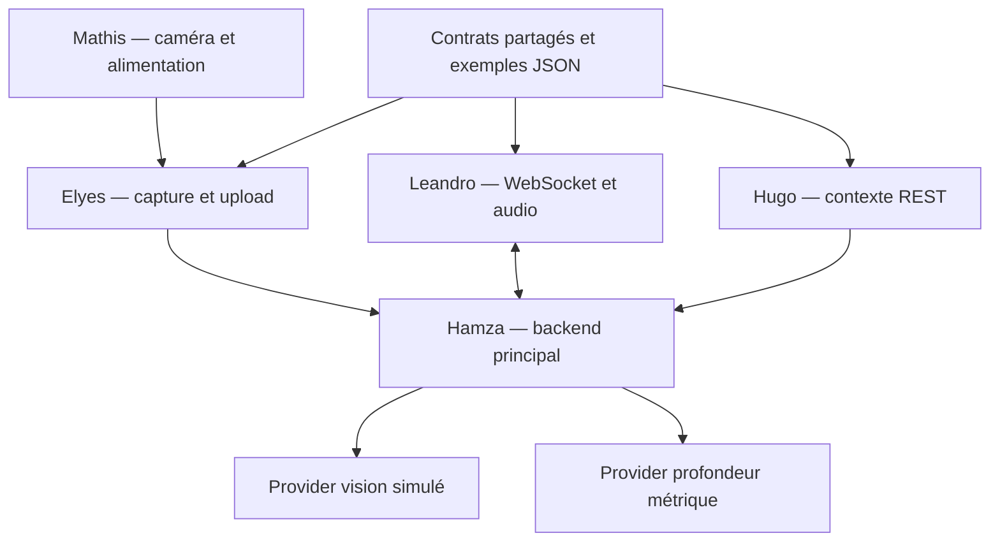
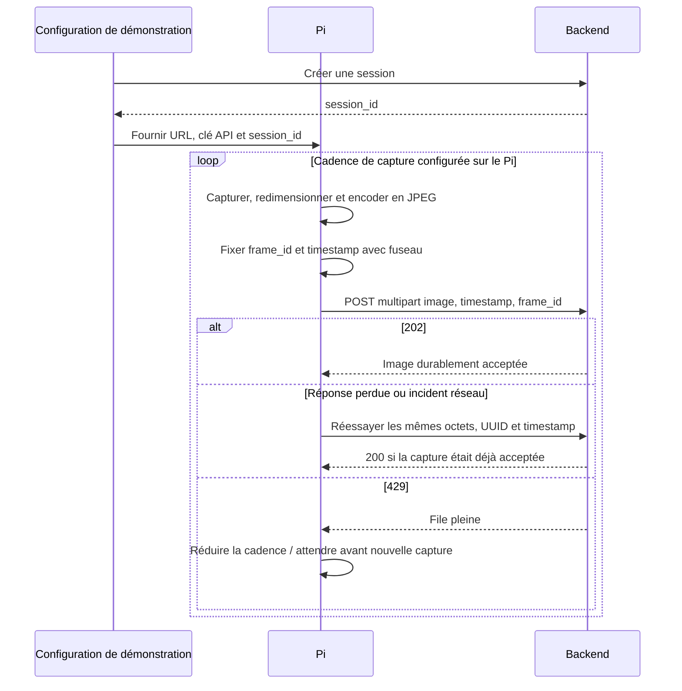
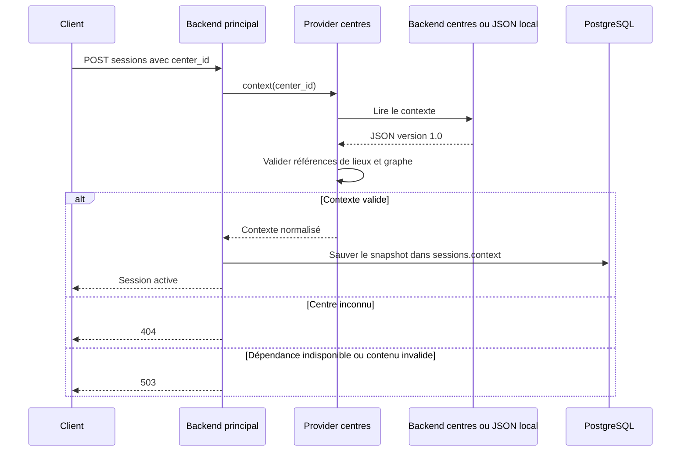
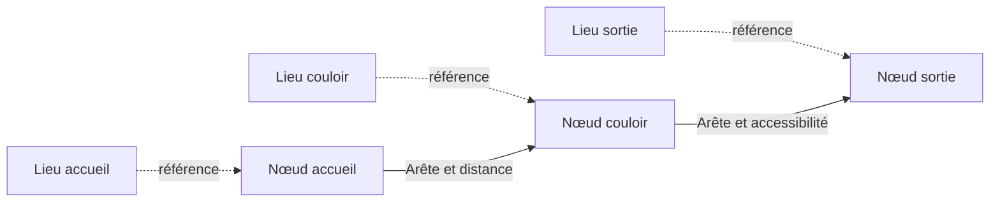
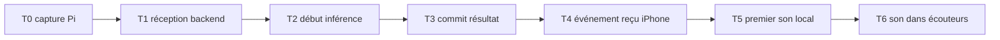

# 06 — Intégration avec l’équipe

## Avancer en parallèle

Chaque intégration peut démarrer avec `docker compose up --build -d`. Aucun modèle lourd ni Raspberry Pi n’est requis pour les scénarios simulés. Les contrats de référence se trouvent dans `/contracts`, et les tests de protocole dans `tests`.

## Pi → backend

Le Pi doit conserver l’UUID, l’horodatage et les octets exacts tant qu’il réessaie une capture. Recompresser le même fichier tout en réutilisant le même `frame_id` peut produire un conflit, puisque l’empreinte change. Pour une nouvelle capture, générer un nouvel UUID.

Synchroniser l’horloge du Pi. Une image trop ancienne ou datée trop loin dans le futur est refusée. Le backend applique aussi une limite d’âge avant l’analyse ; accumuler une longue file de captures pendant une coupure est peu utile pour l’alerte de proximité. Le contrôle de la cadence appartient au logiciel embarqué.

Le `session_id` est fourni aux deux clients par le parcours de démonstration. Aucun protocole d’appairage automatique, QR code ou canal applicatif iPhone → Pi n’est ajouté dans ce POC.

## iPhone ↔ backend

Leandro suit le [contrat HTTP et Realtime](../contracts/mobile-backend.md), après le [provisionnement](../contracts/session-access.md). Les tests avec transport contrôlé sont complétés par une [recette OpenAI réelle dans le navigateur](17-recette-lio.md) ; l’intégration WebRTC native et la recette audio restent à réaliser sur iPhone.

1. Recevoir le token mobile de la même session que le Pi.
2. Ouvrir le [WSS des alertes](../contracts/alerts.md), conserver le curseur et ignorer les alertes expirées.
3. Négocier un appel Realtime en réception audio ; attendre le GET `ready`, appliquer la réponse SDP et vérifier la sortie locale.
4. Effectuer le STT local, préparer la lecture puis POST de la transcription finale avec UUID et époque.
5. Recevoir directement la voix WebRTC ; rapporter la lecture par PUT. Une fin de génération ne signifie pas une fin de lecture.
6. Sur alerte, couper immédiatement la voix, jouer le clip, annuler en HTTP et fermer l’ancien média ; renégocier une époque avant la question suivante.

Le backend n’ajoute aucun TTS ni relais audio. Les clips et leur regroupement sont à intégrer côté app. Les anciens exemples WSS de questions ne servent qu’au diagnostic opérateur.

## Backend centres → backend principal

Le contrat REST attendu est `GET /api/v1/centres/{center_id}/context`. Le provider local lit le fichier `fixtures/centres/{center_id}.json`. Le passage au provider REST se fait par configuration ; aucune réécriture des contrôleurs n’est nécessaire.

Le contexte rassemble des lieux et un graphe. Chaque nœud référence un lieu existant ; chaque arête référence deux nœuds existants et porte une distance positive ou nulle. Les identifiants de lieu et de nœud sont uniques dans leurs collections. Le centre retourné doit correspondre au centre demandé et la version de schéma doit être `1.0`.

Ce graphe donne un contexte métier. Le backend livré n’en déduit pas encore la position des lunettes, un trajet piéton ou une instruction de navigation. Ajouter des lieux en base ne suffit pas à localiser une image dans le bâtiment.

## Scénarios de recette partagée

| Scénario | Attendu côté backend | À vérifier côté client |
| --- | --- | --- |
| Fixture proche | `frame.analyzed`, puis `alert.proximity` | Clip de l’alerte et indication de simulation |
| Deux nouvelles images proches | Une alerte pour chaque image | Pas de perte d’événement |
| Même upload répété | `200`, même image logique, pas de nouvelle analyse | Réutilisation de l’identifiant |
| Même UUID, contenu modifié | `409` | Journaliser le conflit et corriger le producteur |
| Fixture lointaine | Analyse classée `far`, sans alerte proche | Afficher ou vocaliser selon le parcours retenu |
| Image invalide | Refus avant analyse | Gestion de l’erreur et prochaine capture |
| Coupure du mobile pendant l’analyse | Événements conservés en base | Reprise avec `after`, déduplication |
| Redémarrage backend pendant un calcul | Reprise des images interrompues | Reconnexion du mobile |
| Question | Ressource HTTP avec le même `request_id` | Corrélation et lecture WebRTC |
| Centre indisponible | Échec explicite de création de session | Ne pas présenter une session fictivement connectée |
| Session clôturée | Rejet de nouveaux uploads/questions ; historique lisible | Arrêt de capture et fin du parcours |

## Mesure de bout en bout

Relever les durées de capture/upload, attente, inférence, livraison WebSocket et démarrage audio. Les champs backend ne mesurent pas la latence des écouteurs. Pour comparer des horloges Pi/serveur/iPhone, vérifier leur synchronisation ou compléter les mesures par des durées monotones locales.

Mesurer également le nombre d’images acceptées, refusées pour saturation, expirées avant analyse et échouées au modèle, ainsi que les coupures WebSocket. Une moyenne de latence seule peut masquer une accumulation d’images périmées.
