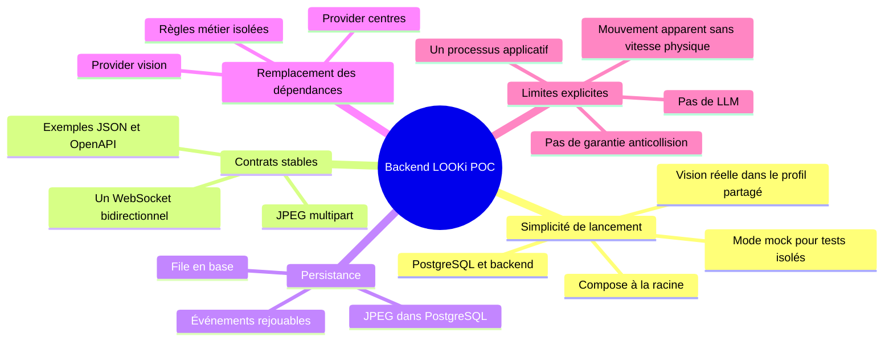
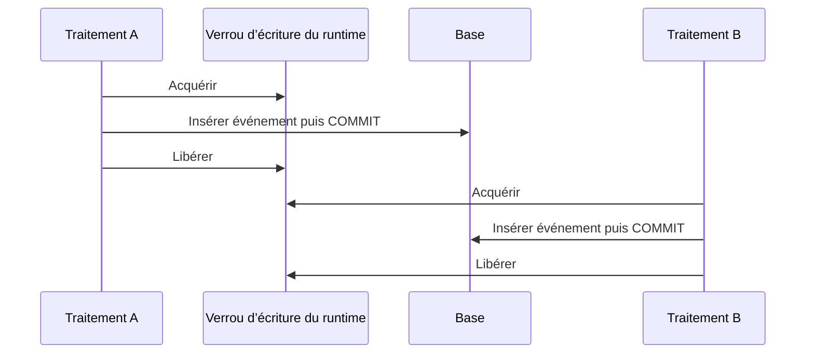
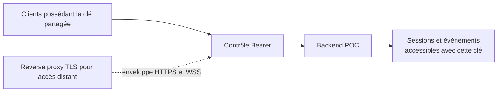
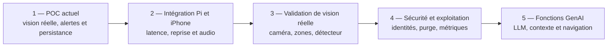

# 07 — Décisions techniques et limites

## Choix retenus

| Décision | Intérêt immédiat | Conséquence à connaître |
| --- | --- | --- |
| FastAPI et Pydantic | Endpoints typés, documentation HTTP, validation | Les messages WebSocket ont besoin d’un contrat complémentaire |
| Controller / service / repository | Protocole, métier et SQL séparés | Quelques classes supplémentaires, mais des dépendances lisibles |
| PostgreSQL et SQLAlchemy async | Stockage durable et accès asynchrones | Les migrations doivent être appliquées avant le démarrage applicatif |
| JPEG dans une colonne `bytea` | Une seule persistance pour le POC | Croissance du volume, besoin ultérieur de rétention ou de stockage objet |
| Worker intégré | Lancement avec deux services Compose | Pas de montée en charge multiprocessus sans évolution de la réservation et des verrous |
| Journal d’événements en base | Reconnexion et inspection par HTTP | Lecture périodique et coûts de conservation |
| Verrou d’écriture local | Ordre cohérent entre validation et curseur d’événement | Coordination valable uniquement dans le processus unique prévu |
| Alertes métriques par capture proche et vigilance visuelle par piste | Signaler aussi les indices visuels lorsque les mètres sont incertains | Répétition visuelle limitée à deux secondes par piste ; politique audio à définir côté mobile |
| Snapshot de contexte par session | Cohérence du contexte d’une session | Une modification du centre n’apparaît pas automatiquement en cours de session |
| Clé Bearer partagée | Intégration simple du Pi et de l’iPhone | Pas d’isolation entre personnes ou appareils possédant cette clé |

## Ordre des événements et nombre de processus

Une séquence SQL attribue un identifiant à l’insertion ; elle ne garantit pas à elle seule l’ordre de validation de transactions concurrentes. Le runtime sérialise les écritures du POC pour que le client puisse avancer son curseur sans sauter une écriture qui serait validée tardivement. Ce verrou est en mémoire du processus. Ajouter `--workers 2` ou répliquer le service invaliderait cette hypothèse.

Une évolution distribuée devra traiter ensemble la réservation des images, la reprise après panne, l’ordre du journal et la publication. Installer seulement un broker ne résout pas automatiquement ces quatre sujets.

## Fidélité de la vision livrée

```mermaid
flowchart TD
    Delivered[Livré] --> Mock[Simulation déterministe reconnue]
    Delivered --> Depth[Adapter Depth Anything métrique]
    Delivered --> Zone[Proximité de zones gauche, centre, droite]
    Delivered --> Objects[RT-DETR et profondeur Outdoor<br/>objets urbains et distances]
    Delivered --> Seg[YOLO26n-seg et ByteTrack<br/>masques et suivi par session]
    Delivered --> Visual[Approche et proximité visuelle<br/>personnes, vélos, voitures]
    Delivered --> Async[UniDepthV2 indépendant<br/>mètres attachés à la capture source]
    Delivered --> Policy[Seuils et événements]
    Next[Étapes suivantes] --> Semantic[Améliorer les classes couvertes<br/>et valider sur des scènes annotées]
    Next --> Temporal[Évaluer mouvements de caméra<br/>et changements de pistes]
    Next --> Calibration[Validation sur caméra finale]
    Next --> LLM[Descriptions et dialogues avec LLM]
    Next --> Maps[Localisation et itinéraires]
```

Les modèles ont été chargés sur CPU et les traitements vérifiés sur des photographies et la vidéo NYC. Le profil partagé `yolo_seg_track` combine désormais segmentation, suivi et proximité visuelle avec une profondeur indépendante. L’[approche face aux distances surestimées](04-vision-et-proximite.md#approche-actuelle-face-aux-distances-surestimées) et les [résultats à 4 CPU](14-proximite-urbaine.md) distinguent les alertes obtenues des distances physiques encore à valider. Les libellés de régions de `depth_anything_metric` restent distincts des classes d’objets ; les distances simulées du mock servent uniquement à vérifier le comportement applicatif.

Une absence d’alerte peut venir d’une distance inconnue, d’un seuil de confiance insuffisant, d’une zone non observée, d’un échec du modèle, d’une image périmée ou d’une rupture réseau. Elle n’est donc pas une preuve d’absence d’obstacle.

## Frontières de sécurité du POC

L’authentification contrôle la possession d’un secret partagé. Elle ne relie pas la requête à un propriétaire de session : `user_id` est une donnée de contexte, pas une preuve d’identité. La configuration locale lie le port au loopback. Un déploiement distant nécessite une clé renouvelée, TLS et une décision sur les clients autorisés.

Les limites de taille, dimensions, âge des captures et longueur des questions bornent certains usages. Elles ne constituent pas un système complet de quotas par utilisateur, de protection contre les abus, de gestion des secrets ou d’audit. Les JPEG peuvent contenir des personnes et des lieux privés ; une politique de conservation et des droits d’accès restent à définir pour une exploitation réelle.

## Évolution proposée

Cette séquence conserve le chemin de remplacement prévu par l’organisation de l’équipe : remplacer les entrées fictives progressivement, vérifier les contrats à chaque étape et garder une démonstration locale indépendante des dépendances externes.
