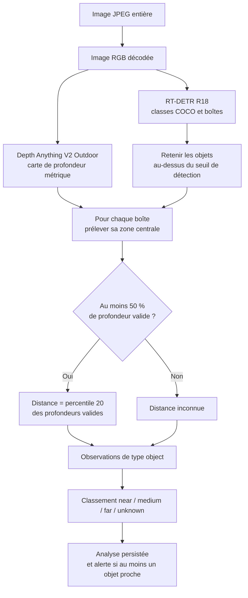
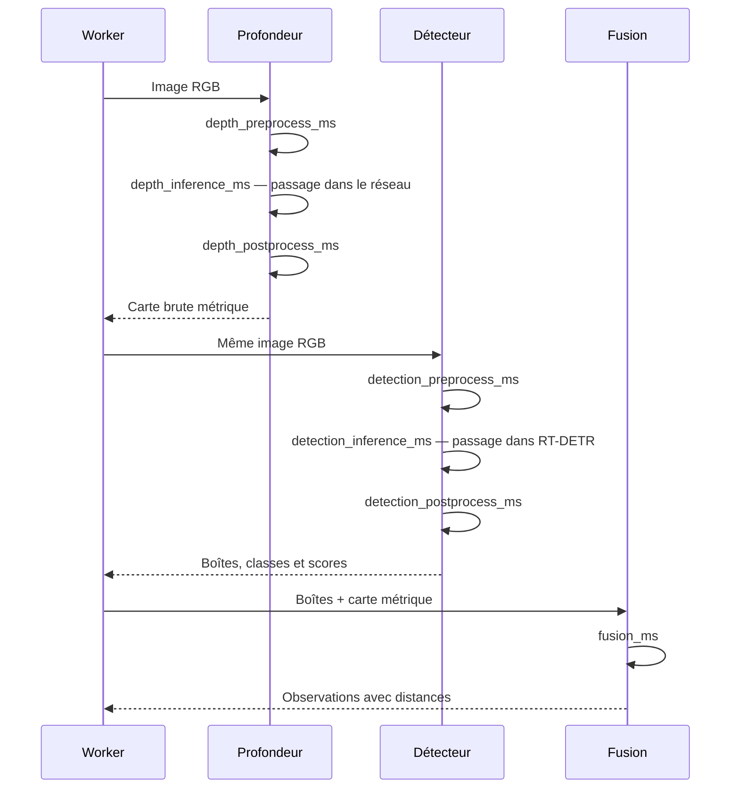
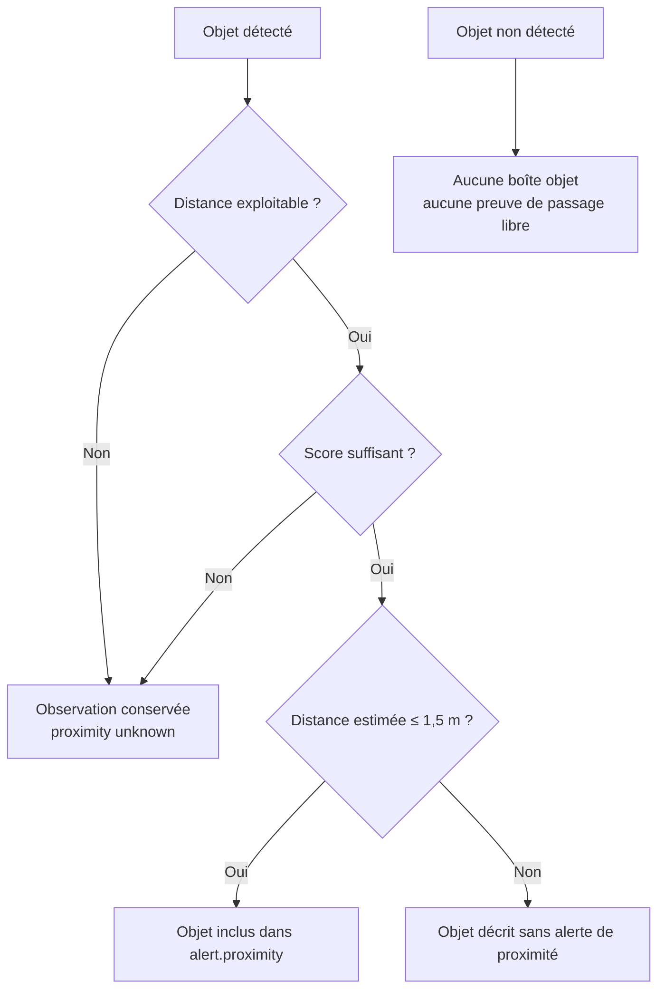

# 09 — Objets urbains, profondeur et temps d’inférence

## Ce que mesure cette campagne

Le provider `urban_objects` associe un détecteur d’objets RT-DETR à une carte de profondeur métrique Depth Anything V2 Outdoor. Il permet de décrire des classes comme `person`, `car`, `bicycle` ou `bus`, puis d’estimer la distance des surfaces contenues dans les boîtes de ces objets. Les alertes de proximité utilisent toujours le seuil de `1.5 m`.

Le temps du passage dans le modèle de profondeur est relevé séparément du prétraitement, de la détection d’objets, de la fusion et de l’attente HTTP/WebSocket. La campagne ne possède aucune distance physique de référence : les mesures en mètres restent les estimations du modèle, pas une vérité terrain.

Le test du **15 octobre 2026** a terminé ses **18 analyses** sur six photos répétées trois fois. Sur ce serveur CPU, le passage dans Depth Anything prend **251,23 ms en médiane**, et l’étape complète de profondeur **262,62 ms**. Des objets sont identifiés dans les six scènes, mais **aucune alerte de proximité n’est produite** au seuil inchangé de `1.5 m`. Les distances retournées, notamment `7.39 m` pour un vélo visuellement au premier plan, ne permettent pas de valider la proximité réelle.

Les preuves de l’exécution sont le [rapport illustré](../output/urban-depth-evaluation/report.html), les [résultats bruts](../output/urban-depth-evaluation/results.json) et la [configuration relevée dans le conteneur](../output/urban-depth-evaluation/runtime.json). Ces fichiers sont des sorties locales de test, régénérables avec la commande ci-dessous.

## Résultats observés

Les mesures proviennent du backend Docker, appelé en HTTP puis observé par WebSocket. Les 18 réponses `frame.analyzed` reçues correspondent à leurs événements persistés et aux captures récupérées par l’API. Le test a conservé les 18 essais, y compris le premier ; aucun échauffement n’a été retiré. `simulated` vaut `false` pour les analyses. La session utilisée est `0967debf-02e2-4387-9490-f83e2e2c82a6`.

| Étape | Médiane, 18 essais | P95, 18 essais |
| --- | ---: | ---: |
| **Réseau Depth Anything seul** — `depth_inference_ms` | **251,23 ms** | **312,94 ms** |
| Profondeur avec préparation et extraction — `depth_total_ms` | 262,62 ms | 324,55 ms |
| Réseau RT-DETR seul — `detection_inference_ms` | 157,45 ms | 185,78 ms |
| Détection avec préparation et post-traitement — `detection_total_ms` | 162,58 ms | 191,66 ms |
| Fusion des objets avec la profondeur — `fusion_ms` | 0,87 ms | 4,16 ms |
| Provider vision complet — `total_vision_ms` | 430,49 ms | 496,19 ms |
| Analyse côté worker — `analysis_latency_ms` | 437,22 ms | 503,73 ms |
| Upload HTTP → analyse reçue par WebSocket | 596,67 ms | 793,21 ms |

Les médianes de plusieurs étapes ne s’additionnent pas nécessairement à la médiane du total : chaque percentile est calculé séparément. Ces durées concernent ce conteneur CPU et ces images ; elles ne mesurent ni le Raspberry Pi ni la capture, le STT ou la restitution audio.

Le tableau suivant reprend les observations du premier passage de chaque photo. Les trois passages conservent les mêmes nombres de détections et ne produisent aucune alerte. Les classes sont les sorties du détecteur, sans annotation de référence permettant de les déclarer toutes correctes.

| Photo | Classes retournées | Observations | Plus petite distance estimée | Alertes sur 3 passages |
| --- | --- | ---: | ---: | ---: |
| Bus et piétons | `bus`, `person` | 5 | 8,305 m | 0 |
| Circulation dans la rue | `bus`, `car`, `motorcycle`, `person`, `truck` | 19 | 6,542 m | 0 |
| Vélos stationnés | `bicycle` | 1 | 7,386 m | 0 |
| Personnes et vélos en contre-jour | `bicycle`, `motorcycle`, `person`, `truck` | 5 | 12,531 m | 0 |
| Passerelle piétonne | `person` | 1 | 25,027 m | 0 |
| Signal pour piétons | `traffic light` | 1 | 3,974 m | 0 |

Le cas des vélos stationnés montre la limite actuelle : plusieurs vélos ou parties de vélos sont visibles au premier plan, mais une seule boîte est retenue et sa distance estimée vaut environ `7.39 m`. Sans distance mesurée sur place, on ne peut pas chiffrer l’erreur ; ce résultat justifie toutefois de ne pas considérer l’estimation comme une mesure de proximité fiable. Le modèle Outdoor employé a été adapté au domaine routier synthétique Virtual KITTI 2 et n’a pas été calibré pour la caméra des lunettes. Le changement de domaine est une piste à évaluer, pas une cause démontrée de ces résultats. Le seuil n’a pas été modifié pour provoquer artificiellement une alerte. [Fiche officielle du checkpoint Outdoor](https://huggingface.co/depth-anything/Depth-Anything-V2-Metric-Outdoor-Small-hf).

La relecture du calcul n’a révélé aucun défaut évident d’unité ou de correspondance des coordonnées : la sortie métrique brute est utilisée sans second facteur d’échelle. Virtual KITTI définit une profondeur axiale `z` par rapport au plan de la caméra ; `distance_m` expose ici cette estimation de profondeur, sans reconstruction d’une portée euclidienne ni étalonnage de télémètre. [Définition de la profondeur dans Virtual KITTI 2](https://europe.naverlabs.com/proxy-virtual-worlds-vkitti-2/).

**Les 18 essais conformes valident l’exécution et le transport des résultats, pas l’exactitude des objets ou des distances.** Zéro alerte signifie qu’aucune estimation retenue n’a satisfait la règle de proximité ; cela ne signifie pas que les scènes sont sûres ou sans obstacle proche.

La règle d’avertissement a été vérifiée séparément dans les tests API avec des observations contrôlées : à `1.2 m` et à la limite de `1.5 m`, une observation de confiance suffisante déclenche une alerte nommant l’objet, persistée puis transmise sur le WebSocket. Au-delà de `1.5 m`, avec une distance inconnue ou un score insuffisant, elle n’en déclenche pas. Ce sont des tests de logique et de protocole ; cette campagne photographique urbaine ne démontre aucun cas positif réel d’alerte.

La vérification finale comprend `154` tests automatisés passés par groupes : `48` pour les API, la proximité et les verrous, `81` pour la vision, `1` pour l’ordre des événements WebSocket et `24` pour le script d’évaluation. Ruff est propre et Alembic ne signale pas de dérive du schéma PostgreSQL. Ces contrôles complètent la campagne HTTP/WebSocket ; ils ne remplacent pas une évaluation des modèles avec des annotations et des distances mesurées.

### Environnement relevé

L’essai s’est déroulé de `14:54:01` à `14:54:13 UTC` le 15 octobre 2026, sur Linux `aarch64`, Python `3.12.15`, PyTorch `2.14.1+cpu`, Transformers `4.57.6`, avec `18` threads PyTorch. Les poids étaient déjà chargés et le périphérique était `cpu`.

| Modèle | Checkpoint | Révision chargée |
| --- | --- | --- |
| Profondeur métrique Outdoor, portée du modèle `80 m` | `depth-anything/Depth-Anything-V2-Metric-Outdoor-Small-hf` | `fd2c22027eaf20374204f14099b8341e1925ad39` |
| Détection COCO | `PekingU/rtdetr_r18vd` | `ac77a11ff0170a41b771c03264987f8ce2b0d753` |

Le seuil proche était `1.5 m`, le seuil lointain `3.0 m`, le score minimum du détecteur et celui de la règle de proximité `0.5`. La limite de `80 m` décrit le domaine numérique du checkpoint, pas une garantie d’exactitude jusqu’à cette distance.

## Architecture de l’analyse



La fusion utilise les `80 %` centraux de chaque boîte pour limiter le mélange avec le fond sur les bords. Elle ne dispose pas d’un masque de segmentation de l’objet. Une zone peut donc toujours mélanger plusieurs surfaces, notamment en cas d’occlusion ou d’objet fin.

Pour une observation `object`, `confidence` correspond au score du détecteur. `depth_valid_fraction` indique séparément la proportion de pixels de profondeur exploitables. Un score élevé de reconnaissance ne prouve pas l’exactitude métrique de la distance.

Les deux modèles sont exécutés successivement dans le provider actuel : profondeur, puis détection, puis fusion. Les flèches du schéma décrivent les dépendances de données et ne signifient pas une exécution parallèle.

## Reproduire le test

Configurer le backend dans `.env` :

```dotenv
LOOKI_VISION_PROVIDER=urban_objects
LOOKI_DEPTH_BACKEND=depth_anything
INSTALL_VISION=true
LOOKI_DEPTH_MODEL_ID=depth-anything/Depth-Anything-V2-Metric-Outdoor-Small-hf
LOOKI_OBJECT_MODEL_ID=PekingU/rtdetr_r18vd
LOOKI_OBJECT_CONFIDENCE_THRESHOLD=0.5
LOOKI_VISION_DEVICE=cpu
LOOKI_NEAR_THRESHOLD_M=1.5
LOOKI_FAR_THRESHOLD_M=3.0
LOOKI_MIN_CONFIDENCE=0.5
```

La valeur de `LOOKI_DEPTH_MODEL_ID` peut aussi rester vide : `urban_objects` choisit alors le checkpoint Outdoor par défaut, tandis que `depth_anything_metric` choisit Indoor. La configuration ci-dessus fixe explicitement le modèle pour reproduire cet essai.

```bash
docker compose up --build -d
curl --fail http://localhost:8000/health/ready
.venv/bin/python scripts/test_real_images.py \
  --base-url http://localhost:8000 \
  --expected-provider urban_objects \
  --images-dir fixtures/urban-images \
  --repeat 3 \
  --output-dir output/urban-depth-evaluation
```

Le backend doit déclarer `vision_provider: urban_objects` avant le test. Le script parcourt les six photos dans l’ordre du manifeste, trois fois, soit `18` soumissions. Chaque soumission utilise un nouvel identifiant et un horodatage courant ; les fichiers ne sont pas des captures vidéo en direct. Le premier essai est conservé, ainsi que les essais lents et les éventuels échecs. Le choix des seuils n’est pas ajusté pour obtenir un nombre d’alertes voulu.

La clé API est fournie par `LOOKI_API_KEY` dans l’environnement ou par `--api-key`. Le fichier `.env` n’est pas une source automatique du secret pour ce script. Les poids des deux modèles sont chargés par le serveur avant l’essai ; le client ne charge aucun modèle.

## Quelle durée correspond à Depth Anything seul ?



| Champ dans `timing_ms` | Ce qu’il mesure |
| --- | --- |
| `depth_preprocess_ms` | Préparation de l’image et transfert des entrées vers le périphérique |
| `depth_inference_ms` | **Exécution du réseau Depth Anything seul**, avec synchronisation du périphérique si nécessaire |
| `depth_postprocess_ms` | Extraction de `predicted_depth` et conversion en tableau NumPy |
| `depth_total_ms` | Somme des trois étapes de profondeur |
| `detection_preprocess_ms` | Préparation des entrées de RT-DETR |
| `detection_inference_ms` | Exécution du réseau RT-DETR seul |
| `detection_postprocess_ms` | Conversion des sorties en boîtes, scores et classes |
| `detection_total_ms` | Somme des trois étapes du détecteur |
| `fusion_ms` | Filtrage des détections et association à la profondeur |
| `total_vision_ms` | Temps total du provider, comprenant profondeur, détection, fusion et opérations intermédiaires |

`latency_ms` mesure le worker et inclut d’autres étapes, notamment le décodage du JPEG et la préparation de la persistance. `http_to_ws_analysis_ms` est mesuré par le client et comprend aussi l’upload, l’attente et la livraison par WebSocket. Le téléchargement et le chargement initial des poids sont exclus des temps de modèle ; le démarrage du TTS et les écouteurs ne sont mesurés par aucun de ces champs.

Les percentiles du rapport utilisent une interpolation linéaire sur les mesures disponibles, avec le nombre d’échantillons indiqué pour chaque métrique. Trois passages sur six photos restent un petit essai local, pas une caractérisation de performance à grande échelle.

## Corpus sélectionné avant prédiction

Les six photographies ont été inspectées visuellement puis inscrites dans le [manifeste](../fixtures/urban-images/manifest.json) avant tout appel de modèle pour cette campagne. La sélection couvre des piétons, véhicules, vélos, structures de passage et signalisation ; elle conserve des conditions difficiles telles que le contre-jour, les objets tronqués et une image monochrome. Toutes les photos sélectionnées doivent rester dans le rapport, même en l’absence d’objet détecté ou d’alerte.

| Photo | Contenu constaté lors de la sélection visuelle | Provenance |
| --- | --- | --- |
| `bus-pedestrians.jpg` | Piétons au premier plan, bus, trottoir et bornes | [Ultralytics — bus.jpg](https://github.com/ultralytics/assets/blob/main/im/bus.jpg) |
| `street-traffic.jpg` | Piétons, voitures, bus, vélos et feux dans une rue | [Depth Anything — demo01](https://github.com/DepthAnything/Depth-Anything-V2/blob/main/assets/examples/demo01.jpg) |
| `parked-bicycles.jpg` | Vélos proches, cadres et roues partiellement visibles | [Depth Anything — demo08](https://github.com/DepthAnything/Depth-Anything-V2/blob/main/assets/examples/demo08.jpg) |
| `people-bicycles-backlight.jpg` | Personnes avec vélos, voitures en arrière-plan, contre-jour marqué | [Depth Anything — demo16](https://github.com/DepthAnything/Depth-Anything-V2/blob/main/assets/examples/demo16.jpg) |
| `pedestrian-bridge.jpg` | Piéton sur une passerelle, garde-corps et structure métallique | [Depth Anything — demo06](https://github.com/DepthAnything/Depth-Anything-V2/blob/main/assets/examples/demo06.jpg) |
| `pedestrian-signal.jpg` | Signal lumineux pour piétons, photographié au téléobjectif | [Wikimedia Commons — Freier Denker](https://commons.wikimedia.org/wiki/File:Pedestrian_LED_Traffic_Light_NYC.jpg) |

Les notes visuelles ne sont pas une annotation exhaustive des objets et ne prescrivent pas les résultats à obtenir. Elles servent à expliquer la sélection. Le signal piéton est une photographie au téléobjectif ; son cadrage ne représente pas la vue d’une caméra portée sur les lunettes.

Les images sont conservées entières, sans recadrage ni synthèse. La préparation applique l’orientation EXIF, une conversion RGB et un redimensionnement proportionnel limité à `1280` pixels sur le plus grand côté, sans agrandissement. Les JPEG finaux utilisent une qualité de `95`. Les originaux, dimensions et empreintes SHA-256 sont conservés dans `fixtures/urban-images/`.

La photographie du signal est publiée par **Freier Denker sous CC0 1.0**, selon sa [fiche Wikimedia Commons](https://commons.wikimedia.org/wiki/File:Pedestrian_LED_Traffic_Light_NYC.jpg). La licence individuelle et l’auteur original des cinq autres photos ne sont pas vérifiés : le manifeste conserve `null` pour ces champs et ne déduit aucun droit photographique de la licence du code des dépôts.

## Interpréter les objets et les avertissements



Le détecteur travaille avec son vocabulaire COCO. Des poteaux, bornes, bordures, trous, vitres ou garde-corps peuvent ne pas être représentés par une classe utile. Les classes connues peuvent aussi être manquées ou mal attribuées. Une photo de signalisation n’implique pas que le système interprète la couleur du feu, le pictogramme ou l’autorisation de traverser.

Une alerte décrit l’objet proche dont la distance estimée est la plus faible. Un dictionnaire traduit les classes courantes pour le TTS français, par exemple `person` en « personne » et `bicycle` en « vélo ». La position « à gauche », « devant » ou « à droite » vient du centre horizontal de sa boîte. Le payload conserve toutes les observations proches, même si le texte en cite une seule. Ce texte est déterministe et ne fait appel à aucun LLM.

Les images sont analysées indépendamment. Il n’existe pas de suivi temporel, de vitesse d’approche, de trajectoire du véhicule ou de calcul du temps avant collision. Le modèle Outdoor utilise un domaine d’apprentissage de scènes routières ; son comportement sur un point de vue piéton et une caméra de lunettes doit être évalué séparément.

Une alerte émise démontre ici que la règle métier a réagi à une estimation proche. Une absence d’alerte ne valide pas la sécurité de la scène. Les prochaines mesures doivent utiliser la caméra finale et des distances relevées dans la scène, par exemple à `0.5`, `1`, `1.5`, `2` et `3 m`, avec des passages libres autant que des obstacles. Il faut comparer les erreurs autour du seuil de `1.5 m` avant toute correction d’échelle, sans appliquer un facteur arbitraire à ces photos.
