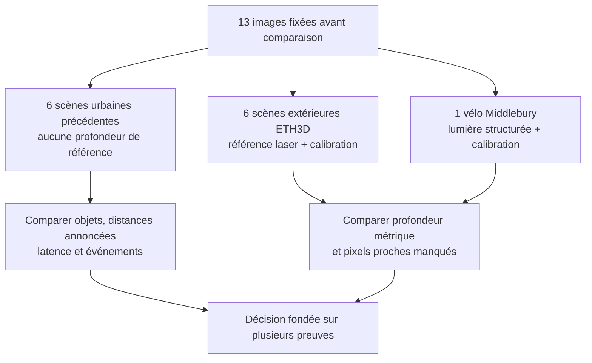
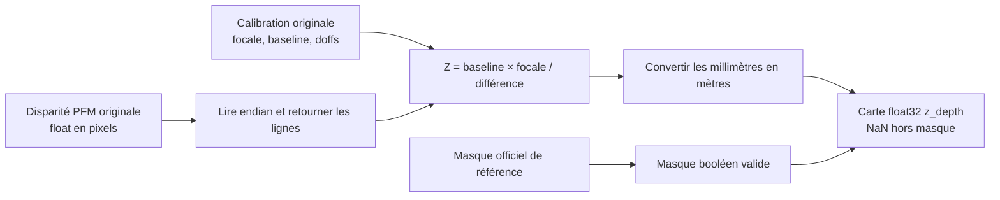
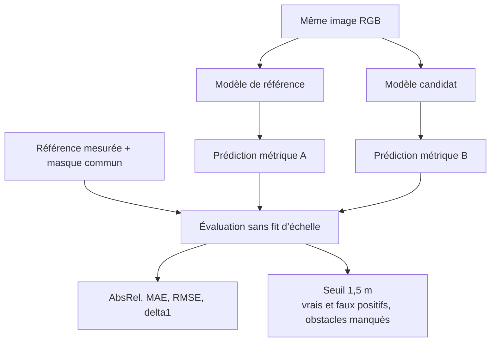

# 10 — Comparaison métrique avec des références mesurées

Le meilleur résultat de cette campagne est **UniDepth V2 avec les intrinsèques réellement mesurées** : sur les six scènes ETH3D, l’erreur relative moyenne par scène passe de `93,02 %` à `20,80 %` par rapport à Depth Anything V2 Outdoor Small. Le rappel des pixels proches atteint `97,65 %`, mais des erreurs subsistent et le vélo Middlebury reste à `39,37 %` d’erreur relative. Ce résultat justifie l’ajout d’une calibration caméra ; il ne permet pas de déclarer le système fiable pour éviter des collisions.

## Question à résoudre

La campagne urbaine précédente renvoyait notamment `7,386 m` pour un vélo au premier plan et aucune alerte à `1,5 m`. Ces photos n’avaient pas de profondeur de référence : elles ont révélé un besoin de validation, mais ne permettaient pas de calculer l’erreur du modèle. Le protocole présent ajoute des scènes calibrées pour comparer les modèles sur une mesure physique indépendante.

Produire une distance plus petite, ou davantage d’alertes, ne suffit pas à prouver une amélioration. Il faut réduire les erreurs de profondeur et les obstacles proches manqués, tout en comptant les fausses alertes. Le seuil reste `1,5 m`, sans facteur de correction choisi après avoir vu les prédictions.



## Premier résultat : caméra estimée depuis le RGB

Le [rapport de comparaison sans calibration](../output/metric-depth-comparison/comparison.html) conserve les treize images et les [mesures détaillées](../output/metric-depth-comparison/comparison.json). Les deux modèles ont produit une carte pour chaque image, sur CPU Linux `aarch64`, PyTorch `2.14.1+cpu`, avec quatre threads. Les treize passages incluent le premier et ne constituent pas un benchmark de latence exhaustif.

| Référence | Indicateur | Depth Anything V2 Outdoor Small | UniDepth V2 ViT-S, caméra estimée |
| --- | --- | ---: | ---: |
| 6 scènes ETH3D | AbsRel moyenne **par scène** | 93,02 % | 39,22 % |
| 6 scènes ETH3D | MAE moyenne **par scène** | 3,306 m | 1,775 m |
| 6 scènes ETH3D | Rappel des pixels proches, sur 31 833 positifs | 0 % | 14,46 % |
| 6 scènes ETH3D | Pixels proches manqués | 31 833 | 27 229 |
| 6 scènes ETH3D | Faux pixels proches | 0 | 1 621 |
| Vélo Middlebury | AbsRel | 122,46 % | 49,79 % |
| Vélo Middlebury | MAE | 4,538 m | 1,846 m |
| Vélo Middlebury | Faux pixels proches, aucun vrai positif dans la scène | 0 | 38 977 |

La baisse de l’erreur moyenne avec UniDepth est réelle sur ces références, mais **le résultat reste insuffisant pour déclarer la proximité fiable**. UniDepth retrouve `4 604` des `4 648` pixels proches de la forêt, tout en manquant les `27 185` pixels proches de l’aire de jeux. Les agrégations par scène évitent que l’image Middlebury, beaucoup plus grande, domine silencieusement les six vues extérieures. Le rapport conserve aussi les agrégations pondérées par pixel, explicitement séparées.

Sur les six anciennes photos de rue, les boîtes identiques ne donnent toujours aucune alerte objet à `1,5 m` pour l’un ou l’autre modèle. Les distances différentes, et parfois très grandes, restent sans vérité terrain. Une baisse isolée de la distance du vélo ne prouve donc pas la justesse des nouvelles estimations. L’expérience suivante fournit les intrinsèques réellement mesurées des sept images de référence, comme condition distincte de ce premier essai.

## Second résultat : calibration physique fournie

Le [rapport calibré](../output/metric-depth-calibrated/comparison.html) reprend exactement les **sept images avec référence**, sans nouvelles photos ni changement de seuil. Les cartes des deux variantes précédentes sont réutilisées ; seule l’inférence UniDepth avec les intrinsèques officielles est ajoutée. La profondeur de référence n’est jamais fournie au modèle et aucun facteur d’échelle n’est ajusté sur les résultats. Les [données détaillées](../output/metric-depth-calibrated/comparison.json) conservent les trois conditions.

| Référence | Mesure | DA2 Outdoor, sans caméra fournie | UniDepth, caméra estimée | UniDepth, calibration fournie |
| --- | --- | ---: | ---: | ---: |
| ETH3D, 6 scènes | AbsRel moyenne par scène | 93,02 % | 39,22 % | **20,80 %** |
| ETH3D, 6 scènes | MAE moyenne par scène | 3,306 m | 1,775 m | **0,997 m** |
| ETH3D, pixels proches | Rappel | 0 % | 14,46 % | **97,65 %** |
| ETH3D, pixels annoncés proches | Précision | Non définie | 73,96 % | **82,03 %** |
| ETH3D, pixels proches manqués | Faux négatifs | 31 833 | 27 229 | **747** |
| ETH3D, faux pixels proches | Faux positifs | 0 | 1 621 | **6 811** |
| Bicycle1 | AbsRel | 122,46 % | 49,79 % | **39,37 %** |
| Bicycle1 | MAE | 4,538 m | 1,846 m | **1,462 m** |
| Bicycle1, aucun vrai proche | Faux pixels proches | 0 | 38 977 | **0** |

Sur ETH3D, les `31 086` vrais pixels proches trouvés par UniDepth calibré expliquent le rappel élevé, mais `747` restent manqués et `6 811` pixels lointains sont annoncés proches. **Ce sont des comptes de pixels, pas des nombres d’obstacles reconnus ni d’alertes WebSocket.** Le traitement actuel ne crée une alerte objet que pour une boîte reconnue suffisamment proche ; certaines surfaces proches de référence, comme les branches et les cordes, ne correspondent pas à son vocabulaire COCO.

Le vélo conserve une erreur élevée malgré une calibration exacte. L’absence de faux pixels proches sur cette image ne signifie donc pas que ses distances sont devenues précises. Les références et les erreurs restent affichées, y compris lorsque le modèle calibré paraît visuellement plus plausible.

Sur ces sept images, le temps médian de l’étape complète de profondeur est de `621,58 ms` pour DA2, `982,21 ms` pour UniDepth sans calibration et `978,73 ms` pour UniDepth calibré. Ce sont des passages uniques sur CPU avec quatre threads, hors chargement des poids et remise à l’échelle pour l’évaluation. Ils ne sont pas directement interchangeables avec la précédente campagne de service à dix-huit threads.

### Conséquence pour la caméra Pi

Le backend sait désormais charger une matrice mesurée, mais aucune calibration de la caméra Pi n’a été inventée à partir des datasets. Sans fichier configuré, UniDepth estime toujours la caméra. Pour poursuivre utilement, il faut calibrer l’objectif et le mode de capture réellement utilisés, envoyer des images rectifiées et vérifier les erreurs ainsi que les alertes à `0,5`, `1`, `1,5`, `2` et `3 m` mesurés.

Pour un objectif d’évitement de collision, ces résultats conduisent aussi à évaluer une mesure matérielle indépendante, par exemple stéréo calibrée ou capteur de distance adapté, avec ses propres zones aveugles. Aucun capteur supplémentaire n’est intégré ou validé dans cette livraison. La monoculaire actuelle reste un prototype d’estimation et d’avertissement.

## Vérification du service et des avertissements

La [vue d’ensemble des résultats](../output/depth-review.html) relie les rapports détaillés. La configuration locale active `urban_objects` avec `unidepth_v2`, sans fichier de calibration globale : les photos libres utilisent donc la caméra estimée. Les matrices ETH3D et Middlebury n’ont pas été réutilisées comme calibration du service pour des photos sans rapport avec ces caméras.

### Six scènes urbaines, trois passages

Le [rapport HTTP/WebSocket UniDepth](../output/urban-unidepth-evaluation/report.html) conserve **18 analyses terminées et zéro alerte**, au seuil inchangé de `1,5 m`. Les [mesures brutes](../output/urban-unidepth-evaluation/results.json) relient les captures aux événements persistés et reçus. Les estimations suivantes restent visibles, y compris les valeurs très grandes :

| Scène | Observation notable du premier passage |
| --- | --- |
| Vélos stationnés | Vélo à `1,700 m`, contre `7,386 m` dans la campagne DA2 ; encore au-dessus du seuil d’alerte |
| Rue avec circulation | Distances d’objets de `60,66 à 163,74 m` |
| Passerelle | Personne à `138,91 m` |

Ces valeurs de rue et de passerelle sont préoccupantes pour l’usage visé et restent dans le rapport. Elles n’ont pas été ramenées artificiellement dans une plage plausible. Sans référence de distance pour ces photos, on ne peut pas chiffrer leur erreur, ni conclure que le vélo à `1,700 m` est désormais correctement mesuré.

| Durée du service, CPU avec 18 threads | Médiane, 18 essais | P95 |
| --- | ---: | ---: |
| API UniDepth `infer()`, pré/post-traitement interne inclus | 860,22 ms | 958,25 ms |
| Étape de profondeur complète | 861,13 ms | 959,10 ms |
| Upload HTTP → analyse reçue par WebSocket | 1 192,01 ms | 1 451,68 ms |

Le provider vision complet prend `1 002,58 ms` en médiane. Sur les trois passages du vélo, l’étape UniDepth prend environ `338 ms` en médiane ; cette image plus petite ne résume pas la latence des autres scènes.

### Cas positifs d’alerte sur les cinq photos antérieures

La [régression sur les cinq photos déjà utilisées](../output/unidepth-real-image-regression/report.html) réexécute tout le corpus, avec le même seuil. Les cinq analyses terminent ; **trois événements `alert.proximity` sont persistés et reçus sur le WebSocket** : les récipients du musée (`vase`, environ `0,81 m`), la verrerie (`vase`, environ `0,69 m`) et les chats sur le canapé (`cat`, environ `1,03 m`). Les deux autres images ne produisent pas d’alerte. [Résultats bruts](../output/unidepth-real-image-regression/results.json).

Ce sont de vraies exécutions du modèle et de la chaîne de messages, avec des distances estimées. Ces cinq photos n’ont pas de profondeur de référence : elles démontrent des cas positifs de transmission d’avertissement, pas leur exactitude physique.

Les tests API complètent cette vérification avec des observations contrôlées aux limites `1,49`, `1,50` et `1,51 m` : le seuil est inclusif à `1,50 m`, l’objet est nommé et l’événement suit le même journal et le même WebSocket. La suite complète comporte **269 tests passés**. Les tests logiciels, les alertes photographiques et les scores de profondeur physique restent trois preuves distinctes.

## Candidats et contraintes

| Candidat | Traitement de la caméra | Intérêt pour LOOKi | Limite à mesurer ou à respecter |
| --- | --- | --- | --- |
| Depth Anything V2 Metric Outdoor Small | Point de comparaison actuel, sans intrinsèques fournies à son interface | Pipeline déjà opérationnel | Domaine routier Virtual KITTI ; exactitude sur lunettes non établie |
| UniDepth V2 ViT-S | Peut estimer les intrinsèques à partir du RGB ; accepte aussi une caméra fournie dans un mode distinct | Candidat compact pour caméra inconnue | Prédiction monoculaire incertaine ; code sous CC BY-NC 4.0 |
| Apple Depth Pro | Estime le champ de vision et la focale | Candidat métrique sans calibration d’entrée | Poids et calcul importants sur ce serveur CPU |
| Metric3Dv2 ViT-S | Conversion métrique dépendant de la focale effective | À considérer lorsque la caméra est calibrée | L’absence d’intrinsèques ne se résout pas en choisissant arbitrairement une focale |
| Depth Anything 3 Metric Large | Profondeur canonique à convertir avec la focale | Candidat pour une caméra connue | Exige une conversion métrique correcte et un runtime distinct |

Les capacités de caméra et les chemins d’inférence viennent des sources des auteurs : [UniDepth V2](https://github.com/lpiccinelli-eth/UniDepth/blob/main/assets/docs/V2_README.md), [Depth Pro](https://huggingface.co/apple/DepthPro-hf), [Metric3D](https://github.com/YvanYin/Metric3D) et [DA3 Metric](https://huggingface.co/depth-anything/DA3METRIC-LARGE). Il ne s’agit pas d’un classement général de précision.

La comparaison principale doit utiliser le même scénario « image RGB, caméra inconnue ». Les intrinsèques des datasets servent à établir et vérifier la référence. Une éventuelle expérience où le modèle reçoit cette calibration doit être annoncée séparément : elle ne représente pas la même information disponible à l’entrée.

## Références physiques et provenance

### Six scènes extérieures ETH3D

Le [manifeste ETH3D local](../fixtures/metric-reference/manifest.json) fixe six photographies monochromes réelles, choisies par inspection des images et de leur référence avant les prédictions. Elles proviennent des archives officielles du benchmark. La géométrie de référence est issue de mesures de scanner laser enregistrées avec les caméras. [Dataset ETH3D](https://www.eth3d.net/datasets), [publication décrivant l’acquisition](https://www.eth3d.net/data/schoeps2017cvpr.pdf).

| Scène | Contenu | Pixels évaluables | Pixels de référence à ≤ 1,5 m | Profondeur minimale valide |
| --- | --- | ---: | ---: | ---: |
| `playground_3l` | Poteaux et cordes d’une aire de jeux | 171 079 | 27 185 | 1,090 m |
| `forest_1s` | Branches et végétation | 122 711 | 4 648 | 0,693 m |
| `facade_1s` | Façade, murs et fenêtres | 196 669 | 0 | 1,921 m |
| `terrace_2s` | Tables, bancs et façade extérieure | 160 672 | 0 | 2,449 m |
| `electro_1l` | Porte et équipements techniques extérieurs | 369 772 | 0 | 2,725 m |
| `playground_1l` | Équipement d’aire de jeux et bâtiments | 216 801 | 0 | 1,614 m |

Les deux scènes ayant une référence proche sont conservées même si le détecteur COCO ne reconnaît pas leurs branches, poteaux ou cordes. C’est une limite du périmètre des objets connus à observer, pas une raison de retirer des images.

### Un vélo Middlebury, conservé séparément

Le [manifeste Bicycle1](../fixtures/metric-bicycle-reference/manifest.json) accompagne une photo réelle couleur, prise en intérieur. Sa référence provient d’une acquisition calibrée par lumière structurée. La scène est conservée à sa résolution native de `2988 × 2008`. [Fichiers officiels Bicycle1](https://vision.middlebury.edu/stereo/data/scenes2014/datasets/Bicycle1-perfect/), [méthode d’acquisition](https://www.cs.middlebury.edu/~schar/papers/datasets-gcpr2014.pdf).

Sur ses `5 856 704` pixels valides, la profondeur va de **2,940 à 4,084 m**, avec une médiane d’image de **3,802 m**. Il n’y a aucun vrai pixel proche à `1,5 m`. Ce résultat illustre pourquoi le cadrage seul ne suffit pas : le vélo occupe une grande partie de l’image, mais la calibration et la disparité le situent à plusieurs mètres. Cette photo contrôle l’échelle et les erreurs sur un vélo ; elle n’ajoute pas un cas positif d’alerte.

### Conversion des sources en profondeur



La formule utilisée est :

```text
z_m = (baseline_mm / 1000) * fx_px / (disparity_px + doffs_px)
doffs_px = cx_droite - cx_gauche
```

La référence est une profondeur axiale `z`, pas une portée euclidienne. La calibration est conservée dans chaque entrée `intrinsics` du manifeste. Les six focales ETH3D ont été vérifiées avec le fichier indépendant `cameras.txt`; les baselines en mètres ont été comparées aux extrinsèques `images.txt`, avec un écart inférieur à `10 µm` dû aux arrondis des fichiers. [Convention de calibration](https://vision.middlebury.edu/stereo/data/scenes2014/).

Le signe du marqueur PFM détermine l’ordre des octets ; les lignes sont stockées du bas vers le haut. L’amplitude du marqueur n’est pas appliquée aux disparités : Bicycle1 utilise `-0.003922` mais contient déjà des valeurs en pixels. Multiplier par cette amplitude fausserait la référence. [Spécification officielle Middlebury](https://vision.middlebury.edu/stereo/submit3/upload-format.html).

Pour ETH3D, seuls les pixels `mask0nocc == 255`, observés dans les deux vues, sont retenus, avec une disparité finie et un dénominateur positif. Les pixels `128`, visibles dans la seule image gauche, sont exclus. Pour Bicycle1, le masque retient les disparités finies, le dénominateur positif et au moins un échantillon de lumière structurée dans `disp0-n.pgm`. Ces deux masques n’ont donc pas exactement le même sens. [Documentation ETH3D](https://www.eth3d.net/documentation).

Les sources restent dans `originals/`; les cartes `ground-truth/*_depth.npy` sont des `float32` en mètres, les masques `*_valid.npy` sont booléens. Les pixels invalides valent `NaN`. Les JPEG conservent la grille originale, sans redimensionnement ni recadrage. Les manifestes contiennent les SHA-256 des fichiers d’entrée et des cartes préparées.

## Comparaison sans ajuster l’échelle après coup

La plage commune d’évaluation est fixée à `[0,1 ; 80] m` sur les pixels de référence valides. Le même masque est appliqué à chaque modèle. Une prédiction positive au-delà de `80 m` reste une erreur évaluée, sans clipping ni exclusion de convenance. Les sorties sont remises sur la grille de référence sans changer leur unité. Aucun ajustement multiplicatif, alignement médian ou décalage calculé à partir de la référence n’est autorisé dans la comparaison métrique.



| Mesure | Interprétation |
| --- | --- |
| AbsRel | Moyenne de l’erreur absolue divisée par la profondeur de référence |
| MAE en mètres | Écart absolu moyen en unité physique |
| RMSE en mètres | Erreur quadratique, plus sensible aux grands écarts |
| `delta1` | Fraction dont le rapport prédiction/référence reste inférieur à `1.25` dans les deux sens |
| Précision proche | Parmi les pixels annoncés proches, part réellement proche |
| Rappel proche | Parmi les pixels réellement proches, part annoncée proche |
| F1 proche | Combinaison de la précision et du rappel lorsqu’elle est définie |

Les comptes de pixels proches doivent accompagner les pourcentages. Un rappel proche n’a pas de sens sur une image sans positif de référence. Le rapport doit aussi signaler les prédictions invalides et éviter de les retirer silencieusement du dénominateur pour améliorer un score.

Une mesure de profondeur par pixel n’est pas une évaluation de la détection d’objets. Pour les six anciennes photos de rue, les boîtes RT-DETR doivent rester identiques entre les variantes de profondeur : cela isole l’effet du modèle métrique sur les distances et avertissements. Sans référence physique pour ces six photos, leur tableau reste une observation de comportement, pas un score d’exactitude.

## Lire les durées et les essais interrompus

Les temps doivent conserver le périphérique, la précision numérique, les threads, le checkpoint et le périmètre du chronomètre. `depth_inference_ms` correspond au passage pur dans le réseau pour l’adapter Depth Anything existant. Pour UniDepth, l’API officielle `infer()` englobe aussi son prétraitement et son post-traitement internes : la métadonnée `depth_timing_scope` doit expliciter cette différence. Comparer les étapes complètes de profondeur est plus pertinent que d’assimiler ces deux champs à des appels réseau strictement identiques.

Un essai interrompu pour coût de calcul ne fournit aucune prédiction exploitable et ne reçoit aucun score de qualité. Il doit rester dans le bilan des candidats comme limite d’exécution sur la machine testée, avec son budget et les ressources observées. Les temps publiés par les auteurs sur GPU ne remplacent pas les durées locales CPU.

Deux essais Depth Pro ont été enregistrés sur Docker CPU avec quatre threads. Le premier, en `bfloat16`, a été interrompu après `200,19 s` sans prédiction. Le second, en `float32`, s’est terminé par `SIGKILL` (`-9`) après `32,58 s`, également sans prédiction. Une pression mémoire est possible, mais ces traces ne suffisent pas à établir la cause du signal. Depth Pro n’est donc pas retenu pour cette machine dans cet essai ; aucune conclusion sur sa précision n’est tirée. [Trace bfloat16](../output/metric-depth-comparison/depthpro-bf16-pilot.json), [trace float32](../output/metric-depth-comparison/depthpro-fp32-pilot.json).

## Reproduire les références

Depuis la racine du dépôt, avec les dépendances de développement installées :

```bash
.venv/bin/python scripts/prepare_metric_reference.py \
  --cache-dir /tmp/looki-eth3d-reference
.venv/bin/python scripts/prepare_bicycle_reference.py \
  --cache-dir /tmp/looki-middlebury-bicycle
```

La préparation ETH3D nécessite `bsdtar`, `7z` ou `7zz`. Les deux scripts vérifient les empreintes attendues des téléchargements avant conversion. Ils ne chargent aucun modèle. Leur sortie ne doit pas être remplacée par une carte prédite ou une profondeur tirée de l’apparence visuelle.

### Rejouer les deux conditions d’inférence

La commande suivante utilise l’image Docker construite avec `INSTALL_VISION=true`, quatre threads et les boîtes du rapport urbain déjà produit. Elle écrit dans un nouveau dossier de reproduction pour préserver les preuves de la campagne décrite ci-dessus. Les poids sont téléchargés ou relus dans le cache du service.

```bash
for depth_model in depth_anything_v2 unidepth_v2; do
  docker compose run --rm -T --no-deps -v "$PWD:/workspace" backend \
    python /workspace/scripts/predict_metric_depth.py \
    --model "$depth_model" --device cpu --threads 4 \
    --image-manifest /workspace/fixtures/urban-images/manifest.json \
    --image-manifest /workspace/fixtures/metric-reference/manifest.json \
    --image-manifest /workspace/fixtures/metric-bicycle-reference/manifest.json \
    --detections-results /workspace/output/urban-depth-evaluation/results.json \
    --output-dir /workspace/output/metric-depth-reproduction
done

.venv/bin/python scripts/compare_metric_depth.py \
  --manifest output/metric-depth-reproduction/predictions.json \
  --output-dir output/metric-depth-reproduction
```

La variante calibrée réutilise ces cartes et ne conserve que les sept images ayant une référence :

```bash
docker compose run --rm -T --no-deps -v "$PWD:/workspace" backend \
  python /workspace/scripts/predict_metric_depth.py \
  --model unidepth_v2 --device cpu --threads 4 --calibrated \
  --reuse-manifest /workspace/output/metric-depth-reproduction/predictions.json \
  --image-manifest /workspace/fixtures/metric-reference/manifest.json \
  --image-manifest /workspace/fixtures/metric-bicycle-reference/manifest.json \
  --output-dir /workspace/output/metric-depth-calibrated-reproduction

.venv/bin/python scripts/compare_metric_depth.py \
  --manifest output/metric-depth-calibrated-reproduction/predictions.json \
  --output-dir output/metric-depth-calibrated-reproduction
```

Toujours fournir `--output-dir` au comparateur pour conserver chaque expérience dans son propre dossier. Le script de prédiction utilise ici les intrinsèques de chaque image du manifeste ; ce mode de comparaison hors ligne ne configure pas la caméra globale du service FastAPI.

## Licences et portée

ETH3D est publié sous **CC BY-NC-SA 4.0**, avec attribution et restriction non commerciale. UniDepth indique **CC BY-NC 4.0** dans son dépôt. Le caractère « POC » ou « interne » ne constitue pas à lui seul une permission d’usage commercial. [Licence ETH3D](https://www.eth3d.net/), [dépôt UniDepth](https://github.com/lpiccinelli-eth/UniDepth).

Depth Pro possède des conditions Apple distinctes pour ses artefacts ; la fiche du checkpoint et les fichiers de licence doivent être considérés séparément de la disponibilité du code. Les sources Middlebury consultées ne donnent pas de licence explicite générale pour Bicycle1 : `license: null` conserve cette incertitude. Les droits des six photos de rue restent ceux détaillés dans leur manifeste, sans hériter automatiquement de la licence d’un modèle.

Même une amélioration sur ces références ne suffit pas à valider les lunettes : ETH3D est monochrome, certaines scènes partagent le même lieu, Bicycle1 est une scène intérieure statique et les corpus publics peuvent avoir participé à l’apprentissage de certains modèles. La prochaine étape reste une mesure avec la caméra Pi, ses intrinsèques et des obstacles placés à des distances connues autour du seuil. Les erreurs proches, les objets non détectés et les fausses alertes doivent être conservés dans cette évaluation.
