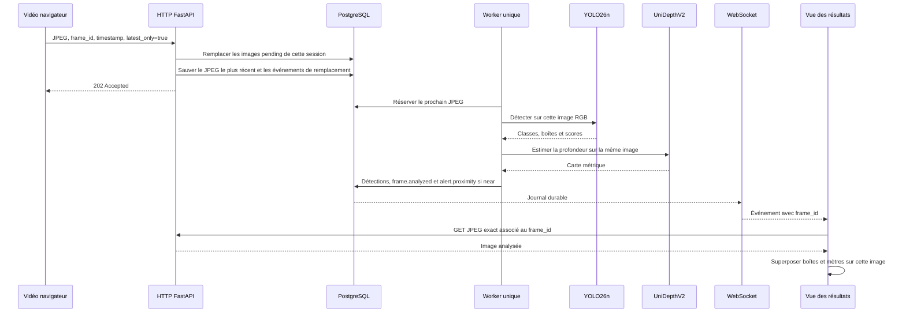
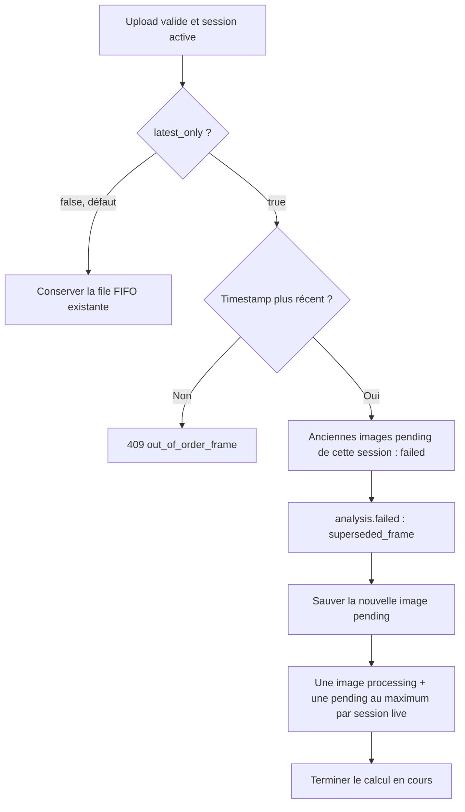
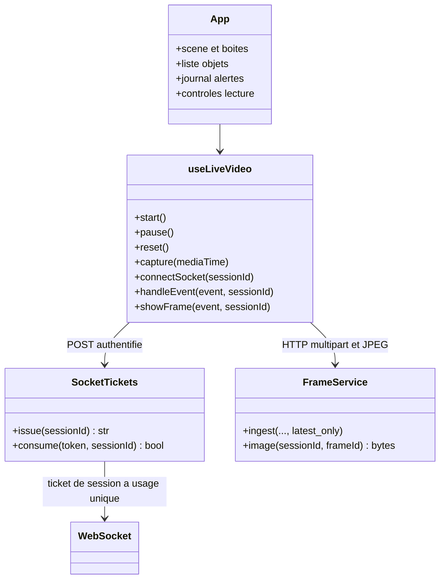

# 11 — Vidéo réelle, YOLO26 Nano et profondeur en direct

Le tableau de bord est servi par FastAPI sur **[/live/](http://127.0.0.1:8000/live/)**. La vidéo est décodée dans le navigateur ; des JPEG sont envoyés vers le même endpoint que celui du Pi. YOLO26n détecte les objets, UniDepthV2 estime leur profondeur et le service métier applique les seuils. Aucun résultat de vision n’est simulé dans ce mode.

Source autonome : [13-video-live.mmd](diagrams/13-video-live.mmd).

## Démarrer depuis le dépôt backend

La configuration locale de la démonstration est déjà activée. Pour la reproduire après clonage, copier `.env.example` vers `.env`, puis renseigner :

```dotenv
INSTALL_VISION=true
LOOKI_VISION_PROVIDER=yolo_objects
LOOKI_DEPTH_BACKEND=unidepth_v2
LOOKI_DEPTH_MODEL_ID=
LOOKI_CAMERA_CALIBRATION_PATH=
LOOKI_UNIDEPTH_RESOLUTION_LEVEL=0
LOOKI_VISION_DEVICE=cpu
LOOKI_CPU_THREADS=4
LOOKI_YOLO_IMAGE_SIZE=640
BACKEND_CPUS=4
BACKEND_MEMORY=6g
LOOKI_DEMO_VIDEO_PATH=/app/media/night-walk.mp4
```

Placer le MP4 dans `media/night-walk.mp4`, ou laisser `LOOKI_DEMO_VIDEO_PATH` vide et choisir une vidéo avec le bouton **Autre vidéo**. Le navigateur ne transmet que les JPEG extraits ; le MP4 choisi reste local. Le clip fourni pour cette campagne a été copié dans `media/`, sans modifier l’original. Les médias, poids et résultats `output/` sont ignorés par Git.

```bash
docker compose up --build -d --wait
docker compose logs --tail=100 backend
```

Ouvrir `/live/` et cliquer sur **Lancer l’analyse**. Une autre clé API peut être saisie dans les paramètres avant l’ouverture de session. La clé reste en mémoire dans l’onglet. Le chargement initial des poids requiert Internet ; les inférences suivantes se font dans le conteneur, avec le cache persistant `model_cache`. Une indisponibilité du modèle échoue explicitement, sans basculement silencieux vers le mock.

Le profil Compose limite le **backend** à quatre CPU et 6 Gio ; PostgreSQL est un conteneur distinct. Les 32 Go correspondent à la VM envisagée, pas à une obligation mémoire de ces modèles ni à une garantie de débit.

## Chemin d’une image



La source vidéo continue à sa cadence normale. La grande vue affiche le dernier **JPEG effectivement analysé**, avec son instant dans la vidéo et son âge. Elle ne superpose pas une profondeur ancienne à une nouvelle scène. Les changements d’image asynchrones sont protégés contre les réponses HTTP arrivant en retard.

La capture cible 15 images/s à 960 pixels de large, JPEG qualité 82 %. Un seul upload est simultanément en vol ; un créneau manqué est compté comme capture non envoyée. Les statistiques distinguent cible, débit envoyé, débit calculé, refus, remplacements et alertes. Le débit affiché utilise les cinq dernières secondes ; il revient à zéro lorsque la lecture est en pause.

## File d’attente et fraîcheur



Le mode normal reste FIFO. Le mode `latest_only` est optionnel et ne supprime pas les images des autres sessions. L’image en cours de calcul se termine ; les images en attente sont remplacées dans la transaction d’admission. Un JPEG invalide ne remplace rien. Une répétition exacte reste idempotente. Un ancien timestamp ne peut pas écraser une capture plus récente.

`superseded_frame` signifie **non analysée**, pas absence d’obstacle. Le frontend le compte séparément d’une erreur de modèle. Ce compromis limite l’accumulation du retard, mais un obstacle présent uniquement dans une image remplacée peut être manqué. La limite globale d’admission, les limites de taille et les contrôles d’âge restent applicables. Une session seule a au maximum deux travaux actifs ; plusieurs sessions partagent un seul worker et réduisent le débit disponible par session.

Les JPEG remplacés restent stockés pour l’audit, avec leur statut et leur événement. **Le disque croît donc avec le nombre d’images reçues**, même si la file de calcul est bornée. Une politique de rétention ou un stockage objet constitue une évolution nécessaire pour un flux permanent. Aucune purge automatique de données n’est ajoutée ici.

## Modèles, fusion et alertes

| Élément | Configuration exécutée |
| --- | --- |
| Détection | `Ultralytics/YOLO26/yolo26n.pt`, révision `070ac3c51435984d992ba92eb3f234daf4e4500d` |
| Bibliothèque | `ultralytics==8.4.182`, poids officiels épinglés |
| Entrée YOLO | `imgsz=640`, score minimum 0,5, maximum 100 objets |
| Profondeur | UniDepthV2 VITS14, résolution officielle `0`, intrinsèques estimées |
| Fusion | Percentile 20 des profondeurs valides dans les 80 % centraux de chaque boîte |
| Couverture requise | 50 % de pixels valides, sinon distance inconnue |
| Proximité | `near` à ≤ 1,5 m ; `far` à ≥ 3 m ; sinon `medium` |

YOLO26n est présenté comme le modèle Nano d’environ 2,4 millions de paramètres dans la [fiche officielle](https://huggingface.co/Ultralytics/YOLO26). Les chiffres CPU publiés dans la [documentation Ultralytics](https://docs.ultralytics.com/models/yolo26/) dépendent de leur matériel et de leur format d’exécution ; ils ne prédisent pas le débit de cette VM avec UniDepth. La fiche publie les conditions AGPL-3.0 du modèle.

YOLO traite chaque image indépendamment ; ni tracking ni modèle vidéo temporel ne sont activés. Les boîtes ne sont pas des masques : fond, occlusions et catégories absentes de COCO limitent la couverture. UniDepth retourne une profondeur axiale en mètres ; ce n’est pas une portée euclidienne mesurée avec un télémètre. Le score YOLO exprime la détection, pas la précision des mètres. Les valeurs restent brutes : aucun facteur n’est appliqué pour fabriquer une alerte.

Chaque image terminée avec au moins un objet `near` produit **un** événement durable `alert.proximity`, regroupant les objets proches. Les seuils et la politique sont ceux du backend existant. Le panneau affiche exclusivement les alertes reçues par WebSocket. Une distance inconnue n’est jamais convertie en zéro ; aucune alerte n’est inventée dans le navigateur.

## Mesures sur le clip de New York

Campagne du 19 octobre 2026, vidéo fournie de 45,06 s, 1280 × 720, environ 29,97 images/s. SHA-256 du MP4 : `47a5d5f8aa57e0f22c3fb647980026ae227ffa4dbc1c184760964e118dce4be0`.

Environnement : Docker local **aarch64**, backend limité à **4 CPU / 6 Gio**, quatre threads de calcul, sans GPU. Ce budget reproduit une contrainte CPU, mais ce n’est pas un benchmark de la future VM x86/32 Go. Les relevés ponctuels Docker ont montré environ 0,85 à 1,05 Gio pour le backend ; ce ne sont pas des mesures de pic garanti.

| Résultat de la campagne complète | Valeur |
| --- | ---: |
| JPEG envoyés et acceptés | 673 / 673 |
| Débit d’envoi mesuré | 14,95 images/s |
| Images analysées réellement | 67 |
| Images remplacées avant inférence | 606 |
| Créneaux sautés par le client | 3 |
| Échecs d’analyse hors remplacement | 0 |
| Débit complet YOLO + profondeur | **1,45 image/s** |
| YOLO, p50 / p95 | 25 / 32 ms |
| Profondeur, p50 / p95 | 645 / 680 ms |
| Vision complète, p50 / p95 | **672 / 718 ms** |
| Distance minimale estimée | 2,15 m |
| Alertes au seuil de 1,5 m | 0 |
| Journal HTTP identique au flux WebSocket | Oui |

Les temps incluent le premier échantillon et portent sur les 67 calculs. Le chargement des poids n’est pas inclus. La durée vision exclut l’attente en file, le réseau et l’affichage. Le test d’envoi a duré 45,02 s et la collecte totale environ 46,35 s.

**Cette configuration ne calcule pas la profondeur de 15 images/s.** Elle reçoit le flux à cette cadence et analyse les images les plus récentes à environ 1,45/s. La profondeur est le principal coût. Une validation de 15 analyses complètes/s demande un autre budget de calcul ou une architecture où la profondeur est moins fréquente, avec une gestion explicite de son âge et des mouvements ; cette dernière variante n’est pas activée ici.

Un premier passage avec la résolution UniDepth standard avait calculé 24 images sur 667 reçues. Avec le niveau 0 mais avant correction du réglage interne des threads Ultralytics, un deuxième passage avait calculé 53 images sur 674 reçues, à 865 ms de vision en médiane. La configuration finale réapplique quatre threads au démarrage de chaque prédiction, après l’initialisation du predictor Ultralytics ; les résultats du tableau correspondent à cette correction. Les images retenues changent avec la cadence de traitement : la différence de distance minimale entre passages ne mesure pas un gain de précision. Le niveau officiel `0` accélère le traitement ; cette vidéo sans distances de référence ne permet pas de conclure sur son erreur métrique. Aucun seuil n’a été relevé pour provoquer artificiellement une alerte.

## Vérification réelle du déclenchement

Le corpus existant `fixtures/real-images/` a été rejoué avec les mêmes modèles et réglages : cinq photos, cinq essais conformes au protocole, **deux alertes réellement persistées et reçues par WebSocket**. Sur `museum-vessels.jpg`, la profondeur minimale associée aux vases est de 0,91 m ; sur `coco-cats-sofa.jpg`, celle d’un chat est de 1,02 m. Les trois autres photos n’ont pas produit d’objet retenu au seuil YOLO. Ces scènes d’intérieur vérifient le chemin positif des alertes ; elles ne constituent pas une validation de précision urbaine.

L’absence d’alerte sur le clip ne prouve pas l’absence de danger : il n’existe pas de vérité terrain métrique pour cette vidéo, et les images remplacées ne sont pas inspectées. Voir la [campagne métrique précédente](10-metric-depth-comparison.md) et refaire les mesures avec la caméra finale pour évaluer faux négatifs et erreur en mètres.

## Rejouer et inspecter les preuves

```bash
# Nécessite ffmpeg installé sur la machine de test, en plus des dépendances dev.
.venv/bin/python scripts/test_live_video.py \
  --video media/night-walk.mp4 --fps 15 \
  --output output/nyc-yolo-live/four-threads

.venv/bin/python scripts/test_real_images.py \
  --expected-provider yolo_objects \
  --images-dir fixtures/real-images \
  --output-dir output/nyc-yolo-live/four-threads-photos
```

`results.json` conserve les envois, correspondances vidéo/frame_id, événements, temps, provenance, configuration et erreurs. Le script vidéo compare le journal HTTP à la réception WebSocket et contrôle qu’une image avec des objets proches a exactement une alerte, tandis qu’une image sans objet proche n’en a aucune. Le script photo produit aussi un rapport HTML autonome. Les rapports de cette exécution sont locaux et ignorés par Git ; les scripts permettent de les reproduire.

Les tests automatisés couvrent la fusion sans modification des mètres, les profondeurs inconnues, la file FIFO et le mode latest, l’idempotence, les uploads anciens/invalides, l’isolation entre sessions, les tickets et la lecture exacte des JPEG. Ils emploient des sorties contrôlées pour vérifier les règles ; les campagnes ci-dessus exécutent les modèles réels.

## Frontend et authentification navigateur



Le frontend React est construit par Vite dans un étage Node du Dockerfile, puis copié dans `app/static/` de l’image Python. Aucun serveur Node n’est nécessaire en production. Le hook gère les appels réseau et la capture ; `App.jsx` gère la présentation ; `metrics.js` contient les calculs testables. Les contrôles et mesures restent stables, sans animation des chiffres d’inférence.

L’API WebSocket native du navigateur ne permet pas un en-tête Bearer arbitraire : le frontend obtient un ticket avec un POST authentifié, puis l’utilise à l’ouverture du WebSocket. Le ticket expire après 30 s, est lié à une session et consommé une seule fois. La clé permanente n’apparaît pas dans l’URL. La connexion native du mobile avec Bearer reste disponible. Le service de tickets est en mémoire et suppose l’unique processus déjà prévu par ce POC.

En cas de rupture, la lecture s’arrête. Le client obtient un nouveau ticket et rejoue le journal depuis son dernier identifiant durable ; les événements sont dédupliqués. La reprise vidéo se fait explicitement avec **Reprendre**. Masquer l’onglet met aussi la lecture en pause. Les alertes du journal sont des événements historiques : leur horodatage doit être vérifié avant toute vocalisation comme danger actuel.

Pour développer l’interface :

```bash
npm --prefix frontend ci
npm --prefix frontend run dev
npm --prefix frontend test
npm --prefix frontend run build
```

Validation de cette livraison : **282 tests Python**, **4 tests frontend**, build Vite et Compose réussi ; les **13 sources Mermaid** et 62 schémas intégrés sont valides. Les largeurs 390, 768 et 1440 px ont été inspectées dans des cadres navigateur, ainsi que la lecture réelle et la pause. Un redémarrage réel du backend a vérifié la pause automatique, les tentatives répétées de reconnexion, le rejeu des résultats et la reprise manuelle de la vidéo.

Le proxy Vite relaie `/api` (HTTP et WebSocket) et `/health` vers le backend local. Les ressources finales sont servies sous `/live/`.

## Évolution : masques et suivi

Les mesures ci-dessus restent la référence du provider à boîtes `yolo_objects`. Le mode local utilise désormais `yolo_seg_track`. Voir [le chapitre 12](12-segmentation-suivi.md) pour les masques, le suivi, les alertes possibles et les nouveaux résultats.
