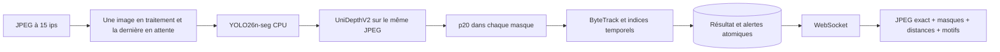
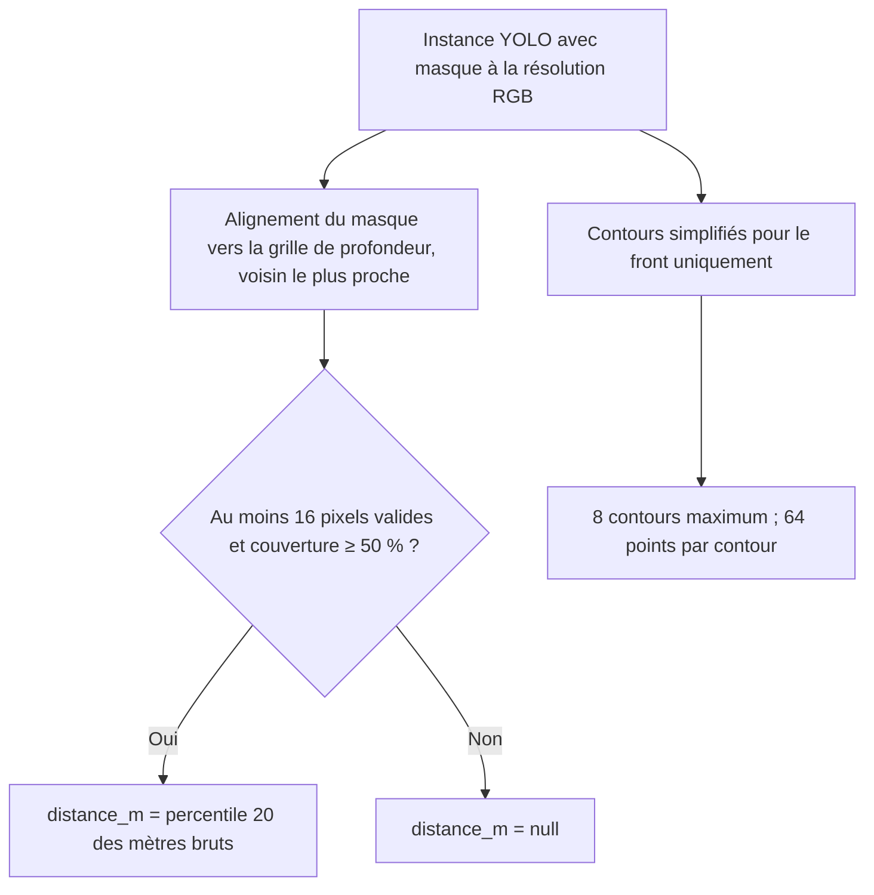
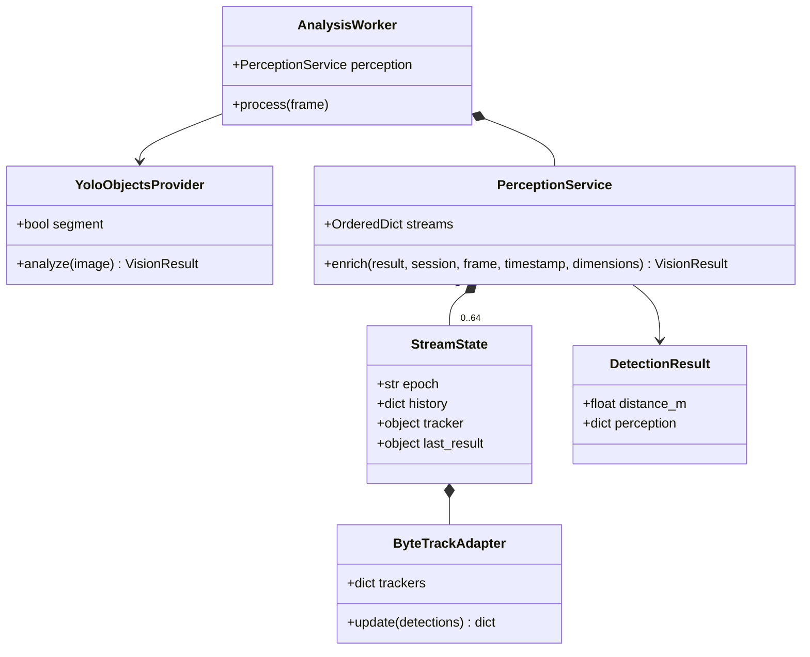
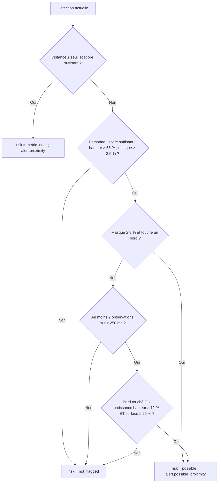
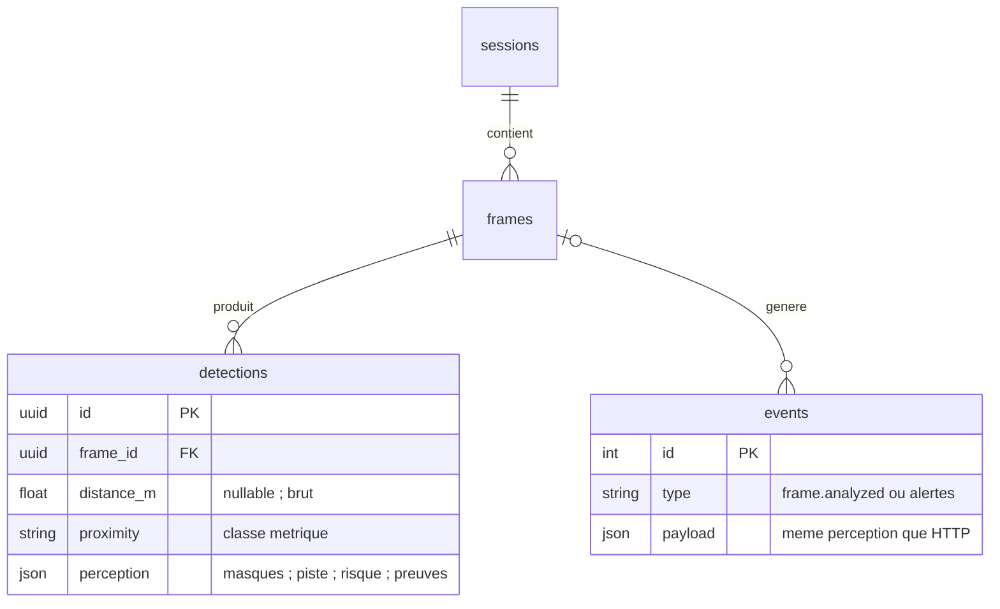

# Segmentation, suivi et proximité possible

> Référence historique de la première campagne synchrone (règles v2, 4 threads). Le fonctionnement courant, les règles v3 et les mesures après séparation de la profondeur sont documentés au [chapitre 13](13-profondeur-independante.md). `LOOKI_DECOUPLED_DEPTH=false` réactive la cadence synchrone, avec les règles v3 du code actuel.

Le provider `yolo_seg_track` utilise **YOLO26n-seg**, **UniDepthV2** et **ByteTrack** sur le serveur. Il corrige l'échantillonnage de profondeur dans les boîtes et ajoute une alerte prudente lorsqu'une personne semble proche malgré une profondeur incompatible. Il ne transforme pas une profondeur monoculaire en mesure physique validée. La calibration du Pi reste reportée.

## Flux réel



Le détecteur et la profondeur sont exécutés séquentiellement dans l'unique worker. Le suivi reçoit seulement les images effectivement analysées, pas les 15 images entrantes par seconde. Une image remplacée dans la file ne produit ni détection ni historique inventé.

Les poids officiels `Ultralytics/YOLO26/yolo26n-seg.pt` sont figés à la révision `070ac3c51435984d992ba92eb3f234daf4e4500d`. `ultralytics==8.4.182` et `lap==0.5.13` sont verrouillés dans `uv.lock`. Le callback CPU réapplique 4 threads après l'initialisation du predictor Ultralytics.

## Mesure dans le masque



Pixels valides : valeur finie, positive, inférieure ou égale à la portée configurée du modèle. Un masque absent ou trop petit ne provoque aucun repli sur la boîte. Les contours affichés sont simplifiés ; le calcul de profondeur utilise le masque binaire complet. Les trous sont rendus par remplissage SVG `evenodd`.

`confidence` reste le score YOLO, `depth_valid_fraction` la fraction de pixels exploitables. Aucun des deux n'est une confiance calibrée dans les mètres. Le percentile décrit une profondeur sur l'objet, pas la distance euclidienne garantie jusqu'à son point physique le plus proche.

## Classes et responsabilités



ByteTrack est séparé par classe pour éviter une association personne/voiture. Le `track_id` comprend un UUID d'époque, la classe et l'identifiant local. Il désigne une piste temporaire, pas une identité de personne. Les associations peuvent échouer ou changer après occlusion. Aucune boîte prédite sans détection actuelle n'est publiée.

Un saut de plus de 2 secondes, une capture non croissante ou un changement de dimensions réinitialise l'époque. Le cache contient au maximum 64 sessions et expire après 60 secondes d'inactivité ; l'historique des pistes expire après 2 secondes. Le dernier résultat est réutilisé lors d'une reprise du même `frame_id`, sans doubler les observations. Le suivi est en mémoire : un redémarrage crée de nouvelles identités, les résultats passés restent en base.

Le frontend interdit le déplacement dans la vidéo pendant une session, y compris en pause. « Recommencer » clôture la session et permet de choisir une position avant un nouveau suivi.

## Règles `person-visual-v2`

Les seuils visuels sont des heuristiques explicites du POC, initialement définies dans `app/services/perception.py`, pas des conversions de pixels en mètres. La nouvelle règle vise les **personnes** ; les alertes métriques continuent de s'appliquer aux autres classes détectées.



Le bord est détecté dans les 2 % extérieurs gauche/droite/bas du masque ; le haut seul ne suffit pas. La croissance compare deux observations espacées de 250 ms à 2 secondes. La branche immédiate évite d'attendre une association stable pour une silhouette déjà très présente et tronquée par le cadrage. Cette branche a été ajoutée après le premier passage réel, qui ne suivait pas assez longtemps certains passants rapides.

Les raisons sont sérialisées dans `reason_codes` : `large_person_mask`, `persistent_track`, `strong_mask_at_edge`, `mask_touches_image_edge`, `growing_person_mask`, puis `depth_visual_disagreement` ou `depth_unavailable`. Un même objet `metric_near` ne reçoit pas aussi `possible`. Deux objets différents peuvent provoquer les deux types d'événements dans la même image.

Le backend émet au maximum un événement de chaque type par image, regroupant les objets concernés. Il n'y a pas encore de cooldown audio : le mobile devra décider de la répétition vocale à partir des événements et des pistes.

## Persistance et protocole

Migration additive `b84e901df8ac` : `detections.perception JSON NOT NULL DEFAULT '{}'`. Aucun changement des anciennes classes `near/medium/far/unknown` ni des mètres bruts. Les anciens providers retournent un objet `perception` vide.



`perception` contient les polygones normalisés, `mask_area_ratio`, `mask_edges`, `track_id`, `track_observations`, `risk`, `distance_quality`, `reason_codes` et `evidence`. Les indices comprennent la hauteur relative, l'âge de la piste, l'intervalle et la croissance.

`alert.possible_proximity` comporte `frame_id`, `provider`, `simulated`, `captured_at`, `text`, `severity`, `ruleset` et `detections`. Il n'invente pas de champ `nearest_distance_m`. Le frontend affiche la mention « proximité possible » à la place de « loin », conserve les mètres et donne les motifs à la sélection d'un objet. HTTP, événement analysé et alerte utilisent les mêmes détections persistées ; les événements sont rejouables avec le curseur existant.

## Activation et reproduction

Dans `.env`, sans écraser les autres paramètres :

```dotenv
INSTALL_VISION=true
LOOKI_VISION_PROVIDER=yolo_seg_track
LOOKI_DEPTH_BACKEND=unidepth_v2
LOOKI_CAMERA_CALIBRATION_PATH=
LOOKI_CPU_THREADS=4
LOOKI_YOLO_IMAGE_SIZE=640
LOOKI_UNIDEPTH_RESOLUTION_LEVEL=0
BACKEND_CPUS=4
BACKEND_MEMORY=6g
LOOKI_DEMO_VIDEO_PATH=/app/media/night-walk.mp4
```

```bash
docker compose up -d --build
uv run scripts/test_live_video.py --video media/night-walk.mp4 --output output/nyc-seg-tracking/final
```

Le fichier vidéo est local et ignoré par Git. `results.json` conserve les temps vidéo des captures, tous les événements, les compteurs, le SHA-256 et les statistiques. Le test vérifie l'égalité exacte des événements HTTP/WebSocket, la correspondance résultat/alerte et l'absence de résultats simulés. La vidéo de 45,06 secondes a pour SHA-256 `47a5d5f8aa57e0f22c3fb647980026ae227ffa4dbc1c184760964e118dce4be0`.

## Résultats du 19 octobre 2026

Sur la même vidéo, quota CPU vérifié à `400000 / 100000` dans cgroup v2, sans calibration :

| Mesure | Résultat |
| --- | --- |
| JPEG acceptés | 674, soit 14,97 ips |
| Images analysées | 66, soit 1,43 ips |
| Images remplacées avant analyse | 608 |
| Échecs d'inférence | 0 |
| Alertes métriques ≤ 1,5 m | 0 |
| Alertes de proximité possible | 8 événements, 9 observations concernées |
| Masques / observations avec piste confirmée | 480 / 251 |
| YOLO segmentation p50 / p95 | 36 / 41 ms |
| Profondeur p50 / p95 | 638 / 653 ms |
| Vision complète avec suivi p50 / p95 | 686 / 711 ms |
| Événements HTTP = WebSocket | 684 événements identiques, valides selon le JSON Schema |

Les alertes possibles apparaissent vers **5,13 s, 10,60 s, 30,73 s, 37,00 s, 37,73 s, 44,00 s, 44,73 s et 45,00 s**. À 5,13 s, une silhouette tronquée et très présente déclenche l'alerte malgré **6,20 m** bruts ; à 37,00 s, les indices temporels déclenchent une alerte malgré **32,04 m** bruts. Les nombres restent affichés comme incertains. À 44,00 s, deux personnes sont regroupées dans un même événement.

La campagne précédente à boîtes mesurait 672 ms en médiane et 1,45 ips. Ce nouveau passage mesure 686 ms et 1,43 ips ; la profondeur domine toujours le coût. Les images retenues par la file changent avec le temps d'inférence : il ne s'agit pas d'une comparaison de précision sur des images strictement identiques, ni de huit dangers physiquement confirmés.

Référence complète locale : `output/nyc-seg-tracking/final/results.json`, session `9b787368-e4a5-4a6f-b940-668e855479bd`. Premier passage exploratoire conservé séparément dans `output/nyc-seg-tracking/results.json` (règles v1, 3 alertes). Un [exemple réel du nouvel événement](../contracts/examples/possible-proximity.json) est versionné sans l'image.

Une régression sur les 5 photographies réelles de `fixtures/real-images` passe aussi : deux événements métriques (`museum-vessels`, minimum estimé 0,91 m ; `coco-cats-sofa`, environ 1,00 m), sans échec. Rapport local : `output/nyc-seg-tracking/photos-verified/report.html`. Cela vérifie la branche métrique du nouveau provider, sans valider la distance physique des photos.

Validation automatique : **303 tests Python** et **5 tests frontend** réussis ; **67 schémas Mermaid intégrés et 14 fichiers `.mmd`** parsés sans erreur.

Les tests automatiques couvrent notamment l'exclusion du fond, les masques invalides, les pistes isolées par session, les reprises idempotentes, les coupures temporelles, la branche immédiate sans piste, l'absence de double alerte sur un même objet et le rejeu HTTP/WebSocket. L'adaptateur ByteTrack réel a aussi été exercé dans l'image Docker.

Dans le front, cliquer sur une alerte met la lecture en pause et affiche le JPEG exact à l'origine de l'événement avec ses masques. La mention « ALERTE CONSULTÉE » distingue cette consultation du dernier résultat reçu. Reprendre réactive l'affichage des nouvelles analyses.

## Limites à garder visibles

- Une segmentation imparfaite peut encore mélanger des pixels ou manquer une personne. La profondeur de nuit reste parfois très fausse, même avec un masque correct.
- Taille apparente, cadrage, rotation de tête et croissance ne prouvent pas une distance de 1,5 m. La nouvelle alerte préfère signaler une incertitude ; elle peut générer des faux positifs.
- Avec une analyse complète bien inférieure à 15 ips, un obstacle peut apparaître et disparaître entre deux analyses. Le suivi ne recrée pas les observations perdues.
- La vidéo n'a pas de distances de référence. Les tests valident les déclenchements et les coûts, pas un pourcentage d'exactitude métrique ou de rappel des dangers. Il faudra des mesures physiques et d'autres scènes indépendantes avant de valider ces règles.
- Les mesures locales utilisent un conteneur ARM64 avec quota de 4 CPU et plafond de 6 Gio ; elles ne sont pas un benchmark de la future VM x86 à 32 Go.

Sources d'implémentation : [segmentation Ultralytics](https://docs.ultralytics.com/tasks/segment/), [ByteTrack Ultralytics](https://docs.ultralytics.com/reference/trackers/byte_tracker/), [poids officiels YOLO26](https://huggingface.co/Ultralytics/YOLO26), [UniDepth officiel](https://github.com/lpiccinelli-eth/UniDepth).
