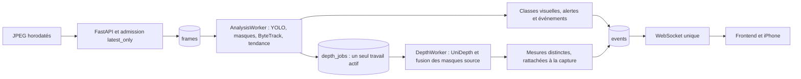
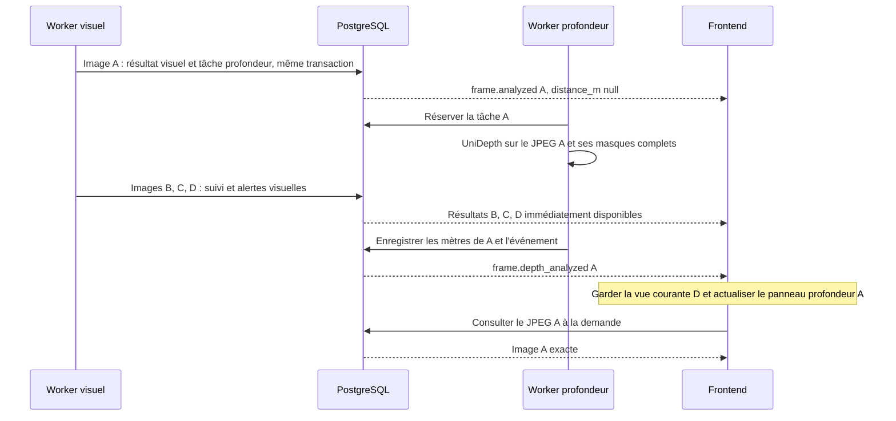
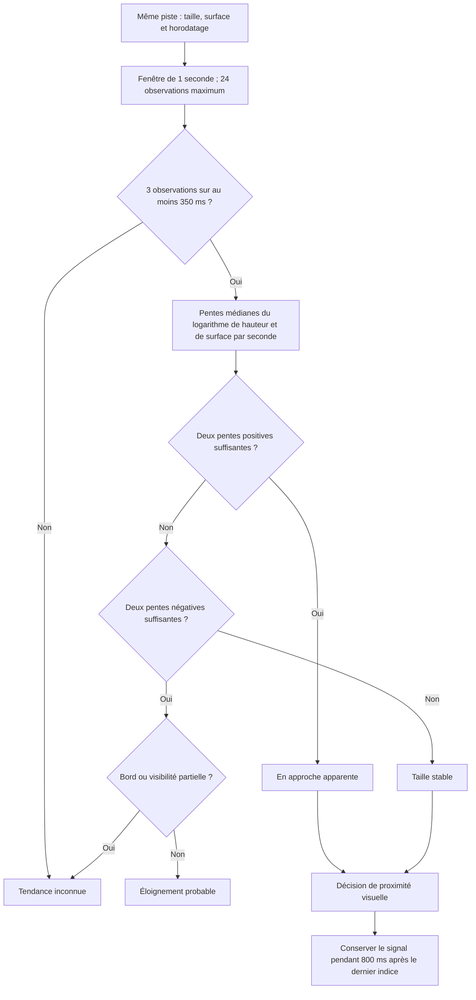
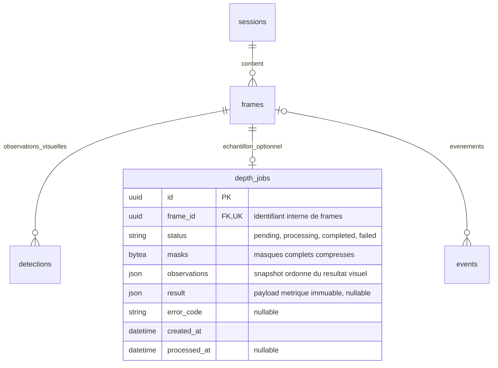
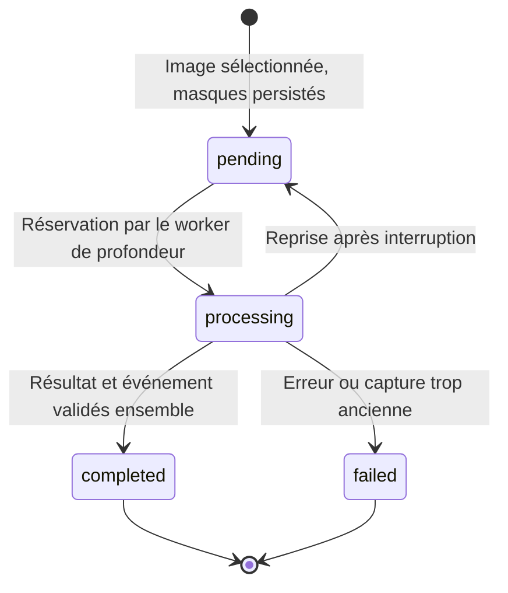
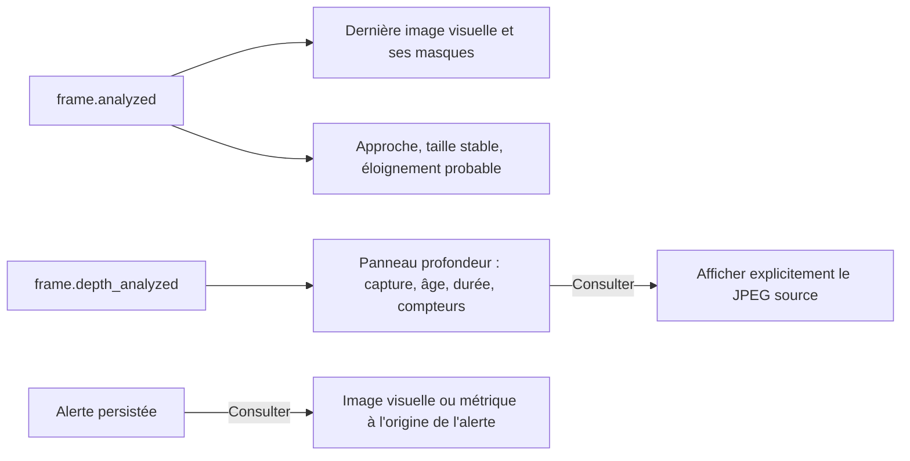

# Suivi rapide et profondeur indépendante

> Les mesures et règles v3 de ce chapitre constituent la référence avant extension aux véhicules. Les profils et réglages courants v4 sont décrits au [chapitre 14](14-proximite-urbaine.md). L’architecture à deux cadences reste inchangée.

Le mode courant `yolo_seg_track` sépare le calcul visuel de la profondeur. `LOOKI_DECOUPLED_DEPTH=true` active deux consommateurs internes au même processus FastAPI. Le suivi n'attend plus UniDepth ; le signal de proximité peut être produit sans estimation métrique.

## Architecture et budget CPU



Profil mesuré : quota Docker de **4 CPU**, plafond de mémoire **6 Gio**, **2 threads Torch par modèle**, un consommateur visuel et un consommateur de profondeur. Les deux modèles ont des verrous d'inférence distincts. Le réglage de threads Torch est commun au processus ; le même budget de 2 est appliqué à chacun. Les variables OMP/MKL/OpenBLAS suivent ce budget, tandis que le quota Compose borne l'ensemble.

Il ne faut pas lancer plusieurs workers Uvicorn ou répliques : admission, curseurs et ordonnancement reposent encore sur les verrous du processus unique. Une future VM x86 à 32 Go devra être mesurée séparément.

## Deux cadences et aucune distance reportée sur une autre image



L'intervalle nominal est de 2 secondes entre admissions de tâches de profondeur. Une tâche est admise seulement si le consommateur est libre ; il n'existe pas de file croissante de calculs UniDepth. Le premier résultat visuel admissible contenant des objets fournit le JPEG et les masques. Le quota est **global au processus**, partagé entre les sessions ; cette version ne garantit pas l'équité entre plusieurs flux concurrents.

Le résultat visuel est immuable : `distance_m=null`, `depth_valid_fraction=null`, `proximity=unknown` en mode indépendant. Les valeurs métriques arrivent dans un autre événement et un autre endpoint. Aucun transfert de mètres, extrapolation métrique ou association entre une ancienne carte de profondeur et de nouvelles boîtes n'est effectué.

La profondeur utilise les **masques binaires complets du passage visuel original**. Ils sont compressés sans perte avec `packbits` et NPZ, sans pickle. Leur ordre correspond au snapshot `observations` de la tâche. Les polygones simplifiés du frontend ne sont pas utilisés pour calculer les distances. UniDepth reste exécuté sur le même JPEG ; YOLO n'est pas relancé par le worker de profondeur.

Une capture âgée de plus de 3 secondes avant le calcul ou au moment de valider la transaction produit `depth.failed` avec `stale_depth`, sans alerte métrique. Une erreur du modèle produit `depth_inference_failed`. Dans les deux cas, le résultat visuel reste `completed` et le suivi continue.

## Tendance relative et mémoire du risque



Règles versionnées `person-visual-v3` dans `app/services/perception.py` :

| Paramètre | Valeur et rôle |
| --- | --- |
| Croissance de hauteur | Pente logarithmique ≥ 0,12/s |
| Croissance de surface | Pente logarithmique ≥ 0,24/s |
| Éloignement probable | Les deux pentes sous les opposés de ces seuils, sans visibilité partielle |
| Fenêtre / minimum | 1 s, au moins 3 observations sur 350 ms |
| Calcul robuste | Médiane des pentes entre paires espacées d'au moins 150 ms |
| Personne imposante | Hauteur ≥ 55 % et surface du masque ≥ 3,5 % |
| Alerte immédiate | Personne imposante, masque ≥ 8 %, touche gauche/droite/bas |
| Grande personne stationnaire | Au moins 2 observations sur 250 ms, hauteur ≥ 72 %, masque ≥ 8 % |
| Mémoire de proximité | 800 ms après le dernier indice, pour la même piste encore observée |
| Répétition d'événement | À l'entrée dans le risque, puis au plus une fois toutes les 2 s par piste |

Les seuils logarithmiques sont des vitesses relatives, pas des pourcentages par image : une cadence variable ne change plus directement la règle. Les tendances peuvent être affichées pour toutes les classes ; **les heuristiques de proximité visuelle restent spécifiques aux personnes**. Les alertes métriques ponctuelles concernent toutes les classes dont la profondeur est exploitable.

Une visibilité partielle est signalée si le masque touche un bord, ou si sa couverture de la boîte chute de plus de 40 % entre deux observations. Le bord supérieur participe à cette prudence mais ne suffit pas à l'alerte immédiate. Un masque qui rétrécit dans ces situations ne déclenche pas « éloignement probable ». La mémoire ne crée pas d'objet fictif : elle s'applique à une piste qui possède une détection actuelle. Une piste perdue peut être recréée sous un nouvel identifiant, avec une nouvelle alerte.

ByteTrack conserve maintenant jusqu'à 15 pas perdus ; les historiques restent bornés par le temps de capture et réinitialisés après un écart de plus de 2 secondes, un changement de dimensions ou une capture non croissante. Les événements ne sont pas répétés à chaque image, mais le champ visuel `risk=possible` reste affiché pendant toute la période concernée.

## Contrats et persistance



Migration additive `c581a9367e02` : cinquième table métier `depth_jobs`. Son unicité sur `frame_id` empêche plusieurs échantillons pour une même capture. Les masques sont chargés uniquement au moment de réserver le travail. Le résultat métrique et ses événements sont enregistrés dans une même transaction sous le verrou d'écriture partagé ; l'ordre des curseurs est conservé.



Nouveaux éléments du protocole :

- `frame.analyzed.metadata.depth_mode=independent` et `depth_sample_status=scheduled|not_sampled`.
- `perception.motion=approaching|receding|stable|unknown`, `risk` accepte `approaching`, et `alert_emitted` indique si la détection contribue à l'événement visuel de cette image.
- `evidence` expose les pentes par seconde, le nombre d'observations, la visibilité partielle et la durée restante de conservation du risque.
- `frame.depth_analyzed` contient les mètres de sa capture, ses chronométrages et `source_frame_id`, sans modifier le `frame.analyzed` déjà envoyé.
- `depth.failed` indique un échec partiel ; ne pas arrêter le flux visuel côté mobile.
- `GET /api/v1/sessions/{session_id}/frames/{frame_id}/depth` renvoie `status`, `payload` et `error_code`. Le payload terminé est exactement celui de `frame.depth_analyzed`. Le contrôle de session reste identique à celui des images.
- `alert.possible_proximity` utilise `ruleset=person-visual-v3`. `alert.proximity` reste attaché au résultat métrique de sa capture et n'efface pas un signal visuel courant.

Le schéma WebSocket accepte aussi les anciens événements v2 pour permettre le rejeu des sessions existantes. En mode synchrone (`LOOKI_DECOUPLED_DEPTH=false`), `frame.analyzed` peut toujours contenir les mètres comme auparavant ; les règles visuelles actuelles restent v3.

## Frontend



Le panneau principal affiche la surface relative du masque et la tendance, au lieu d'un nombre de mètres emprunté à une ancienne image. Le panneau de profondeur permet de consulter séparément le résultat ponctuel. La consultation met la lecture en pause ; reprendre affiche de nouveau les nouvelles captures. L'âge et le temps dans la vidéo restent visibles. Une session n'est considérée terminée qu'après les résultats visuels et les tâches de profondeur annoncées.

## Configuration et vérification

```dotenv
INSTALL_VISION=true
LOOKI_VISION_PROVIDER=yolo_seg_track
LOOKI_DEPTH_BACKEND=unidepth_v2
LOOKI_UNIDEPTH_RESOLUTION_LEVEL=0
LOOKI_CPU_THREADS=2
LOOKI_DECOUPLED_DEPTH=true
LOOKI_DEPTH_INTERVAL_SECONDS=2
LOOKI_DEPTH_MAX_AGE_SECONDS=3
LOOKI_WORKER_POLL_SECONDS=0.01
BACKEND_CPUS=4
BACKEND_MEMORY=6g
LOOKI_DEMO_VIDEO_PATH=/app/media/night-walk.mp4
```

```bash
docker compose up -d --build
uv run scripts/test_live_video.py --video media/night-walk.mp4 --output output/nyc-independent-depth/final
uv run --extra dev pytest -q
npm --prefix frontend test
```

Le test vidéo attend les résultats des deux traitements, compare les événements HTTP et WebSocket et vérifie que le flux visuel ne contient aucun mètre réutilisé. Il vérifie également le payload HTTP de chaque échantillon de profondeur. Le script historique `test_real_images.py` évalue la fusion synchrone ; utiliser `LOOKI_DECOUPLED_DEPTH=false` pour cette procédure historique.

## Limites

Les changements de taille indiquent un mouvement **apparent**. Une rotation de tête, un changement d'orientation de l'objet, une occlusion ou une association de piste erronée peuvent fausser la tendance. Le système ne compense pas encore explicitement la rotation de la caméra et ne calcule ni vitesse physique ni temps de collision. Un petit objet proche peut aussi rester difficile à détecter.

La taille dans l'image ne fournit pas de mètres absolus. Les heuristiques de proximité ne sont pas validées comme seuil physique d'un mètre ; elles complètent les estimations monoculaires et peuvent produire des faux positifs. La calibration du Pi et les tests avec distances mesurées restent reportés. Les scores YOLO ne mesurent pas la fiabilité des distances.

## Mesures sur la même vidéo NYC

Campagne complète du 19 octobre 2026, vidéo `media/night-walk.mp4` de 45,06 s, JPEG à 15 ips, résolution YOLO 640, UniDepthV2 vits14 niveau 0. SHA-256 source : `47a5d5f8aa57e0f22c3fb647980026ae227ffa4dbc1c184760964e118dce4be0`. Rapport local : `output/nyc-independent-depth/final/results.json`, session `6363f982-7a9d-416f-8d02-88ae0eb06db8`.

| Mesure | Résultat |
| --- | --- |
| Images acceptées / analysées / remplacées | 674 / 591 / 83 |
| Débit analysé, fin des traitements incluse | **13,07 ips** |
| Vision rapide, médiane / p95 | **68,73 / 75,93 ms** |
| YOLO segmentation, médiane / p95 | 58,42 / 62,99 ms |
| Profondeur, échantillons / échecs | 21 / 0 |
| Profondeur, médiane / p95 | 1 152,73 / 1 179,46 ms |
| Échecs visuels, hors remplacements attendus | 0 |
| Événements « proximité possible » / métriques | **14 / 0** |
| Observations « en approche » | 1 254 |
| Observations avec mémoire de proximité | 11 |
| Égalité HTTP / WebSocket et payloads profondeur | Vérifiée, aucune erreur |

La campagne synchrone précédente traitait 66 images sur 674, soit environ 1,43 ips. Le nouveau débit visuel est environ **9 fois supérieur**, sous le même quota de 4 CPU. La profondeur individuelle est plus lente avec 2 threads et en concurrence avec YOLO ; sa cadence réduite évite de bloquer le suivi. Ce benchmark mesure une exécution locale ARM64 limitée par Docker, pas les performances promises d’une VM x86 à 32 Go.

Les alertes visuelles ont été reçues à 5,07 ; 10,53 ; 15,87 ; 24,87 ; 29,87 ; 32,00 ; 34,40 ; 36,80 ; 36,93 ; 37,40 ; 40,87 ; 42,80 ; 43,00 ; 44,00 secondes dans le clip. Plusieurs alertes rapprochées peuvent concerner des pistes différentes. À 16,67 s, une silhouette perd presque la moitié de sa surface visible ; l’indice de visibilité partielle conserve la vigilance pendant les 602 ms restantes. Les compteurs représentent des observations et événements, pas un nombre de personnes distinctes ni un nombre de dangers confirmés.

La profondeur minimale estimée reste **3,40 m** sur les échantillons de ce passage. Aucune alerte métrique à 1,5 m n’a donc été émise. Les nouvelles alertes proviennent du canal visuel indépendant : ce résultat démontre son fonctionnement malgré ces mètres, **pas** une correction mesurée de la précision métrique. La vidéo n’a pas de vérité terrain de distance ; rappel et faux positifs physiques restent à mesurer avec le Pi.


Un contrôle réel complémentaire avec `fixtures/real-images/museum-vessels.jpg` a produit une estimation minimale de **0,905 m** et un `alert.proximity` reçu sur le WebSocket. Le payload `/depth` correspond exactement à l’événement, tandis que les détections visuelles d’origine gardent leurs mètres nuls. Ce contrôle valide le déclenchement et l’association des données, sans vérité terrain physique sur cette photo. Rapport local : `output/nyc-independent-depth/positive-depth.json`.

Validation logicielle : **314 tests backend**, **6 tests frontend**, compilation Vite et Ruff réussis ; **711 événements réels** de la campagne conformes au JSON Schema ; 73 schémas Mermaid intégrés et 15 `.mmd` analysés sans erreur. Les tests supplémentaires couvrent la profondeur lente/en échec, la fraîcheur, la reprise de tâches interrompues sans doublon, l’isolation des sessions, les pentes normalisées dans le temps et la mémoire du risque.
