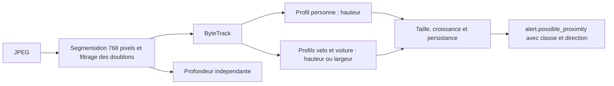
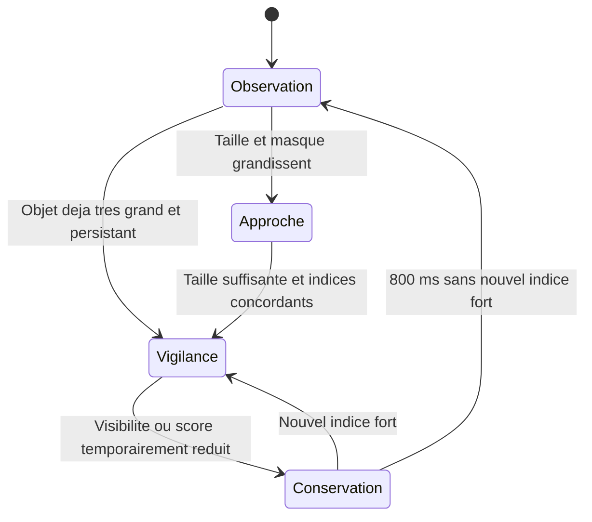

# Personnes, vélos et voitures : proximité visuelle v4

Le mode `yolo_seg_track` applique désormais `urban-visual-v4` aux classes COCO `person`, `bicycle` et `car`. Il conserve le calcul de profondeur indépendant du [chapitre 13](13-profondeur-independante.md), la mémoire de risque de 800 ms et la limitation des répétitions par piste. La calibration du Pi reste reportée.



Source autonome : [16 — Proximité urbaine](diagrams/16-proximite-urbaine.mmd).

## Profils de taille apparente

Les ratios sont normalisés par la largeur/hauteur de l’image. La surface correspond aux pixels du masque, pas à la boîte. Ces seuils sont des heuristiques du POC, pas des équivalents calibrés d’un mètre.

| Classe | Dimension imposante | Surface minimale | Surface pour alerte immédiate au bord | Dimension très grande persistante | Surface très grande |
| --- | --- | --- | --- | --- | --- |
| Personne | hauteur ≥ 55 % | 3,5 % | 8 % | hauteur ≥ 72 % | 8 % |
| Vélo | hauteur ≥ 32 % **ou** largeur ≥ 28 % | 1,2 % | 4 % | hauteur ≥ 55 % **ou** largeur ≥ 50 % | 3,5 % |
| Voiture | hauteur ≥ 30 % **ou** largeur ≥ 32 % | 3,5 % | 10 % | hauteur ≥ 50 % **ou** largeur ≥ 55 % | 12 % |

Une silhouette imposante produit une vigilance immédiate si sa surface dépasse aussi le seuil immédiat et qu’elle touche un bord gauche/droite/bas. Sinon il faut une piste présente sur au moins 250 ms et deux observations, avec une croissance ou un bord touché. Une silhouette très grande et persistante peut alerter même sans croissance ni bord. Le vélo possède un seuil de surface inférieur : ses roues et son cadre occupent peu de pixels dans une boîte relativement grande.

Pour les personnes, la pente temporelle porte toujours sur la hauteur. Pour les vélos et voitures, elle porte sur `sqrt(largeur × hauteur)` : une voiture vue de côté peut grandir en largeur sans gagner autant de hauteur. La surface du masque doit également croître. Les seuils restent 0,12/s et 0,24/s en pente logarithmique, avec une fenêtre de 1 s et au moins trois observations couvrant 350 ms. Le mouvement est apparent : ce n’est ni une vitesse physique ni une prédiction de collision.



## Détection et suivi

Le profil partagé dans `.env.example` utilise le même modèle Nano et les mêmes poids figés, avec `LOOKI_YOLO_IMAGE_SIZE=768` et `LOOKI_OBJECT_CONFIDENCE_THRESHOLD=0.25`. Il s’active après copie vers `.env` ; les modèles se téléchargent au premier démarrage. Voir [le guide de lancement](05-installation-et-exploitation.md#profil-réel-partagé-et-téléchargement-des-modèles) et [la justification de l’approche](04-vision-et-proximite.md#approche-actuelle-face-aux-distances-surestimées). Le seuil d’une **nouvelle** alerte reste `LOOKI_MIN_CONFIDENCE=0.5`. Les détections faibles sont visibles avec leur score et la mention « à confirmer » si elles ne sont pas associées à une piste.

ByteTrack reçoit désormais les observations entre 0,25 et 0,50, précédemment retirées avant le suivi. Elles peuvent récupérer une piste existante ; le seuil de création de piste reste 0,50. Ce comportement correspond à l’association en deux étapes décrite dans la [documentation Ultralytics](https://docs.ultralytics.com/modes/track/#shared-tracker-arguments). Une observation faible associée peut conserver le risque existant pendant la fenêtre de 800 ms ; elle ne crée pas et ne prolonge pas cette fenêtre.

Le filtre de doublons conserve l’observation ayant le meilleur score lorsque **la classe est identique**, l’IoU des boîtes atteint 0,60 et l’IoU des masques atteint 0,55. Deux personnes aux masques disjoints ou une personne sur un vélo sont conservées. Les masques retenus restent alignés avec les observations envoyées au calcul de profondeur.

Budget inchangé : quota Docker 4 CPU, 2 threads par modèle, limite mémoire 6 Gio. La résolution supérieure augmente le temps de calcul ; le modèle conserve une seule image en attente par session.

## Contrats et affichage

- `perception.visual_profile` : `person`, `bicycle`, `car` ou `null`.
- `perception.detection_status` : `tentative`, `confident` ou `tracked`. `tracked` décrit une association, pas une certification de la classe ou de la distance.
- `evidence.bbox_width_ratio`, `size_measure` (`height` ou `extent`) et `size_log_rate_per_second` documentent le critère utilisé. `height_log_rate_per_second` est nul pour les profils utilisant l’étendue de boîte.
- Les motifs génériques `large_object_mask`, `growing_object_mask` et `large_persistent_object` remplacent les noms propres aux personnes. Le frontend sait encore afficher les anciens motifs historiques.
- Le texte de l’alerte nomme les classes et directions concernées, par exemple « Proximité possible : voiture à gauche, vélo devant. Vigilance visuelle, distance incertaine. » Aucun mètre n’est inventé.
- Le JSON Schema conserve les règles v2 et v3 pour le rejeu et accepte `urban-visual-v4`.

Le frontend propose des filtres d’alertes « Toutes », « Personnes », « Vélos » et « Voitures », avec compteurs. Ils utilisent les classes du payload, y compris les événements contenant plusieurs classes, pour retrouver les alertes véhicules après les alertes personnes plus récentes.

## Reproduire

```bash
test -f .env || cp .env.example .env
docker compose up -d --build
uv run scripts/test_live_video.py --video media/night-walk.mp4 --output output/nyc-urban-v4/final
uv run pytest -q
npm --prefix frontend test
```

Attendre que le backend soit prêt et fournir la vidéo privée à `media/night-walk.mp4` avant l’évaluation. Un `.env` existant doit correspondre au profil partagé pour reproduire ces réglages. Le rapport distingue les observations, approches et événements d’alerte par classe. Un événement peut concerner plusieurs classes ; les compteurs par classe ne sont donc pas toujours additionnables. Le nombre d’observations ne mesure pas le rappel ou la précision d’un détecteur sans annotations de référence.

## Résultats sur NYC, quota de 4 CPU

Campagne du 19 octobre 2026, même clip de 45,06 s et même SHA-256 `47a5d5f8aa57e0f22c3fb647980026ae227ffa4dbc1c184760964e118dce4be0`, session `e4876e64-1951-41af-bf07-3a1201bb31df`. Rapport local : `output/nyc-urban-v4/final/results.json`.

| Mesure | Profil v4 : 768 pixels, seuil 0,25 |
| --- | --- |
| Images acceptées / analysées / remplacées | 673 / 388 / 285 |
| Débit réellement analysé | **8,54 ips** |
| Vision rapide médiane / p95 | **107,05 / 118,83 ms** |
| YOLO segmentation médiane / p95 | 83,49 / 90,79 ms |
| Profondeur : nombre / médiane | 21 / 1 190,92 ms |
| Échecs visuels / profondeur | 0 / 0 |
| Événements de proximité possible | **18 : 14 personnes, 4 voitures** |
| Alertes métriques | 0 |
| Observations avec mémoire de risque | 38 |
| Égalité HTTP et WebSocket | Vérifiée |

| Classe | Observations | Score ≥ 0,50 | Associées à une piste | En approche | Événements visuels |
| --- | --- | --- | --- | --- | --- |
| Personne | 4 012 | 2 320 | 2 481 | 822 | 14 |
| Voiture | 1 119 | 703 | 741 | 167 | 4 |
| Vélo | 1 | 0 | 0 | 0 | 0 |

Les alertes voitures arrivent à **15,40 ; 17,47 ; 22,60 ; 28,93 secondes**. Leur texte indique « voiture à gauche ». Il s’agit de vigilance basée sur la taille et l’évolution des masques, pas de collisions démontrées. La profondeur minimale reste estimée à 2,07 m, sans déclenchement métrique à 1,5 m.

La candidature « vélo » de 4,8 s possède un score de 0,292 et aucune piste. La capture montre à cet endroit les jambes d’un passant : c’est un **faux positif isolé**, sans alerte. Le clip ne valide donc pas un suivi réel de vélo. Le test complémentaire `fixtures/urban-images/parked-bicycles.jpg` contient un véritable vélo et produit une détection à **0,889**, avec l’événement WebSocket « Proximité possible : vélo devant. Vigilance visuelle, distance incertaine. » Le résultat HTTP correspond aux observations de l’événement. Ce test sur photo valide détection et alerte immédiate ; l’approche d’un vélo est couverte par des séquences de tailles contrôlées dans les tests, et reste à éprouver sur une vraie séquence cycliste. Rapport local : `output/nyc-urban-v4/bicycle-real-check.json`.

### Compromis de détection

Le profil précédent atteignait 13,07 ips avec 640 pixels et un seuil de 0,50. Le profil actuel analyse moins d’images mais conserve davantage d’observations par image : 10,34 personnes et 2,88 voitures en moyenne, dont 5,98 et 1,81 avec un score ≥ 0,50. Les valeurs précédentes étaient 5,30 personnes et 1,67 voiture à ce seuil. Les images effectivement analysées diffèrent avec la cadence : ces nombres ne constituent pas une mesure de rappel ou de précision.

Une comparaison exploratoire sur **les mêmes 45 images fixes**, avant filtrage supplémentaire des doublons, se trouve dans `output/nyc-urban-v4/probe/detections.json` :

| Résolution / seuil | Personnes | Voitures | Vision médiane, profondeur inactive |
| --- | --- | --- | --- |
| 640 / 0,50, filtré depuis les propositions à 0,25 | 251 | 73 | — |
| 640 / 0,25 | 437 | 125 | 75,5 ms |
| 768 / 0,50, filtré depuis les propositions à 0,25 | 272 | 77 | — |
| 768 / 0,25 | 493 | 143 | 93,7 ms |

Le seuil plus bas retrouve des observations peu assurées et introduit aussi du bruit. Elles sont affichées comme telles ; un score seul ne garantit pas une détection correcte. Des bornes ou poteaux absents des classes COCO ne seront pas reconnus par ces nouveaux profils. Une évaluation annotée sur la caméra Pi est nécessaire avant de conclure à un gain de précision général.

## Validation

327 tests Python et 7 tests frontend passent, ainsi que Ruff et la compilation Vite. Les 714 événements du passage vidéo sont conformes au JSON Schema. Les tests v4 couvrent la largeur des véhicules, leur croissance, leur éloignement, les objets petits, la conservation brève sur score faible, les doublons de masques et les alertes HTTP/WebSocket des deux classes. Une vérification avec le vrai ByteTrack confirme que des observations à 0,30 conservent les pistes voiture/vélo initialisées à 0,90, sans créer seules de nouvelles pistes.

Exemples contractuels réels : [alerte voiture](../contracts/examples/car-possible-proximity.json), [alerte vélo](../contracts/examples/bicycle-possible-proximity.json).
