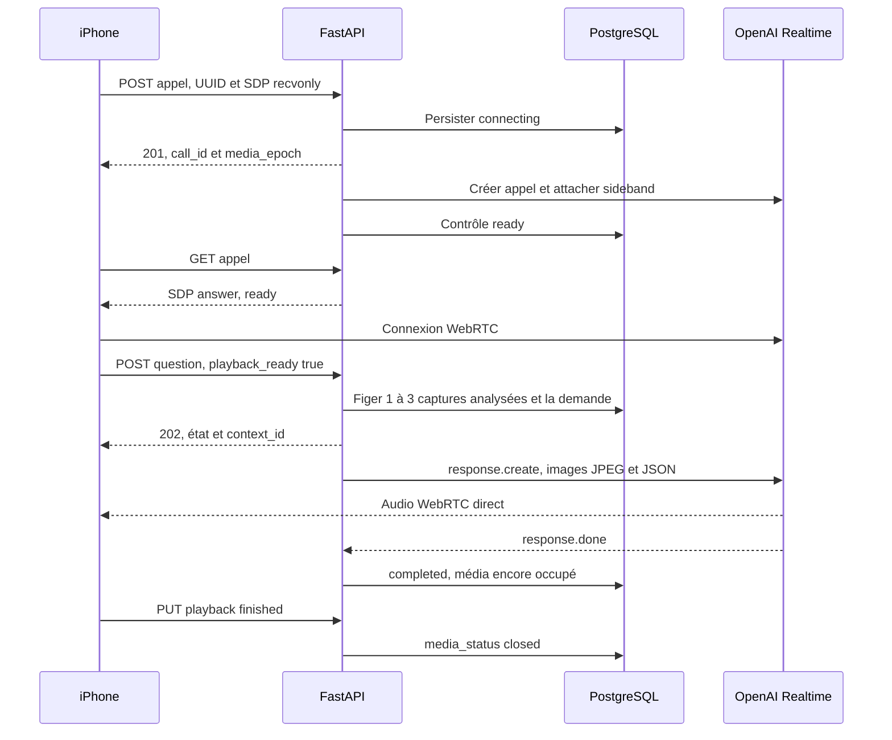
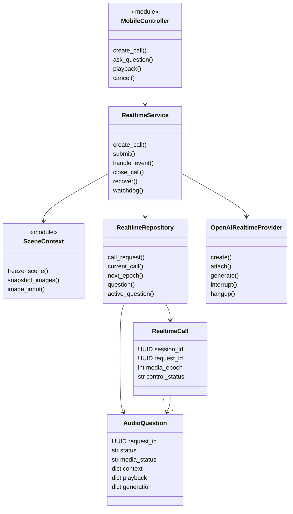

# 15 — Mobile Realtime et ingestion Pi JPEG

**État livré le 30 octobre 2026 : backend implémenté, tests automatisés avec fournisseur contrôlé.** Cet état décrit les tests du 30 octobre. Le lot du 6 novembre et sa recette OpenAI sont détaillés dans [Lio OpenAI](16-lio-openai.md) ; la recette physique iPhone reste distincte. Les performances vision mesurées précédemment restent des mesures JPEG sur ARM64 ; elles ne deviennent pas un benchmark du Pi ou de la VM finale.

## Contrats à partager

| Responsable | Document |
| --- | --- |
| Elyes et Hamza | [Pi JPEG](../contracts/raspberry-backend.md) : multipart, UUID, capture UTC, cadence et réessais |
| Leandro et Hamza | [Mobile HTTP](../contracts/mobile-backend.md) : SDP, questions, lecture et annulation |
| Leandro et Hamza | [Alertes](../contracts/alerts.md) : WSS, sound_id et expiration |
| Opérateur POC | [Session et jetons](../contracts/session-access.md) : une session, deux capacités |

L’API accepte toujours les JPEG du front de diagnostic. Le Pi envoie du JPEG, avec une qualité initiale conseillée de 85/100. Les nouveaux PNG sont refusés ; les PNG déjà persistés restent lisibles. `frames.content_type` conserve le type d’origine et la restitution `/image` renvoie les mêmes octets.

## Une question et deux fins distinctes

Source : [17-mobile-realtime.mmd](diagrams/17-mobile-realtime.mmd).

Le backend gère les commandes métier en HTTP, le contrôle fournisseur en sideband et laisse le média rejoindre directement l’iPhone. Le mobile effectue le STT local ; sa piste micro ne part pas chez OpenAI. Les alertes WSS restent produites par les règles visuelles même lorsque Realtime est désactivé ou en échec.

`completed` signifie fin de génération, jamais fin de lecture. `media_status` reste occupé jusqu’au PUT `finished` ou à la fermeture de l’appel. Une annulation coupe la génération, demande le vidage puis ferme systématiquement l’appel dans ce POC. L’iPhone coupe localement sans attendre et détruit son ancienne connexion ; la question suivante utilise une nouvelle époque.

## Classes, modules et séparation des couches

Source : [18-classes-realtime.mmd](diagrams/18-classes-realtime.mmd).

`MobileController` et `SceneContext` désignent ici des modules de fonctions, pas des classes Python ajoutées artificiellement. Les schémas Pydantic contrôlent strictement les entrées ; les repositories portent les accès SQL ; le provider isole la forme des requêtes OpenAI. Les opérations réseau ne conservent jamais le verrou SQL d’écriture. Les tâches d’ouverture, génération, écoute et fermeture appartiennent au runtime unique.

## Snapshot et persistance

La sélection lit les trois dernières captures analysées depuis PostgreSQL sous le verrou de cohérence. Il s’agit d’une **vue bornée sur la base**, pas d’un nouveau cache indépendant ni d’une limite à trois images stockées. Le JSON immuable de la demande conserve les références, dates, dimensions et jusqu’à 32 objets par capture. Une profondeur tardive ne modifie pas ce JSON et ne se transfère pas à une autre image. Aucune image fraîche donne `unavailable`, sans génération.

La migration `d73c9a210bf4` ajoute `realtime_calls` et `audio_questions` : voir [l’ERD et les contraintes](02-base-de-donnees.md#appels-et-demandes-audio-durables). Les clés idempotentes et deux index uniques partiels imposent un appel non clos et une sortie occupée au maximum par session. Les images restent dans `frames`, sans duplication binaire dans les snapshots.

Après redémarrage, le backend marque les appels et demandes interrompus, ferme les appels fournisseur connus et ne renvoie jamais automatiquement une génération incertaine. Une fermeture distante échouée bloque la réutilisation et est retentée à intervalles d’au moins cinq secondes par le contrôleur périodique.

## Activation et limites

Configurer `LOOKI_REALTIME_ENABLED=true` et la clé privée `LOOKI_OPENAI_API_KEY`, puis recréer le backend. Les valeurs initiales sont `gpt-realtime-2.1`, voix `marin`, scène de 3 s, connexion 20 s, génération 30 s, lecture 60 s et appel 900 s. Le provider utilise des réponses hors conversation et un déclenchement explicite ; aucune génération automatique à l’ouverture.

Les capacités mobile/Pi sont signées et limitées à une session et un rôle. Le provisionnement manuel du POC ne remplace pas un système de comptes utilisateurs. La rotation de la clé opérateur invalide ces capacités ; aucune révocation individuelle ni purge automatique n’est livrée.

Le contexte métier centres est conservé sur la session, mais le snapshot Realtime v1 décrit la scène et la question : itinéraires, graphe de navigation et outils LLM restent hors périmètre. La configuration Compose historique reste 4 CPU / 2 threads ; pour la VM partagée 8 vCPU / 32 Go, tester 6 CPU et 3 threads sans multiplier les workers Uvicorn.

## Validation et travail restant

Tests : JPEG exact, type et limites, isolation par session/rôle, rejeu sans double génération, sélection immuable, absence de scène, lecture séquencée, cancellation après fin de génération, délais, perte sideband, redémarrage et fermeture pendant l’ouverture. L’adaptateur est testé avec HTTP/WebSocket contrôlés ; les migrations sont vérifiées sur PostgreSQL 16 par upgrade, comparaison de schéma, downgrade et réapplication.

Restent à réaliser : capture caméra Pi, débit JPEG et réseau réel, SDK WebRTC iOS, clips vocaux, arbitrage sonore sur écouteurs, négociation et interruptions avec le véritable service OpenAI. Aucun résultat de test automatisé ne prouve que la voix a été entendue sur un téléphone.
