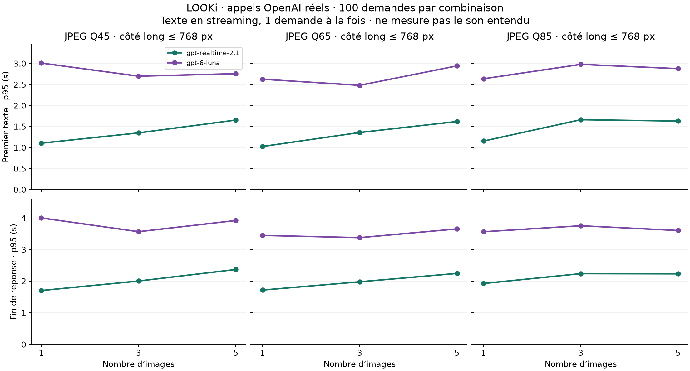
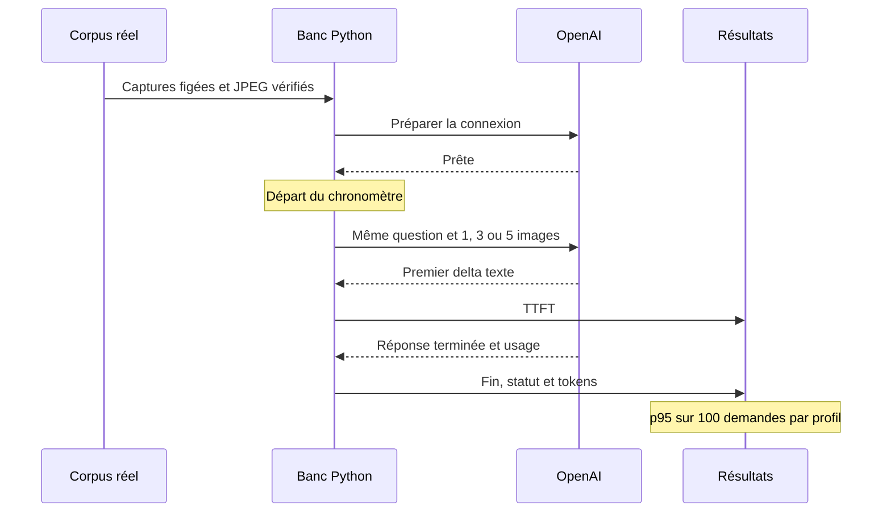

# Benchmark LLM : 1, 3 et 5 images, JPEG 45 / 65 / 85

Campagne du **19 novembre 2026**, avec des appels OpenAI réels et une **sortie texte** pour les deux modèles. Les **1 800 demandes prévues ont été exécutées**, avec **1 799 réponses complètes et un échec WSS** conservé. Chaque combinaison comporte 100 tentatives ; les 20 appels préliminaires et les 2 demandes de mise en route sont exclus des percentiles. Le banc est livré dans [`scripts/benchmark_llm.py`](../scripts/benchmark_llm.py).

La phase de demandes s’est déroulée de **13:38:25 à 14:38:51 UTC**, soit **60 min 25 s**, mise en place et reprise WSS incluses. La fermeture des clients s’est achevée à 14:38:53 UTC. Les données décrivent des scènes répétées avec cache actif ; **elles ne mesurent pas le premier son entendu sur iPhone**.

## Résultats mesurés

**1800 demandes mesurées**, 100 par combinaison. 1 échec(s). Les 2 demandes de mise en route sont exclues des percentiles.

Durées en **secondes**. Le p50 porte sur les réponses complètes ; le p95 porte sur toutes les tentatives (échec = +∞).

| JPEG | Images | Realtime premier texte p50 / p95 | Luna premier texte p50 / p95 | Realtime fin p50 / p95 | Luna fin p50 / p95 | Réussites RT / Luna |
| --- | ---: | ---: | ---: | ---: | ---: | ---: |
| 45 | 1 | 0,779 / 1,104 | 1,346 / 3,010 | 1,357 / 1,704 | 2,009 / 3,997 | 100/100 · 100/100 |
| 45 | 3 | 0,937 / 1,349 | 1,479 / 2,699 | 1,554 / 2,004 | 2,263 / 3,563 | 100/100 · 100/100 |
| 45 | 5 | 1,117 / 1,654 | 1,571 / 2,758 | 1,702 / 2,367 | 2,371 / 3,916 | 100/100 · 100/100 |
| 65 | 1 | 0,813 / 1,026 | 1,462 / 2,627 | 1,359 / 1,718 | 2,194 / 3,446 | 100/100 · 100/100 |
| 65 | 3 | 0,957 / 1,358 | 1,488 / 2,481 | 1,550 / 1,979 | 2,160 / 3,375 | 100/100 · 100/100 |
| 65 | 5 | 1,125 / 1,619 | 1,549 / 2,944 | 1,734 / 2,244 | 2,258 / 3,651 | 99/100 · 100/100 |
| 85 | 1 | 0,807 / 1,154 | 1,502 / 2,637 | 1,391 / 1,926 | 2,155 / 3,562 | 100/100 · 100/100 |
| 85 | 3 | 1,013 / 1,663 | 1,597 / 2,980 | 1,607 / 2,237 | 2,335 / 3,750 | 100/100 · 100/100 |
| 85 | 5 | 1,201 / 1,630 | 1,576 / 2,878 | 1,823 / 2,231 | 2,366 / 3,601 | 100/100 · 100/100 |

### Taille des entrées

Moyenne par demande, somme des JPEG avant base64, en **kio** (1 024 octets). Les deux modèles reçoivent les mêmes contenus. Le base64 ajoute environ un tiers, puis viennent le JSON et les instructions.

| Qualité | 1 image | 3 images | 5 images |
| --- | ---: | ---: | ---: |
| 45 | 32,0 | 95,7 | 160,5 |
| 65 | 41,6 | 124,7 | 209,4 |
| 85 | 64,7 | 194,4 | 326,2 |

### Cache et consommation

Tokens agrégés sur les seules demandes mesurées. Les tokens de sortie incluent le raisonnement compté par le fournisseur. Les compteurs de cache documentent une campagne répétée ; ils ne prouvent pas un démarrage à froid.

| Modèle | Entrée | Entrée en cache | Sortie | Demandes avec usage |
| --- | ---: | ---: | ---: | ---: |
| `gpt-realtime-2.1` | 1629422 | 1478035 | 82427 | 899/900 |
| `gpt-6-luna` | 1789050 | 1731504 | 43909 | 900/900 |

Enveloppe tarifaire prudente calculée : **10.383 USD** pour les 1802 appels de cette campagne, mise en route incluse, essai préliminaire exclu. Usage/coût manquant pour 1 demande(s). Ce montant sans remise de cache n’est pas une facture OpenAI.



Le point Realtime « 5 images / JPEG 65 » inclut un échec de transport dans son dénominateur ; le p95 reste fini selon la convention décrite ci-dessous.

## Lecture et décision pour le POC

Sur le profil actuel **3 images, JPEG 85**, le premier texte arrive au p95 en **1,663 s avec Realtime** contre **2,980 s avec Luna**. La fin de réponse est observée en **2,237 s contre 3,750 s**. Realtime présente un p95 de premier texte inférieur dans les neuf combinaisons testées. Cela soutient son maintien pour le parcours interactif existant ; ce comparatif texte ne démontre pas sa latence audio complète.

À **3 images**, JPEG 65 réduit les entrées de **194,4 à 124,7 kio en moyenne, soit 35,8 %**, et donne ici des p95 de premier texte de **1,358 s / 2,481 s**. C’est un candidat pour réduire le trafic. La qualité des descriptions et la lecture des petits textes n’ont pas été notées : **les réglages de production restent donc 3 images / JPEG 85**, sans bascule automatique de modèle ou de qualité.

Le nombre d’images augmente systématiquement les octets à transmettre, mais les p95 observés ne sont pas strictement croissants : par exemple, Realtime en JPEG 85 donne 1,663 s à trois images et 1,630 s à cinq. Cette petite différence ne prouve pas que cinq images sont plus rapides. Avec 100 tentatives, seules cinq valeurs dépassent le rang retenu pour le p95 ; aucune différence faible ne constitue à elle seule un gain établi. Le bénéfice sémantique de trois ou cinq images reste à évaluer.

Les tokens d’entrée en cache représentent **90,71 % chez Realtime et 96,78 % chez Luna**, sur les usages retournés. Cette comparaison décrit donc surtout des entrées répétées. Les UUID, observations et images changeants de la production peuvent réduire ce cache. Les chiffres ne sont pas une prédiction de latence à froid ni une comparaison de la seule vitesse interne des modèles.

## Incident conservé et reprise

Une seule tentative échoue : **`r099-gpt-realtime-2.1-n5-q65`**, à 14:38:27 UTC, sur la scène nocturne. Le statut enregistré est `transport_or_decode_error`, après **2,185 s**, sans premier texte, fin de réponse ni usage reçus. Il ne s’agit pas d’une expiration du délai local de 30 s. Cette tentative reste dans le dénominateur : **99/100 réussites pour ce profil**, 899/900 pour Realtime et 900/900 pour Luna. Aucun retry n’a remplacé l’échec.

L’incident survient environ 60 minutes après l’ouverture de la connexion. C’est **compatible avec la limite de session Realtime de 60 minutes documentée par OpenAI**, mais le code de fermeture n’a pas été collecté : la cause exacte n’est pas confirmée. [Référence officielle](https://developers.openai.com/api/docs/guides/realtime-conversations).

La demande Realtime suivante, profil 5 images / JPEG 85, ouvre une nouvelle connexion en **1,661 s**, puis termine normalement. Ce temps de mise en place reste séparé de son TTFT, comme prévu par le protocole. Les demandes restantes ont réussi. Pour une prochaine campagne longue, collecter le code de fermeture et évaluer un renouvellement anticipé de session, en publiant séparément ce nouveau profil de connexion.

## Preuves et contrôles

Les valeurs des tableaux ci-dessus proviennent de [tables.md](benchmarks/llm-p95-2026-11-19/tables.md). Les fichiers ci-dessous sont publiés dans les deux dépôts ; aucune clé, transcription complète, image ou vidéo source n’est incluse.

| Fichier | Usage |
| --- | --- |
| [requests.csv](benchmarks/llm-p95-2026-11-19/requests.csv) | 1 802 tentatives, mise en route incluse ; latences, statuts, compteurs et empreintes |
| [summary.json](benchmarks/llm-p95-2026-11-19/summary.json) | p50/p95, dénominateurs, erreurs et consommations par profil |
| [config.json](benchmarks/llm-p95-2026-11-19/config.json) | Paramètres exacts de la campagne |
| [corpus-manifest.json](benchmarks/llm-p95-2026-11-19/corpus-manifest.json) | Sources publiques, instants et empreintes des captures |
| [payloads.json](benchmarks/llm-p95-2026-11-19/payloads.json) | JPEG effectivement préparés : dimensions, octets et SHA-256 |
| [prompt.txt](benchmarks/llm-p95-2026-11-19/prompt.txt) | Instructions communes, sans secret ni observation injectée |
| [schedule.json](benchmarks/llm-p95-2026-11-19/schedule.json) | Ordre des 1 802 tentatives |
| [environment.json](benchmarks/llm-p95-2026-11-19/environment.json) | Bibliothèques et empreintes des sources d’acquisition |
| [completion.json](benchmarks/llm-p95-2026-11-19/completion.json) | Fin normale de campagne et nombre réalisé |
| [sha256.json](benchmarks/llm-p95-2026-11-19/sha256.json) | Contrôle d’intégrité de l’export |
| [Graphique SVG](benchmarks/llm-p95-2026-11-19/p95.svg) | Figure vectorielle exportable |

Le champ `base_git_revision` désigne le commit parent avant ajout du banc ; le code était en cours de modification. Les empreintes `source_sha256` identifient précisément les sources exécutées et ont été comparées aux fichiers livrés : aucune source d’acquisition n’a changé durant la campagne.

Contrôles effectués : **381 tests Python passent**, Ruff passe, le nouveau Mermaid a été rendu avec Mermaid CLI 11.17.1 et Chrome. Le CSV publié reproduit exactement la synthèse JSON. L’ordre réalisé correspond au programme de 1 802 tentatives, les contenus envoyés aux deux modèles sont identiques par paire, et il ne reste aucune demande locale en vol. Les liens, miroirs Mermaid et copies contractuelles sont vérifiés dans le dépôt documentaire.

## Ce que mesure le comparatif

Comparer **`gpt-realtime-2.1` via WSS, en sortie texte**, et **`gpt-6-luna` via Responses/SSE**, sur des contenus image et texte identiques. Luna ne produit pas d’audio natif ; le dénominateur commun est donc le texte en streaming.

| Repère | Définition |
| --- | --- |
| Départ | Horloge monotone juste avant la sérialisation et l’envoi de la demande |
| Premier texte, TTFT | Première réception d’un `response.output_text.delta` non vide |
| Fin | Réception de `response.done` ou `response.completed`, statut `completed` |
| Mise en place WSS | Connexion et acquittement `session.updated`, mesurés séparément avant le départ |
| Préparation des JPEG | Décodage, redimensionnement et encodage mesurés séparément, hors délai API |

Les durées incluent l’envoi du contenu vers OpenAI, la file et le traitement fournisseur, puis le retour réseau. Le compteur ne donne pas le temps d’inférence interne seul. La connexion HTTPS est conservée dans un pool ; une reconnexion implicite éventuelle reste incluse dans ses délais. Les connexions WSS déjà prêtes sont réutilisées ; une reprise explicite est identifiée dans le CSV.

Le banc est un client Python local vers le cloud OpenAI (macOS arm64, Python 3.12.14, httpx 0.28.1, websockets 15.0.1, Pillow 12.3.0). Le CPU n’a pas été limité à un nombre de vCPU et la charge hôte/réseau n’était pas isolée ; des tests logiciels et rendus documentaires ont tourné durant l’acquisition. Il ne lance ni FastAPI, ni PostgreSQL, ni YOLO/UniDepth, ni le STT ou le TTS. Il ne mesure pas le matériel iPhone/écouteurs, le réseau du Pi ou la VM finale 8 vCPU. **Le seuil « premier son après fin de parole < 3 s » reste à mesurer sur le parcours audio réel.**

Source du schéma : [22-benchmark-llm.mmd](diagrams/22-benchmark-llm.mmd).

<!-- diagram: 22-benchmark-llm.mmd -->


## Protocole figé

| Paramètre | Valeur |
| --- | --- |
| Matrice | 2 modèles × 3 nombres d’images × 3 qualités JPEG |
| Répétitions | 100 demandes par combinaison, 1 800 demandes mesurées |
| Mise en route | 1 demande par modèle, publiée mais exclue des percentiles |
| Essai préliminaire | 20 appels distincts, hors campagne principale |
| Images | 1, 3 ou 5 ; côté long ≤ 768 px, sans agrandissement, ratio préservé |
| Qualité JPEG | 45, 65 ou 85, encodage Pillow ; ce n’est pas le paramètre API `detail` |
| Détail vision API | `detail` non spécifié ; traitement par défaut propre à chaque API/modèle |
| Modèles | Identifiants accessibles et renvoyés par les API, enregistrés dans le CSV |
| Raisonnement / sortie | `low`, 1 024 tokens maximum, texte français en 1 à 3 phrases |
| Instructions | Base du prompt de production `lio.scene.v1.1`, identique pour les deux modèles, sans suffixe dynamique `instructions_for_scene` ; texte et SHA-256 conservés |
| Contexte | Captures et repères temporels ; perception déclarée `not_run`, aucune fausse profondeur |
| Historique | Aucun : Realtime `conversation: none`, Responses sans `previous_response_id`, `store: false` |
| Ordre | Blocs de 18 profils mélangés, graine 20261119 ; une demande en cours à la fois |
| Expiration | 30 s par demande ; aucune relance automatique ou substitution d’un échec |
| Garde-fous d’exécution | Arrêt après 3 échecs consécutifs ou enveloppe de coût estimée atteinte |

Les paramètres de production restent **3 images maximum, JPEG 85, côté long 768 px, réponse audio Realtime**. Les profils 1 et 5 images appartiennent à ce banc ; le contrat mobile n’est pas élargi par ces essais. Modifier `--max-side` constitue une nouvelle campagne, dans un autre dossier de sortie.

### Corpus

Les clips publics bruts de [MOTChallenge](https://motchallenge.net/) sont déjà référencés dans le benchmark vision de l’équipe. Le script vérifie leur SHA-256 avant extraction :

| Clip | Scène |
| --- | --- |
| `MOT17-05-DPM` | Rue, caméra mobile, piétons |
| `MOT17-09-DPM` | Extérieur de jour, piétons |
| `MOT20-01` | Gare, foule à l’intérieur |
| `MOT20-05` | Extérieur de nuit, foule |

Pour chaque clip : captures à **2, 2,5, 3, 3,5 et 4 secondes**. Le profil 1 garde la dernière ; le profil 3 garde les indices 0/2/4 ; le profil 5 garde les cinq. Les deux modèles voient donc la même dernière scène et, à nombre et qualité égaux, exactement les mêmes octets. Les dimensions encodées observées sont 640 × 480, 768 × 432 et 768 × 502 selon le clip ; elles restent identiques entre qualités et modèles pour une même capture. Chaque clip apparaît 25 fois dans chaque combinaison.

Les images viennent de MP4 déjà compressés, pas de captures brutes du capteur du Pi. Les vidéos « raw » du site portent déjà un compteur et un libellé de séquence ; le banc n’ajoute aucune annotation de détecteur. L’extraction a utilisé FFmpeg 9.0.1.

La question est fixe : « Décris brièvement les éléments visibles devant moi et leur position dans la scène récente. » Les vidéos sources et captures ne sont pas ajoutées au Git ; le manifeste conserve URL, horodatage, dimensions et empreintes. Le script peut les reconstruire avec FFmpeg. Des versions différentes du décodeur ou de Pillow peuvent produire des octets différents : comparer les empreintes des captures et des JPEG avec celles de la campagne publiée.

### Calcul des percentiles et erreurs

Le p95 utilise le **rang le plus proche supérieur** : trier les durées et prendre le rang `ceil(0,95 × n)`. Avec 100 demandes réussies, c’est la 95e valeur ; aucune interpolation. Le p50 utilise le même procédé.

Les tableaux présentent le nombre prévu, tenté, réussi et échoué. Les quantiles conditionnels sur les réponses complètes restent distincts des quantiles de toutes les tentatives : pour ces derniers, un échec vaut `+∞`. Si le p95 atteint une telle valeur, il est publié « non borné », jamais remplacé par le percentile des seules réussites. Une réponse incomplète ou vide échoue même si un premier texte a été reçu. Un coût absent reste inconnu.

Le CSV conserve les dates, les durées, le statut, les compteurs de tokens/cache, les tailles et les empreintes des entrées/sorties. Les clés, en-têtes, identifiants fournisseur et transcriptions complètes n’y sont pas publiés. Les traces locales contenant les textes restent dans `output/`, ignoré par Git.

## Vérifier les chiffres sans appels payants

Après clonage du dépôt backend, depuis sa racine :

```sh
python3 scripts/verify_llm_benchmark.py \
  --directory docs/benchmarks/llm-p95-2026-11-19
```

Cette commande utilise uniquement la bibliothèque standard Python : elle vérifie les empreintes des fichiers publiés puis recalcule toutes les statistiques à partir de `requests.csv`. Elle n’ouvre pas le `.env` et n’utilise ni clé, ni base, ni modèle. L’empreinte assure l’intégrité des fichiers par rapport au manifeste ; elle ne constitue pas une signature du fournisseur.

## Reproduire les mesures

Depuis le dépôt backend, installer Python 3.12, [uv](https://docs.astral.sh/uv/) et FFmpeg. Sur Ubuntu : `sudo apt-get install ffmpeg`. Utiliser le `.env` **privé** du backend avec `LOOKI_OPENAI_API_KEY` ; le banc ne nécessite pas `LOOKI_REALTIME_ENABLED=true`, de services Docker ni de poids YOLO/Depth. La clé du projet doit donner accès aux deux modèles et les appels sont facturés.

```sh
uv sync --frozen --extra dev
uv run python scripts/benchmark_llm.py prepare
uv run python scripts/benchmark_llm.py run \
  --output output/llm-p95/ma-campagne \
  --repetitions 100 --max-estimated-usd 25
uv run python scripts/benchmark_llm.py summarize \
  --output output/llm-p95/ma-campagne
uv run --with matplotlib python scripts/publish_llm_benchmark.py \
  --output output/llm-p95/ma-campagne \
  --destination output/llm-p95/publication
```

Un premier contrôle réduit peut utiliser `--repetitions 1` dans un dossier séparé : 18 profils + 2 demandes de mise en route. **Il ne suffit pas à estimer un p95 fiable.** Le script de publication refuse une campagne incomplète, les identifiants dupliqués et des entrées différentes entre modèles.

`--resume` reprend uniquement les demandes encore non enregistrées, avec une configuration identique. Si `inflight.json` subsiste après une interruption, le script s’arrête : inspecter cette tentative avant toute reprise, car elle a pu être facturée. Ne pas la supprimer pour relancer silencieusement la même demande. Pour une nouvelle campagne, choisir un nouveau dossier.

L’enveloppe de coût est calculée sur les tokens retournés, avec des tarifs prudents sans remise de cache. Par million de tokens : Realtime utilise 5 USD en entrée (tarif image appliqué aussi au texte) et 24 USD en sortie ; Luna utilise 0,125 USD en entrée et 0,50 USD en sortie. Le calcul est volontairement majoré par rapport aux entrées standard et ne déduit pas les caches ; il exclut les éventuels suppléments régionaux ou niveaux de service. Elle est contrôlée entre les appels ; le dernier appel peut la dépasser. Elle n’est ni un plafond de facturation OpenAI ni une estimation complète lorsque l’usage manque. Les prix sont datés et doivent être revérifiés avant une autre campagne.

## Interpréter les résultats

Ce corpus répète quatre scènes : il mesure la variabilité des délais sur ces entrées et cette connexion, pas la couverture de tous les usages urbains. Les caches du fournisseur sont laissés actifs et leurs compteurs sont publiés. L’essai préliminaire peut avoir réchauffé certains préfixes ; un warmup ne permet pas d’affirmer que toute l’infrastructure fournisseur est chaude. Les résultats décrivent des demandes répétées, pas des démarrages à froid. En usage Pi, les captures, identifiants et observations changent : le même taux de cache ne peut pas être supposé. Le CSV permet d’examiner les demandes avec ou sans tokens en cache, mais leur sous-échantillon ne remplace pas une campagne dédiée de 100 demandes à froid par profil.

Une qualité JPEG plus basse réduit les octets envoyés, mais les deux modèles peuvent travailler sur un nombre de patches/tokens voisin à dimensions identiques. Le gain de transfert n’est donc pas forcément un gain équivalent de TTFT. Les différences de longueur de réponse et de raisonnement affectent aussi le délai total. `low` n’impose pas le même nombre de tokens de raisonnement aux deux familles.

Le protocole n’évalue pas automatiquement la fidélité des descriptions, l’OCR, les alertes ou la sûreté du déplacement. Il ne remplace pas la campagne sémantique définie par l’équipe, ni un test avec le JSON complet des observations de production. Une évolution du modèle, des instructions, du réseau ou du contexte exige de nouvelles mesures. Les deux API ont renvoyé leur nom d’alias, sans révision de poids figée : reproduire les paramètres plus tard ne garantit pas le même modèle interne.

## Sources officielles vérifiées le 19 novembre 2026

- [GPT-6 Luna](https://developers.openai.com/api/docs/models/gpt-6-luna) : entrée image, sortie texte, effort de raisonnement.
- [GPT Realtime 2.1](https://developers.openai.com/api/docs/models/gpt-realtime-2.1) et [conversations Realtime](https://developers.openai.com/api/docs/guides/realtime-conversations) : sortie texte ou audio, événements de streaming.
- [Création Responses](https://developers.openai.com/api/reference/resources/responses/methods/create) : streaming, images et usage.
- [Tarifs OpenAI](https://developers.openai.com/api/docs/pricing) : prix standard utilisés pour l’enveloppe indicative.
