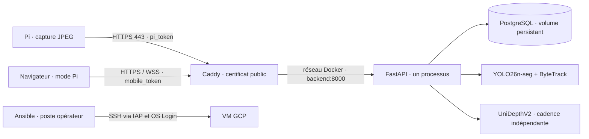
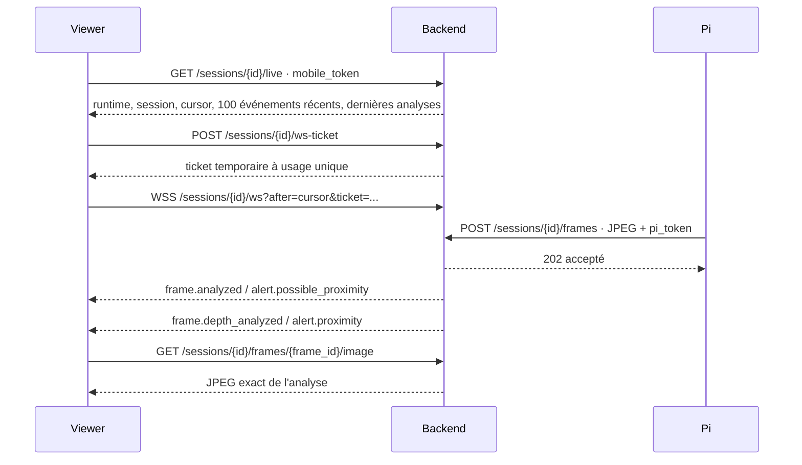

# GCP, HTTPS et mode lunettes

Le déploiement est automatisé dans [Looki-PoC-IaC/ansible](https://github.com/Mindsept/Looki-PoC-IaC/tree/main/ansible). L'IaC crée une VM Ubuntu 24.04 `e2-standard-8` (8 vCPU, 32 Go), un disque persistant de 50 Go, une IP fixe et les règles réseau. Ansible déploie un commit précis du backend et Caddy, sans copier les clés Git ou le `.env` du développeur.



## Déployer

Depuis le dépôt infrastructure :

```bash
tofu -chdir=GCP plan -out=https.tfplan
tofu -chdir=GCP apply https.tfplan
./ansible/deploy.sh /chemin/vers/backend COMMIT_SHA
python3 ansible/provision_pi.py
```

Le playbook attend le bootstrap Docker, installe une archive Git, le `.env` privé et le proxy, puis lance le projet Compose `looki-vision`. Alembic applique les migrations. Il vérifie `/health/ready` localement puis en HTTPS depuis le poste opérateur, avec validation du certificat. Les modèles sont téléchargés au premier démarrage : la vérification de readiness autorise jusqu'à 30 minutes. Les volumes PostgreSQL, modèles et certificats persistent ; ne pas utiliser `down -v` pour terminer une session.

Le profil réserve 4 vCPU et 6 Go au backend, 2 threads par modèle, YOLO à 768 px et une demande de profondeur au plus toutes les 2 s. Le deuxième backend doit avoir un projet Compose et des volumes distincts, avec un autre port local si nécessaire. PostgreSQL n'est pas public. L'API est exposée sur loopback côté hôte ; Caddy la rejoint par le réseau Docker.

Le déploiement initial laisse `LOOKI_REALTIME_ENABLED=false` : la vision ne nécessite aucune clé OpenAI. Activer séparément Lio avec une clé projet privée si nécessaire.

## Connecter les lunettes

`provision_pi.py` crée une session et des jetons de 8 heures par défaut. Il écrit des fichiers privés exclus de Git sous `ansible/.local/pi-<session>/` :

| Fichier | Destinataire | Contenu |
| --- | --- | --- |
| `pi.env` | Raspberry Pi | URL HTTPS, UUID de session, `pi_token` |
| `viewer.json` | Navigateur | Même URL et session, `mobile_token`, expiration |

Transférer uniquement `pi.env` sur le Pi. Depuis le dossier contenant `capture_sender.py` :

```bash
chmod 600 /chemin/pi.env
. /chemin/pi.env
python3 capture_sender.py --source picamera2 \
  --base-url "$LOOKI_BASE_URL" --session-id "$LOOKI_SESSION_ID" \
  --fps 2 --width 960 --height 540 --jpeg-quality 85
```

Synchroniser l'horloge du Pi : les nouvelles captures de plus de 30 s ou de plus de 5 s dans le futur sont refusées. Les réessais conservent UUID, horodatage et octets JPEG. `latest_only=true` évite une file d'analyse qui grossit.

Avec Picamera2 `RGB888`, le tableau est déjà BGR pour OpenCV : une seconde conversion RGB→BGR avant `imencode` inverse rouge et bleu. [Formats Picamera2 officiels](https://datasheets.raspberrypi.com/camera/picamera2-manual.pdf).

## Observer depuis le navigateur

Ouvrir la sortie OpenTofu `live_url` (`/live/?mode=pi`), importer `viewer.json`, puis cliquer **Se connecter aux lunettes**. La saisie manuelle de la session et du jeton mobile fonctionne aussi. Le fichier doit correspondre à l'origine HTTPS de la page. Les secrets restent dans la mémoire de l'onglet, sans URL, localStorage ou export de diagnostic.



Le snapshot est en lecture seule, accessible au mobile/opérateur de cette session. Il capture un état cohérent avec le curseur, puis le WSS reprend après ce curseur. La dernière image et la dernière profondeur restent disponibles même si elles sont antérieures aux 100 événements récents. Le viewer se reconnecte automatiquement et ignore doublons et événements d'une autre session.

Les dimensions de l'image, les masques, pistes et alertes correspondent au même `frame_id`. La profondeur reste attachée à sa capture, consultable séparément. Une bannière signale une image âgée de plus de 3 s. Figer l'affichage ou consulter une alerte ne stoppe pas le Pi. **Déconnecter le viewer ou fermer la page ne ferme jamais la session des lunettes.**

Les statistiques Pi décrivent les résultats reçus, pas la cadence d'émission inconnue du navigateur. Le journal/export conserve au plus 2 000 événements sur cette connexion, avec 100 événements récents au démarrage. L'historique complet reste dans l'API. Quinze captures/s ne garantissent pas quinze analyses/s sur CPU.

## Valider et exploiter

1. Vérifier HTTPS et `/health/ready`, puis les `202` du Pi.
2. Observer un JPEG analysé avec le provider réel et les événements WSS.
3. Tester un rapprochement, consulter motifs visuels et capture de profondeur ; les mètres restent non calibrés.
4. Reconnecter le viewer puis couper brièvement le réseau du Pi. Vérifier la reprise sans changer de session.
5. Augmenter progressivement la cadence en surveillant latence, remplacements, CPU, RAM et disque.

Renouveler les accès avec `python3 ansible/provision_pi.py --session-id UUID`, recopier `pi.env`, réimporter `viewer.json`, reconnecter les clients. Ne pas transmettre la clé opérateur aux appareils.

Les JPEG, même remplacés avant analyse, restent en base. La limite de file ne limite pas le stockage. Fermer les anciennes sessions et utiliser le script de purge documenté, backend arrêté. Le disque et l'IP réservée restent alloués quand la VM est arrêtée.

## Validation réelle du 26 novembre 2026

Deux essais de 30 secondes ont utilisé le client `capture_sender.py` du dépôt embarqué avec l'extrait New York déjà fourni au projet, à 2 captures/s, via Internet et HTTPS vers GCP. La caméra physique et le partage de connexion de l'iPhone n'étaient pas disponibles depuis le poste de test. Le provider serveur était réel, sans mock ni appel OpenAI.

| Mesure | Premier essai | Essai final de l'application `e7f5b44` |
| --- | --- | --- |
| JPEG analysés | 60 | 60 |
| Résultats de profondeur reçus | 11 | 8 |
| Profondeurs écartées car trop anciennes | 0 | 2 (`stale_depth`) |
| Alertes `alert.possible_proximity` | 5 | 5 |
| Alertes métriques `alert.proximity` | 0 | 0 |

Sur l'essai final, le temps serveur `total_vision_ms` (60 observations) a une médiane de **237,8 ms**, un p95 interpolé de **353,9 ms** et un maximum de **985,7 ms**. Pour les 8 profondeurs publiées, `depth_job_total_ms` vaut **2 284,7 ms** en médiane et **2 403,7 ms** au p95. Ces temps excluent le transport et le rendu navigateur ; les profondeurs rejetées n'entrent pas dans les statistiques des résultats publiés. Cet essai court valide l'intégration, pas une capacité garantie à 15 analyses/s ou une précision métrique.

Les deux `stale_depth` correspondent au garde-fou existant de 3 secondes, conservé : aucune ancienne distance n'a été remise en circulation pour faire passer le test. Les 60 analyses YOLO et les 5 alertes visuelles ont continué. Les événements terminaux ont également été relus via l'API après le test navigateur.

Le quota Docker vérifié était **4 vCPU / 6 Gio**, avec **2 threads par modèle**. Une observation pendant le calcul indiquait environ **2,9 CPU / 1 Gio** ; ce n'est pas une mesure de pic. Le disque utilisait environ 11 Go sur 48 Go disponibles au système après le premier build, modèles inclus.

Vérifications effectuées : certificat HTTPS public, redirection HTTP 308, workers et PostgreSQL sains, reprise WSS après fermeture réelle du socket, pause/reprise de l'image, consultation d'une profondeur et d'une alerte, absence de fermeture de session par le viewer, disparition du jeton au rechargement, absence d'erreur JavaScript et de débordement horizontal à 390 px. Le viewer a aussi été ouvert et connecté dans le navigateur intégré. Tests automatisés : **383 tests Python et 17 tests frontend** réussis.

Le test reproductible est `scripts/test_pi_browser.py` : il utilise Chrome isolé, les deux fichiers privés et le vrai client embarqué. Il ne lit pas la clé opérateur et ne génère aucun événement simulé. Exemple depuis le backend :

```bash
uv run --no-sync --with playwright --with opencv-python-headless \
  python scripts/test_pi_browser.py \
  --viewer /chemin/viewer.json --pi-env /chemin/pi.env \
  --sender /chemin/client-embarque/capture_sender.py \
  --video /chemin/video.mp4 \
  --chrome '/Applications/Google Chrome.app/Contents/MacOS/Google Chrome'
```

Les rapports JSON, journaux du client et captures d'écran restent dans `output/`, exclus de Git. La prochaine validation doit se faire avec la caméra des lunettes, son réseau et des distances mesurées sur place.
