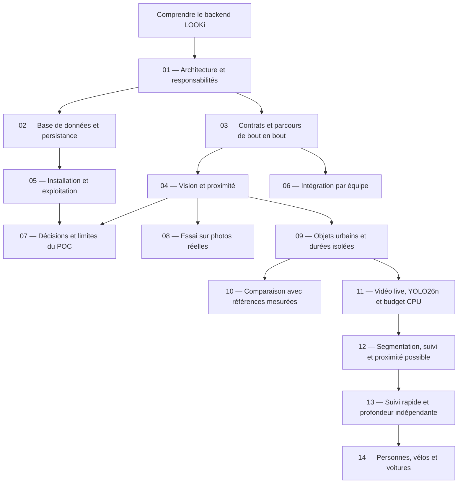
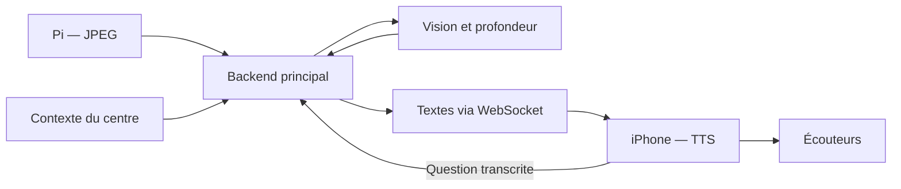

# LOOKi — Documentation du backend principal

Ce dossier décrit le prototype livré à la racine de ce dépôt (`backend/` dans le workspace LOOKi) : réception des JPEG du Raspberry Pi, analyse asynchrone, classement de proximité, alertes et échanges textuels avec l’iPhone. Les schémas représentent le code de cette première version. Les fonctions prévues pour une phase ultérieure sont explicitement identifiées.

| Lecture | Contenu | Public principal |
| --- | --- | --- |
| [01 — Architecture](01-architecture.md) | Déploiement, couches, classes, dépendances, traitements | Toute l’équipe |
| [02 — Données](02-base-de-donnees.md) | Relations, tables, contraintes, transactions, reprise | Backend principal, centres |
| [03 — Contrats et flux](03-contrats-et-flux.md) | API HTTP, WebSocket, idempotence, événements, reconnexion | Embedded, iPhone, backend |
| [04 — Vision et proximité](04-vision-et-proximite.md) | Mock, profondeur métrique, objets urbains, seuils, limites | Backend, Embedded, Hardware |
| [05 — Exploitation](05-installation-et-exploitation.md) | Compose, configuration, migrations, tests, incidents | Backend, démonstration |
| [06 — Intégration](06-integration-equipe.md) | Travail indépendant, scénarios d’acceptation, branchements | Toute l’équipe |
| [07 — Décisions](07-decisions-et-limites.md) | Justification des choix et travail restant | PO, équipe technique |
| [08 — Test sur images réelles](08-test-images-reelles.md) | Photographies sourcées, procédure, observations et limites de la mesure | Backend, Embedded, Hardware |
| [09 — Test urbain](09-test-urbain.md) | Objets de rue, fusion avec la profondeur, temps isolés et alertes | Backend, Embedded, Hardware |
| [10 — Comparaison métrique](10-metric-depth-comparison.md) | Modèles candidats, calibration, références physiques, erreurs et alertes manquées | Backend, Embedded, Hardware, PO |
| [11 — Vidéo live](11-video-live-yolo.md) | Interface React, YOLO26n, file latest, tickets WebSocket, mesures réelles à 4 CPU | Backend, Embedded, PO |
| [12 — Segmentation et suivi](12-segmentation-suivi.md) | Masques, ByteTrack, indices contradictoires, classes, persistance et tests CPU | Backend, Embedded, PO |
| [13 — Profondeur indépendante](13-profondeur-independante.md) | Deux cadences, tendance de taille, mémoire du risque, reprise et mesures à 4 CPU | Backend, Embedded, iPhone, PO |
| [14 — Proximité urbaine](14-proximite-urbaine.md) | Profils personnes/vélos/voitures, détection, motifs et tests à 4 CPU | Backend, Embedded, iPhone, PO |

Les formats échangeables se trouvent dans [`../contracts/`](../contracts/README.md). La spécification HTTP est publiée à l’exécution sur `/openapi.json` et `/docs`. Le schéma WebSocket complète OpenAPI, qui ne décrit pas les messages échangés sur une connexion ouverte.

## Sources Mermaid autonomes

Les **16 fichiers `.mmd`** du [catalogue des diagrammes](diagrams/README.md) couvrent l’architecture, les couches, les classes métier et vision, les tables BDD, l’ingestion, les questions, la reconnexion, le cycle des images, la proximité et le déploiement Compose. Ils complètent les schémas intégrés aux chapitres.

La racine de toutes les commandes est désormais le **dépôt `backend/`** : `compose.yaml`, `.env.example`, `README.md`, `contracts/` et ce dossier `docs/` sont réunis au même endroit.

## Parcours conseillé

Pour lancer une démonstration, commencer par le [README du dépôt](../README.md), puis le guide d’exploitation. Pour connecter le Pi ou l’iPhone, lire les contrats et le guide d’intégration. Pour remplacer les simulations, lire l’architecture et le chapitre vision avant de modifier un provider.

Le mode proposé par `.env.example` produit des observations simulées afin de démontrer tout le protocole sans matériel ni poids de modèle. La configuration locale `.env` peut activer le provider réel. Une distance simulée ne mesure pas une scène réelle. La profondeur métrique est une estimation monoculaire à valider sur la caméra et l’environnement retenus ; ce POC ne garantit pas l’évitement d’obstacles.
